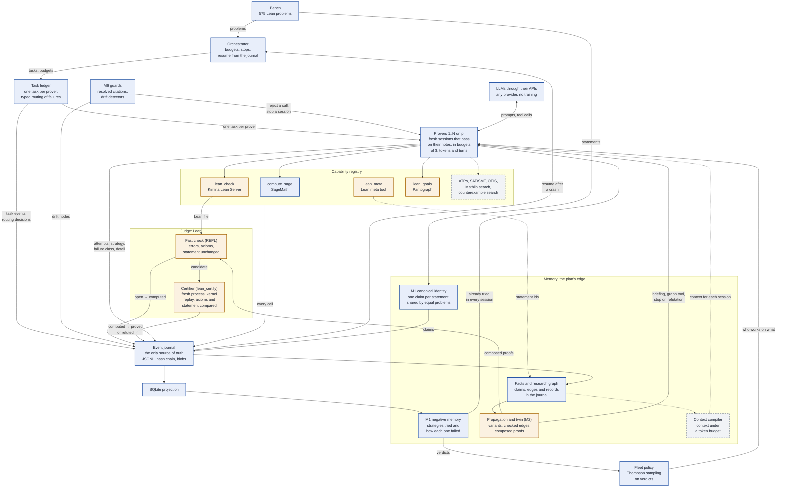

# Seshat

A harness for autonomous mathematical research with LLMs: models through their APIs, Lean as the
judge, classical tools first.

Status: early development (phase P0a). The event journal, the memory store, the line API, the proof
validator, the certifier (a kernel replay in a fresh Lean process), a client for Kimina Lean Server,
the capability registry (manifests, host profiles, MCP boundary, contract tests), a first bench of
575 problems from
[formal-conjectures](https://github.com/google-deepmind/formal-conjectures), the M0 loop
(independent provers on pi, in sessions that pass on their notes) and four lines (M1: shared claims
and negative memory; M2: the variant graph and its logical propagation; M6: guards and drift
detectors; the fleet policy) are written and tested with a simulated model and a simulated Lean. The
work of a run is recorded as tasks in a ledger, and a run whose process ended is continued from its
journal ([documentation/ledger.md](documentation/ledger.md)). The provers can also be given SageMath,
an external program installed with Docker or pip
([documentation/compute.md](documentation/compute.md)). Nothing has run against a real Lean or a
real model yet.

## How research flows



Blue: built and tested. Orange: written, waits for a Lean server. Grey and dashed: planned, not
written.

Today one loop runs, tested with a simulated model and a simulated Lean: each prover edits a Lean
sketch and checks it with `lean_check`, and the first file that passes the fast check makes the
statement `computed`, a candidate. SageMath is the only classical tool plugged in. Every tool call
goes through the capability registry, which writes it to the journal, with its inputs and outputs
as blobs. The orchestrator records the work as tasks in a ledger (one `prove` task per prover, and
a routing decision for each failed check), never copying a claim's status, and a run whose process
ended is continued from the journal alone: `harness run --resume` takes up each problem where the
journal left it, with the budgets that were left, and never runs or certifies a candidate twice
([documentation/ledger.md](documentation/ledger.md#resume)).
Lean is the judge: no statement becomes `proved` without the certifier's kernel replay
([documentation/certifier.md](documentation/certifier.md)). A run certifies each candidate when the
host has a certifier, and the lines' proofs of other claims and of negations too: a certified proof
makes a claim `proved`, a certified proof of its negation `refuted`. The certifier is unavailable
until the host profile gives it a sandbox command or opts in to running candidates' code unsandboxed
(neither shipped profile does). It is written and tested with a fake `lake`; its Lean program has
never been compiled.
The memory is what the plan counts on to beat existing systems: its store is
written (claims, the edges between them and records of every kind, all in the journal), and so are
the first lines that use it. M1: one claim per statement, each attempt labeled with its strategy
and how it failed, and an "already tried" section in every session
([documentation/memory.md](documentation/memory.md),
[documentation/m1-identity-memory.md](documentation/m1-identity-memory.md)). M2: a graph of variants
of a claim, joined by edges that become `lean_checked` only when Lean accepts their link lemma; logic
rules follow those edges and turn what they derive into composed proofs that go through the same
fast check; and a proof of the negation of a claim is tried alongside the provers, whichever side
loses being stopped ([documentation/graph.md](documentation/graph.md)). M2 waits for a Lean server
like the fast check. M6 adds the guards against hallucination and the drift detectors: neutral
framing, citations that must resolve, no raw error text, anchored revisions, and sessions stopped
when they loop ([documentation/guards.md](documentation/guards.md)). The fleet policy chooses what
each session works on by Thompson sampling on the verdicts the memory holds, puts more provers on a
subgoal only where one does badly, and sends hard decisions to a stronger model
([documentation/fleet.md](documentation/fleet.md)). The other mechanisms will come as lines that a
run switches on (`harness run --lines M1,M10` or `--ablation M10`), so that each is measured against
the run without it ([documentation/lines.md](documentation/lines.md)).

This diagram changes with the code: a change to the research flow updates it in the same commit
([documentation/development.md](documentation/development.md#conventions)).

## Commands

```sh
pnpm install
pnpm check
pnpm harness capabilities
pnpm harness models
pnpm harness run --checkout ../google-deepmind/formal-conjectures-bench-v1 --model PROVIDER/ID --sample 5
pnpm harness run --checkout ../google-deepmind/formal-conjectures-bench-v1 --model PROVIDER/ID --sample 5 --tool compute.sage
pnpm harness run --resume runs/RUN_ID --checkout ../google-deepmind/formal-conjectures-bench-v1
```

The checkout is formal-conjectures at the bench's tag, `bench-v1-lean4.27.0`
([documentation/m0-loop.md](documentation/m0-loop.md#commands)); `pnpm harness models` lists the
models and says whether their credentials are set.

Documentation: [documentation/](documentation/README.md).

Working on Seshat, alone or with other agents: [CLAUDE.md](CLAUDE.md). The plan and the state of
its build: [plans/](plans/seshat-plan-ledger.md).
