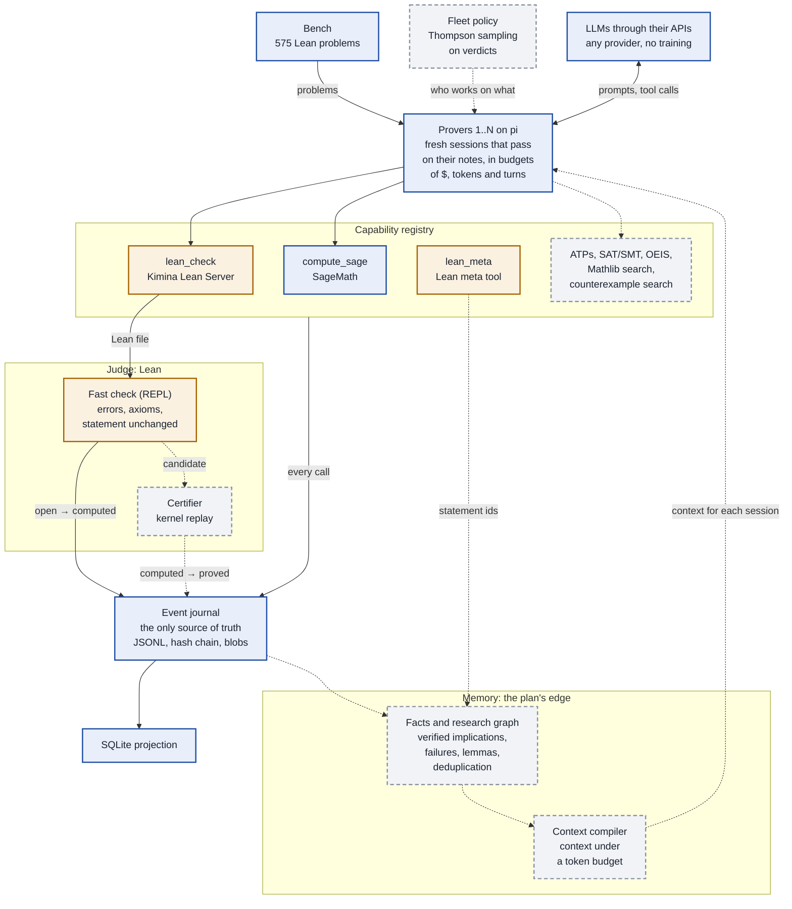

# Seshat

A harness for autonomous mathematical research with LLMs: models through their APIs, Lean as the
judge, classical tools first.

Status: early development (phase P0a). The event journal, the memory store, the line API, the proof validator,
a client for Kimina Lean Server, the capability registry (manifests, host profiles, MCP boundary, contract tests), a
first bench of 575 problems from
[formal-conjectures](https://github.com/google-deepmind/formal-conjectures), and the M0 loop
(independent provers on pi, in sessions that pass on their notes) are written and tested with a
simulated model and a simulated Lean. The provers can also be given SageMath, an external program
installed with Docker or pip ([documentation/compute.md](documentation/compute.md)). Nothing has
run against a real Lean or a real model yet.

## How research flows



Blue: built and tested. Orange: written, waits for a Lean server. Grey and dashed: planned, not
written.

Today one loop runs, tested with a simulated model and a simulated Lean: each prover edits a Lean
sketch and checks it with `lean_check`, and the first file that passes the fast check makes the
statement `computed`, a candidate. SageMath is the only classical tool plugged in. Every tool call
goes through the capability registry, which writes it to the journal, with its inputs and outputs
as blobs.
Lean is the judge: no statement becomes `proved` without the certifier's kernel replay, which is
still to write. The memory is what the plan counts on to beat existing systems: its store is
written (claims, the edges between them and records of every kind, all in the journal), the
mechanisms that would use it are not ([documentation/memory.md](documentation/memory.md)). Each
mechanism will come as a line that a run switches on (`harness run --lines M1,M10` or
`--ablation M10`), so that it is measured against the run without it; no line is written yet
([documentation/lines.md](documentation/lines.md)).

This diagram changes with the code: a change to the research flow updates it in the same commit
([documentation/development.md](documentation/development.md#conventions)).

## Commands

```sh
pnpm install
pnpm check
pnpm harness capabilities
pnpm harness models
pnpm harness run --checkout ../google-deepmind/formal-conjectures-bench-v1 --model PROVIDER/ID --sample 5
pnpm harness run --checkout ../google-deepmind/formal-conjectures-bench-v1 --model PROVIDER/ID --sample 5 --tool compute.sage
```

The checkout is formal-conjectures at the bench's tag, `bench-v1-lean4.27.0`
([documentation/m0-loop.md](documentation/m0-loop.md#commands)); `pnpm harness models` lists the
models and says whether their credentials are set.

Documentation: [documentation/](documentation/README.md).
