# Seshat

A harness for autonomous mathematical research with LLMs: models through their APIs, Lean as the
judge, classical tools first.

Status: early development (phase P0a). The event journal, the memory store, the line API, the proof
validator, the certifier (a kernel replay in a fresh Lean process), a client for Kimina Lean Server,
the capability registry (manifests, host profiles, MCP boundary, contract tests), a first bench of
575 problems from
[formal-conjectures](https://github.com/google-deepmind/formal-conjectures), the M0 loop
(independent provers on pi, in sessions that pass on their notes) and seven lines (M1: shared claims
and negative memory; M2: the variant graph and its logical propagation; M11: small models and
counter-models; M6: guards and drift detectors; M12: the scheduler and its ladder; M18: a curriculum of variants on its first rung; M17: a run in an extended Lean environment; the fleet policy, with sampled session settings, informal-first sessions and a soft failure memory) are written and tested with a
simulated model and a simulated Lean. The work of a run is recorded as tasks in a ledger, and a run
whose process ended is continued from its journal ([documentation/ledger.md](documentation/ledger.md)). A run can also stop by itself at a
token, dollar or time limit or at a breakpoint, write an account of where it stands and wait for the research team, whose hints, signatures and
steers go into the journal and change no claim's status ([documentation/human.md](documentation/human.md)). The Lean the harness runs against is written
as data, an environment (`lean/env/NAME.toml`), which `harness lean-env resolve` checks for
consistency before anything is built ([documentation/lean-env.md](documentation/lean-env.md)); line M17 puts a run in
one with more packages than the bench's.
The provers can also be given SageMath, an external program installed with Docker or pip
([documentation/compute.md](documentation/compute.md)). A run can start on the memory of an earlier
one (`--memory-from`), its learned records are stamped with where they come from, and the memory store can
draw the unverified items a briefing shows at random and measure their effect; no line calls the draw yet
([documentation/memory.md](documentation/memory.md)). Nothing has run against a real
Lean or a real model yet.

## How research flows

```mermaid
flowchart TB
  classDef built fill:#e8eefa,stroke:#1f4fa3,stroke-width:2px,color:#1b2230
  classDef wait fill:#fbf1e1,stroke:#a66300,stroke-width:2px,color:#1b2230
  classDef planned fill:#f1f3f6,stroke:#8a92a3,stroke-width:2px,stroke-dasharray:6 4,color:#1b2230

  bench["Bench<br/>575 Lean problems"]:::built
  fleet["Fleet policy<br/>Thompson sampling on verdicts,<br/>sampled settings, exploration<br/>floor, discount per run"]:::built
  dag["nl_first sessions<br/>step DAG, checked,<br/>one lemma per step"]:::wait
  judge["judge: k calls,<br/>majority, disagreement,<br/>anti-sycophancy"]:::wait
  guards["M6 guards<br/>resolved citations,<br/>drift detectors"]:::built
  llm["LLMs through their APIs<br/>any provider, no training"]:::built
  provers["Provers 1..N on pi<br/>fresh sessions that pass<br/>on their notes, in budgets<br/>of $, tokens and turns"]:::built
  orchestrator["Orchestrator<br/>budgets, stops,<br/>resume from the journal"]:::built
  ledger["Task ledger<br/>one task per prover,<br/>typed routing of failures"]:::built
  m11["Line M11: small models<br/>counter-models,<br/>fingerprints, sequences"]:::wait
  leanenv["Lean environment<br/>lean/env files, resolver,<br/>environment hash"]:::built
  envbuild["lean-env build<br/>cache get, lake build,<br/>time per package"]:::wait
  m12["Line M12: scheduler<br/>given-clause loop, proof numbers,<br/>subsumption, owners"]:::built
  holes["Named holes of a sketch<br/>claims, a decomposes_into edge<br/>checked by Lean, inner provers"]:::wait
  ladder["Escalation ladder<br/>rungs move up when budget<br/>is spent without Lean progress"]:::built
  m18["Line M18: variant curriculum<br/>rung 1: special cases of a hard<br/>problem, a capped share of budget"]:::wait
  m17["Line M17: extended environment<br/>the run's Lean has more<br/>packages than the bench's"]:::wait
  team["Research team<br/>reads the account,<br/>answers with hints,<br/>signatures, steers"]:::built
  account["Account of a turn<br/>turns/N/report.md,<br/>built from the journal"]:::built
  narrative["Turn narrative<br/>written by a model,<br/>every id checked"]:::wait

  subgraph TOOLS["Capability registry"]
    leancheck["lean_check<br/>Kimina Lean Server"]:::wait
    sage["compute_sage<br/>SageMath"]:::built
    leanmeta["lean_meta<br/>Lean meta tool"]:::wait
    leangoals["lean_goals<br/>Pantograph"]:::wait
    leanlsp["lean_lsp<br/>Lean language server"]:::wait
    oeis["oeis_search<br/>OEIS"]:::wait
    lmfdb["lmfdb_query<br/>LMFDB"]:::wait
    findstat["findstat_identify<br/>FindStat"]:::wait
    decide["decide_ask<br/>Jev, a decision-only<br/>model, only to order"]:::wait
    moretools["ATPs, SAT/SMT,<br/>counterexample search"]:::planned
  end

  subgraph JUDGE["Judge: Lean"]
    fast["Fast check (REPL)<br/>errors, axioms,<br/>statement unchanged"]:::wait
    certifier["Certifier (lean_certify)<br/>fresh process, kernel<br/>replay, axioms and<br/>statement compared"]:::wait
  end

  journal["Event journal<br/>the only source of truth<br/>JSONL, hash chain, blobs"]:::built
  projection["SQLite projection"]:::built

  subgraph MEMORY["Memory: the plan's edge"]
    identity["M1 canonical identity<br/>one claim per statement,<br/>shared by equal problems"]:::built
    tried["M1 negative memory<br/>strategies tried and<br/>how each one failed"]:::built
    kg["Facts and research graph<br/>claims, edges and records<br/>in the journal"]:::built
    prop["Propagation and twin (M2)<br/>variants, checked edges,<br/>composed proofs"]:::wait
    compiler["Context compiler<br/>context under<br/>a token budget"]:::planned
    earlier["Memory carried over<br/>from an earlier run,<br/>pinned by its last hash"]:::built
    learned["Stamps, epochs and draw<br/>of unverified records<br/>(no line calls it yet)"]:::built
  end

  bench -->|problems| orchestrator
  orchestrator -->|"tasks, budgets"| ledger
  ledger -->|"one task per prover"| provers
  ledger -->|"task events,<br/>routing decisions"| journal
  journal -->|"resume after<br/>a crash"| orchestrator
  orchestrator -->|"a turn ends: limit,<br/>breakpoint"| account
  journal -->|"read, no model"| account
  account --> team
  team -->|"hints, signatures,<br/>steers, as human"| journal
  team -->|"harness resume"| orchestrator
  llm -.->|"if asked"| narrative
  narrative -.->|"marked model-written"| account
  bench -->|statements| identity
  identity -->|claims| journal
  fleet -->|"who works on what,<br/>with which settings"| provers
  fleet -->|"mode nl_first"| dag
  dag -->|"step plan"| provers
  dag -->|"informal step claims,<br/>decomposes_into proposals"| journal
  llm <-->|"k calls, never<br/>a verdict"| judge
  ledger -->|"retry_stronger<br/>before branch"| fleet
  guards -->|"reject a call,<br/>stop a session"| provers
  guards -->|"drift nodes"| journal
  bench -->|"problems, when<br/>M11 is on"| m11
  m11 -->|"briefing, or stops<br/>the provers"| provers
  m11 -->|"decide files"| leancheck
  m11 -->|"sequences"| oeis
  m11 -->|"negation proofs"| fast
  m11 -->|"nodes, computed edges"| journal
  llm <-->|"prompts, tool calls"| provers
  provers --> leancheck & sage
  provers -->|"sketches ending in<br/>named sorry holes"| m12
  m12 -->|"holes as claims,<br/>one prove task each"| holes
  holes -->|"link lemma, hole proofs"| leancheck
  holes -->|"claims, edges, tasks"| journal
  m12 -->|"lemmas proved,<br/>with their names"| provers
  journal -->|"spend since the<br/>last Lean progress"| ladder
  ladder -->|"ladder.escalated:<br/>starts the lines of the rung"| journal
  ladder -->|"rung 1"| m18
  m18 -->|"variants as claims,<br/>special_case_of edges, tasks"| journal
  m18 -->|"proved special cases<br/>and proofs in the briefing"| provers
  provers -.-> moretools
  leanmeta -.->|"statement ids"| kg
  provers --> leangoals
  provers --> leanlsp
  provers --> oeis & lmfdb & findstat
  fleet -.->|"cold start:<br/>capped pseudo-counts"| decide
  leanenv -->|"lakefile, lock"| envbuild
  leanenv -->|"hash in the version<br/>of every Lean tool run"| journal
  envbuild -->|"the project<br/>Lean runs in"| leancheck
  m17 -->|"names the run's<br/>environment"| leanenv
  m17 -->|"extra imports in every file,<br/>a probe before the problems"| leancheck
  leancheck -->|Lean file| fast
  fast -->|"open → computed"| journal
  fast -->|candidate| certifier
  certifier -->|"computed → proved<br/>or refuted"| journal
  TOOLS -->|"every call"| journal
  provers -->|"attempts: strategy,<br/>failure class, detail"| journal
  journal --> projection
  earlier -->|"replayed before<br/>the run's journal"| projection
  projection --> learned
  learned -.->|"lines draw: Tasks<br/>9, 11 and 18"| provers
  projection --> tried
  tried -->|"already tried,<br/>in every session"| provers
  tried -->|"verdicts"| fleet
  journal --> kg
  kg --> prop
  prop -->|"composed proofs"| fast
  prop -->|"briefing, graph tool,<br/>stop on refutation"| provers
  kg -.-> compiler
  compiler -.->|"context for each session"| provers
```



Blue: built and tested. Orange: written, waits for a Lean server. Grey and dashed: planned, not
written.

Today one loop runs, tested with a simulated model and a simulated Lean: each prover edits a Lean
sketch and checks it with `lean_check`, and the first file that passes the fast check makes the
statement `computed`, a candidate. SageMath is the only classical tool for computing that is plugged
in; the OEIS, the LMFDB and FindStat can be asked too ([documentation/models.md](documentation/models.md#the-services-as-capabilities)).
The provers can also be given Lean's language server, `lean_lsp` (the goals at a line, several
tactics tried at one line, Mathlib search): information that never changes a status, written and
waiting for a Lean like the fast check ([documentation/lean-lsp.md](documentation/lean-lsp.md)).
Every tool call goes through the capability registry, which writes it to the journal, with its inputs
and outputs as blobs. The orchestrator records the work as tasks in a ledger (one `prove` task per
prover, and a routing decision for each failed check), never copying a claim's status, and a run
whose process ended is continued from the journal alone: `harness run --resume` takes up each
problem where the journal left it, with the budgets that were left, and records one certification
per candidate ([documentation/ledger.md](documentation/ledger.md#resume)).
With `--human` or a turn limit (`--turn-tokens`, `--turn-usd`, `--turn-minutes`) the run ends a turn by itself, at the limit or at a breakpoint
(an impasse, a problem settled, two informal validators in disagreement): no session or model call starts after it, the account
`turns/N/report.md` is built from the journal alone, and the run waits until the team has answered with `harness hint`, `sign` and `steer`
and resumed it. Those answers are recorded under each person's name and change no claim's status
([documentation/human.md](documentation/human.md)).
Lean is the judge: no statement becomes `proved` without the certifier's kernel replay
([documentation/certifier.md](documentation/certifier.md)). A run certifies each candidate when the
host has a certifier, and the lines' proofs of other claims and of negations too: a certified proof
makes a claim `proved`, a certified proof of its negation `refuted`. The certifier is unavailable
until the host profile gives it a sandbox command or opts in to running candidates' code unsandboxed
(neither shipped profile does). It is written and tested with a fake `lake`; its Lean program has
never been compiled.
The memory is what the plan counts on to beat existing systems: its store is
written (claims, the edges between them and records of every kind, all in the journal), and so are
the first lines that use it. M1: one claim per statement, each attempt labeled with its strategy
and how it failed, and an "already tried" section in every session
([documentation/memory.md](documentation/memory.md),
[documentation/m1-identity-memory.md](documentation/m1-identity-memory.md)). M2: a graph of variants
of a claim, joined by edges that become `lean_checked` only when Lean accepts their link lemma; logic
rules follow those edges and turn what they derive into composed proofs that go through the same
fast check; and a proof of the negation of a claim is tried alongside the provers, whichever side
loses being stopped ([documentation/graph.md](documentation/graph.md)). M2 waits for a Lean server
like the fast check. M11: a statement of magmas or of a number is tried on batteries of small
objects, a counter-model becomes a proof of the negation that Lean must check, and the verdicts
give candidate edges between claims and a lookup of the numbers where it holds as a sequence
([documentation/models.md](documentation/models.md)); it waits for a Lean server too. M6 adds the
guards against hallucination and the drift detectors: neutral framing, citations that must
resolve, no raw error text, anchored revisions, and sessions stopped when they loop
([documentation/guards.md](documentation/guards.md)). The fleet policy chooses what each session
works on by Thompson sampling on the verdicts the memory holds, puts more provers on a subgoal only
where one does badly, and sends hard decisions to a stronger model. It samples each session's settings
(temperature, thinking level, a diversity directive, standard or informal-first mode), discounts old failures per run and keeps
a floor of exploration, so that a failure of a weaker configuration does not close a door for good
([documentation/fleet.md](documentation/fleet.md)). Informal-first sessions and the multi-call `judge` helper
have only run against a simulated model. M12 schedules the work between sessions: a prover's sketch with named `sorry` holes becomes claims joined by a decomposition that Lean checks, each hole is a task for a short inner prover, chosen by a given-clause loop with weighted proof numbers, and a problem that spends its budget without Lean progress moves up a ladder of lines ([documentation/scheduler.md](documentation/scheduler.md)); M18, the first rung, solves easier variants of a hard problem with a capped share of its budget and feeds their proofs to later sessions ([documentation/curriculum.md](documentation/curriculum.md)); both have only run against a simulated model and Lean, and nothing says M18 pays.  `decide` puts a typed choice, score or yes/no to a decision-only model (Jev, optional, off by default,
with the run's own model as the default and the fallback) to order work, never to change a claim's status; with Jev on, short proof states go to a third party, and it has never run against the real service
([documentation/decide.md](documentation/decide.md)). The other mechanisms will come as lines that a
run switches on (`harness run --lines M1,M10` or `--ablation M10`), so that each is measured against
the run without it ([documentation/lines.md](documentation/lines.md)).

This diagram changes with the code: a change to the research flow updates it in the same commit
([documentation/development.md](documentation/development.md#conventions)).

## Commands

```sh
pnpm install
pnpm check
pnpm harness capabilities
pnpm harness models
pnpm harness run --checkout ../google-deepmind/formal-conjectures-bench-v1 --model PROVIDER/ID --sample 5
pnpm harness run --checkout ../google-deepmind/formal-conjectures-bench-v1 --model PROVIDER/ID --sample 5 --tool compute.sage
pnpm harness run --resume runs/RUN_ID --checkout ../google-deepmind/formal-conjectures-bench-v1
pnpm harness run --checkout ../google-deepmind/formal-conjectures-bench-v1 --model PROVIDER/ID --sample 5 --turn-usd 2
pnpm harness hint runs/RUN_ID --claim CLAIM_ID "text"    # then sign, steer, and: harness resume runs/RUN_ID --checkout ...
pnpm harness lean-env resolve base
pnpm harness run --checkout ../google-deepmind/formal-conjectures-bench-v1 --model PROVIDER/ID --sample 5 --tool lean.lsp
```

The checkout is formal-conjectures at the bench's tag, `bench-v1-lean4.27.0`
([documentation/m0-loop.md](documentation/m0-loop.md#commands)); `pnpm harness models` lists the
models and says whether their credentials are set.

Documentation: [documentation/](documentation/README.md).

Working on Seshat, alone or with other agents: [CLAUDE.md](CLAUDE.md). The plan and the state of
its build: [plans/](plans/seshat-plan-ledger.md).
