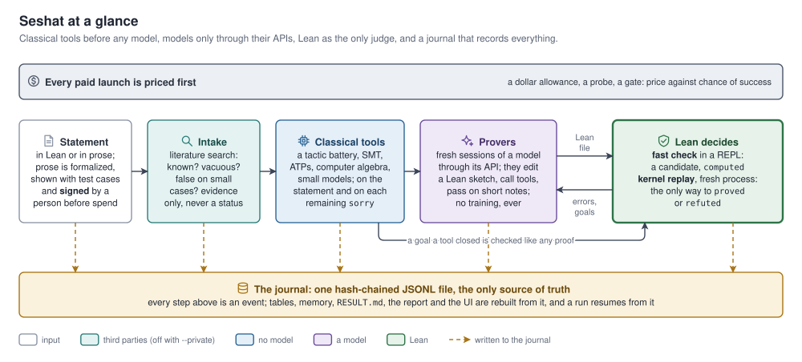
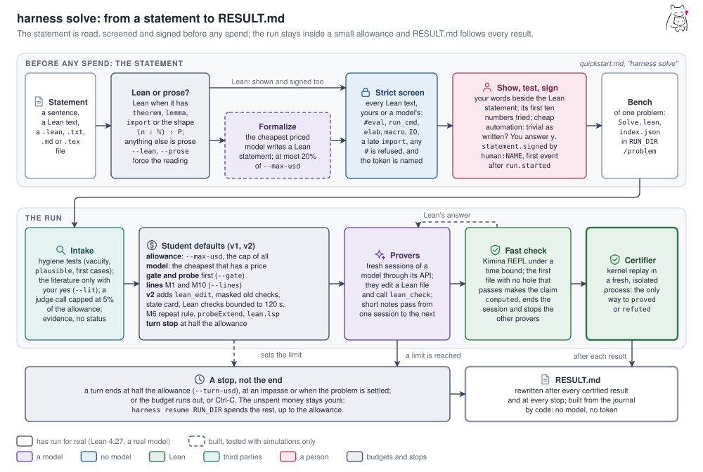
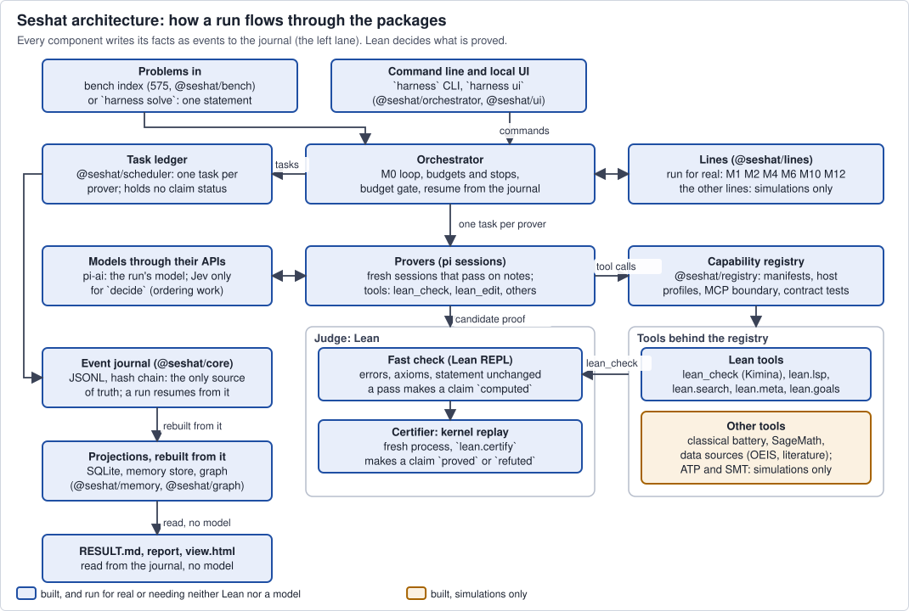

# Seshat

[](https://github.com/Kdevos12/seshat/actions/workflows/check.yml)
[](LICENSE)
[](documentation/status.md)
[](documentation/lean-env.md)
[](documentation/install.md)
[](CITATION.cff)

A harness for autonomous mathematical research with language models: models through their APIs, Lean as the judge, classical tools first.

**Cheap, verified, open.** Give Seshat a statement in Lean or in plain English and a dollar cap. It tries classical tools first, then lets open-weight models (DeepSeek by default) write Lean proofs, and says *proved* only when Lean's kernel has replayed the proof. In its largest measured run it certified 16 of 20 Putnam competition problems for $1.27 of model calls in all ([results](#results-so-far), with their caveats).

```sh
git clone https://github.com/Kdevos12/seshat.git && cd seshat
scripts/setup.sh                                   # Node packages, Lean 4.27.0, the Lean server: documentation/install.md
pnpm harness solve "The sum of two odd numbers is even." --max-usd 0.50
```

Seshat takes a mathematical statement, in Lean or in prose, and works on it under a dollar allowance: it tries classical tools before any model, lets models propose Lean proofs in fresh sessions, and calls a statement proved only when Lean's kernel has replayed the proof. Its principles:



- **Models through their APIs only.** No training and no fine-tuning; small learned components (an online k-NN, a published premise selector) are used as they are.
- **Lean is the judge.** A claim is `proved` or `refuted` only after the certifier's kernel replay; a model's word, a tool's output, an informal proof or a heuristic is evidence or a hint, never a status ([trust](documentation/trust.md)).
- **Classical tools first.** Decision procedures, a tactic battery, computer algebra, SMT and ATPs run before a model is asked, and what they find still goes through Lean.
- **The journal is the only source of truth.** Every fact is an event in a hash-chained JSONL journal; tables, indexes and reports are projections rebuilt from it, and a run whose process ended resumes from it ([journal](documentation/journal.md)).
- **Every action is proportionate to a budget.** A probe and a budget gate put a price against a chance of success before each paid launch, and a run stops with an account of why ([scheduler](documentation/scheduler.md#the-budget-gate)).

## Status: beta v1

Version 1.0.0-beta.1. The core runs for real: on the owner's machine, with Lean 4.27.0 and a real model through its API, `harness solve` has certified Putnam problems of competition level through the kernel replay, and the graded bench was admitted by the real Lean. Most of the research lines (lemma library, lessons, small models, curriculum, archive, program search, repairs), the heuristic card bank, ATP and SMT with reconstruction, the consortium turns and the consolidation pass have only been tested with a simulated model and a simulated Lean; they are written against their interfaces and drawn in orange in the diagram below. The measured runs are small (at most 20 problems and a few dollars each) and their comparisons are not statistically conclusive. [documentation/status.md](documentation/status.md) has the full account.

## Results so far

All numbers are from the task ledger ([plans/seshat-plan-ledger.md](plans/seshat-plan-ledger.md)), on grade B problems (Putnam competition problems) of the graded bench, on the owner's machine, with a real Lean and a real model.

| Run | Date | What it measured | Result |
|---|---|---|---|
| Pilot | 2026-11-11 | 6 problems, cap $0.50 each, `solve` with the baseline defaults `v1` | 6 of 6 certified by kernel replay for $0.126 in all; the other two arms were not valid (the provider's balance ran out) |
| Second run | 2026-11-12 | the same 6 problems | `v1` 4 of 6 for $0.205: the baseline varies from run to run; two defects found and fixed |
| Third run | 2026-11-12 to 13 | 20 problems, cap $0.50 each, three arms: `v1`, `v2` and `v2` with blueprints | after the certifier fix: `v1` 16 of 20, `v2` 14, blueprints 15; $4.02 in all with a one-problem trial; no arm beats another |
| Replay | 2026-11-13 | the 6 problems left unsolved, the arm with blueprints, refinement rounds, repair and the informal proof first | 0 of 6 certified for $1.41 |
| Graph smoke run | 2026-11-13 | lines M2 and M4 on 4 of those problems | 0 of 4 for $0.67; they ran without error and added nothing in a single fresh run |

What the runs taught, and what was fixed because of them:

- The third run's first scores (13, 13, 13) were wrong: the certifier refused `X._unsafe_rec`, a constant that Lean 4.27.0 adds for every recursive definition, and rejected six good proofs. After the fix, checked on a real Lean on 2026-11-13, the same candidates certify (`v1` 16, `v2` 14, blueprints 15 of 20). A `partial def` is still refused.
- The blueprints of the third run were all judged unhealthy because the blueprint format was in no prompt; it is now in the briefing, and the check answer says how a blueprint is read.
- The replay (0 of 6) showed that four of the six problems were stopped by the budget gate after the probe, that the verifier of the informal proof (the same model) was too lenient, and that a hole's file did not carry its context; the fixes are in the ledger. These six are the hard end of the set: no claim is made that blueprints help.
- A yardstick caveat: every PutnamBench problem has a public Lean proof, which a model may have seen.

## Install

Seshat runs on Linux and macOS (Windows through WSL2). [documentation/install.md](documentation/install.md) is the whole road, in three levels:

| Level | You get | You need |
|---|---|---|
| Try it | the command line, the local interface, the heuristic card bank | Node 22.19 or later and pnpm 10: `scripts/setup.sh --no-lean` (or `pnpm install`) |
| A real run | `harness solve` with proofs certified by Lean's kernel | Lean 4.27.0 through elan, the Lean environment `base` (30 to 60 minutes to build the first time), the Kimina Lean server, bubblewrap, a model key: `scripts/setup.sh` |
| Optional tools | SageMath, z3, E and Vampire, Lean's language server, literature search, Jev | each one on its own |

```sh
scripts/setup.sh              # does every step it can, skips what is done, never uses sudo
$EDITOR .env                  # DEEPSEEK_API_KEY=...; `pnpm harness` reads .env by itself
scripts/kimina.sh             # the Lean server, in a terminal of its own
pnpm harness doctor           # what this machine still lacks, and how to fix it
pnpm harness solve "(n : ℕ) : n + 0 = n" --max-usd 0.10
pnpm harness ui               # the local interface, on 127.0.0.1 only
```

`solve` takes a statement in prose, in Lean or a `.lean` file; prose is formalized and shown for your signature before anything is spent. It always runs under a dollar allowance, and leaves `RESULT.md` in the run directory whatever stopped it. [documentation/quickstart.md](documentation/quickstart.md) is the guide to `solve`. To work on the code: [CONTRIBUTING.md](CONTRIBUTING.md).

## How it works





Each compartment has a page and a figure, all drawn by code ([documentation/figures.md](documentation/figures.md)); the
[documentation's home](documentation/README.md#figures) shows them together.

| Compartment | Page | Figure |
|---|---|---|
| Trust: who may change a claim's status | [trust.md](documentation/trust.md) | [trust](documentation/images/trust.svg) |
| The fast check and the kernel replay | [certifier.md](documentation/certifier.md) | [certification](documentation/images/certification.svg) |
| Lean environments, and the gate in front of new Lean | [lean-env.md](documentation/lean-env.md) | [lean-env](documentation/images/lean-env.svg) |
| The journal, the only source of truth | [journal.md](documentation/journal.md) | [journal](documentation/images/journal.svg) |
| The memory store | [memory.md](documentation/memory.md) | [memory](documentation/images/memory.svg) |
| The variant graph (line M2) | [graph.md](documentation/graph.md) | [graph](documentation/images/graph.svg) |
| The context packet (line M4) | [context.md](documentation/context.md) | [context](documentation/images/context.svg) |
| Tools behind capabilities | [capabilities.md](documentation/capabilities.md) | [tools](documentation/images/tools.svg) |
| Classical tools before any model (line M10) | [classical.md](documentation/classical.md) | [battery](documentation/images/battery.svg) |
| A prover in fresh sessions | [m0-loop.md](documentation/m0-loop.md) | [sessions](documentation/images/sessions.svg) |
| Blueprints: a problem as a graph of holes (line M12) | [scheduler.md](documentation/scheduler.md#blueprints-plan-change-ca9) | [blueprints](documentation/images/blueprints.svg) |
| The fleet and the heuristic cards | [fleet.md](documentation/fleet.md), [heuristics.md](documentation/heuristics.md) | [fleet](documentation/images/fleet.svg) |
| The budget gate | [scheduler.md](documentation/scheduler.md#the-budget-gate) | [budget](documentation/images/budget.svg) |
| The escalation ladder | [scheduler.md](documentation/scheduler.md#the-escalation-ladder-pe4-of-the-memory-evolution-plan-change) | [ladder](documentation/images/ladder.svg) |
| Runs: two axes, seven words | [runs.md](documentation/runs.md) | [runs](documentation/images/runs.svg) |
| Consortium mode | [human.md](documentation/human.md) | [consortium](documentation/images/consortium.svg) |
| Campaigns, judged by the verified frontier | [campaign.md](documentation/campaign.md) | [campaign](documentation/images/campaign.svg) |
| Measuring a line | [ablate.md](documentation/ablate.md) | [ablation](documentation/images/ablation.svg) |

## The research flow

Green: has run for real, on the owner's machine with Lean 4.27.0 and a real model, or against the real program or
service ([documentation/status.md](documentation/status.md) has the dates and the runs). Blue: built and tested with the
simulated model and Lean; it needs nothing external to run as tested. Orange: written and tested with simulations, but it
needs something real before it has run: a model, a service (Jev, the OEIS), a program (Vampire, E) or data (the
equational-theories rows, the first real ablation). Grey and dashed: planned, not written (the further classical tools, such
as SAT and counterexample search).

```mermaid
flowchart TB
  classDef real fill:#e6f2ea,stroke:#2e7448,stroke-width:2px,color:#1b2230
  classDef built fill:#e8eefa,stroke:#1f4fa3,stroke-width:2px,color:#1b2230
  classDef wait fill:#fbf1e1,stroke:#a66300,stroke-width:2px,color:#1b2230
  classDef planned fill:#f1f3f6,stroke:#8a92a3,stroke-width:2px,stroke-dasharray:6 4,color:#1b2230

  bench["Bench<br/>575 Lean problems"]:::real
  benchseq["Bench sequences and tags<br/>variants, shared files,<br/>analogy and induction"]:::built
  benchext["bench-ext<br/>equational-theories rows from a<br/>local cache, never vendored"]:::wait
  protocol["Paired protocol<br/>Wilson intervals, exact McNemar,<br/>solved per dollar, target line"]:::real
  graded["Graded bench<br/>A exercises, B competition, C research,<br/>admitted by Lean, from local checkouts"]:::real
  ablate["harness ablate<br/>M0 then each line, or one experiment:<br/>same problems, same budget"]:::real
  measures["Measures from the journals<br/>spend per site, reliability and ECE,<br/>cache per rung and line, curves"]:::real
  probe["Entrenchment probe<br/>memory on against verified facts<br/>only, alarm in the report"]:::built
  optprompts["harness optimize-prompts<br/>GEPA-style rewrite on a dev split,<br/>gate: held-out and temporal,<br/>patches a person merges"]:::built
  realopt["First real prompt optimization<br/>needs a model, Lean<br/>and the dataset"]:::wait
  realablate["First real ablation<br/>needs a model, Lean, Jev<br/>and the dataset"]:::wait
  fleet["Fleet policy<br/>Thompson sampling on verdicts,<br/>sampled settings, exploration<br/>floor, discount per run"]:::built
  heurbank["Heuristic card bank<br/>methods of reasoning, not tools:<br/>built-in and pack cards,<br/>a control arm per bucket"]:::built
  dag["nl_first sessions<br/>step DAG, checked,<br/>one lemma per step"]:::wait
  judge["judge: k calls,<br/>majority, disagreement,<br/>anti-sycophancy"]:::wait
  guards["M6 guards<br/>resolved citations,<br/>drift detectors"]:::real
  llm["LLMs through their APIs<br/>any provider, no training"]:::real
  budgetgate["Budget gate (off by default)<br/>price against chance before each launch,<br/>probe first, widen on Lean progress,<br/>exploration floor, skips kept in the journal"]:::real
  provers["Provers 1..N on pi<br/>fresh sessions that pass<br/>on their notes, in budgets<br/>of $, tokens and turns"]:::real
  orchestrator["Orchestrator<br/>budgets, stops,<br/>resume from the journal"]:::real
  ledger["Task ledger<br/>one task per prover,<br/>typed routing of failures"]:::real
  m11["Line M11: small models<br/>counter-models,<br/>fingerprints, sequences"]:::wait
  graphhunt["Graph counterexamples (M11.graphs, off)<br/>model-written predicate, batteries to 8 vertices,<br/>local search, families, Lean templates<br/>lean/SeshatLib/Finite"]:::wait
  leanenv["Lean environment<br/>lean/env files, resolver,<br/>environment hash"]:::built
  libbuilder["LibraryBuilder (off by default)<br/>coding agent in a sandbox,<br/>files added to lean/SeshatLib"]:::wait
  libgate["Seshat's gate<br/>diff, fresh lake build, no sorry,<br/>certifier, test lemmas"]:::wait
  defreview["Definition review<br/>new definitions unreviewed:<br/>not in claim statements"]:::built
  envbuild["lean-env build<br/>cache get, lake build,<br/>time per package"]:::wait
  m12["Line M12: scheduler<br/>given-clause loop, proof numbers,<br/>subsumption, owners"]:::real
  holes["Named holes of a sketch<br/>claims, a decomposes_into edge<br/>checked by Lean, inner provers<br/>blueprint: holes that use holes,<br/>hole sessions with tools, verdicts,<br/>refinement rounds: a planner call<br/>rewrites the blueprint (CA12)"]:::real
  ladder["Escalation ladder<br/>rungs move up when budget<br/>is spent without Lean progress"]:::built
  m18["Line M18: variant curriculum<br/>rung 1: special cases of a hard<br/>problem, a capped share of budget"]:::wait
  m15["Line M15: archive of decompositions<br/>cells, a Thompson pick of the one to extend,<br/>schemas from closed sub-DAGs"]:::wait
  m17["Line M17: extended environment<br/>the run's Lean has more<br/>packages than the bench's"]:::wait
  m8["Line M8: inductive engine<br/>data tables, hypotheses as<br/>programs, conjecture pool"]:::wait
  m3["Line M3: lemma library<br/>promoted aux lemmas, BM25 search,<br/>library_search"]:::built
  m13["Line M13: theory exploration<br/>minimal laws, integer relations,<br/>candidates for the library"]:::wait
  m16["Line M16: program search<br/>islands of scored programs,<br/>rung 2 of the ladder"]:::wait
  m4["Line M4: context compiler<br/>frozen prefix, tail, premises,<br/>expand, graph_query"]:::real
  m5["Line M5: lessons<br/>from accepted proofs and recurring<br/>failures, deactivated by effect"]:::built
  m14["Line M14: repairs<br/>typed critics, Lakatos repair<br/>of refuted conjectures"]:::wait
  sandbox["Sandbox for programs<br/>time and memory limits,<br/>no network, scratch directory"]:::built
  team["Research team<br/>reads the account,<br/>answers with hints,<br/>signatures, steers"]:::built
  account["Account of a turn<br/>turns/N/report.md,<br/>built from the journal"]:::built
  narrative["Turn narrative<br/>written by a model,<br/>every id checked"]:::wait
  solve["harness solve<br/>a statement in Lean or prose, one-problem bench,<br/>student defaults v1 or v2: small cap, gate, M1 and M10"]:::real
  consolidate["Consolidation pass (CA24, harness consolidate)<br/>cards, duplicate and unsupported lessons, a page whose<br/>every sentence cites journal events; a new run on the old one"]:::wait
  hotloop["Cheaper hot loop (solve defaults v2)<br/>lean_edit in place of a rewritten file, old check results<br/>masked in batches, bounded Lean checks, a state card<br/>from the journal, the run budget in rounds"]:::real
  leanpush["Premises pushed (CA22, option leanSearch)<br/>after a check: a name search on each unknown identifier,<br/>a goal search on each hole; each hit checked with Lean"]:::real
  signature["Signature of a prose statement<br/>formalized, shown with test lemmas,<br/>statement.signed before any spend"]:::wait
  doctor["harness doctor<br/>Lean, Kimina, credentials, prices, network,<br/>isolation; writes the sandboxed host profile"]:::real
  resultmd["RESULT.md<br/>built from the journal, no model,<br/>after every certified result and every stop"]:::real
  viewhtml["harness view<br/>one static HTML page from the journal,<br/>no server, no network, all text escaped"]:::built
  intake["Intake, before any paid session<br/>three queries, one judge call under $0.05, a quote that must be<br/>in the fetched text; vacuity, plausible, test lemmas; off with --private"]:::real
  informal["Informal proof first (PA13, option informalFirst)<br/>a proof in natural language, a verifier reads the final text:<br/>correct x3 in a row, or revised, or regenerated; a hint,<br/>never a status; shown as not checked by Lean"]:::real
  uipage["harness ui<br/>local page on 127.0.0.1: token, Host and Origin checks,<br/>escaped text, keys in a 0600 file, starts the commands"]:::built

  subgraph TOOLS["Capability registry"]
    leancheck["lean_check<br/>Kimina Lean Server"]:::real
    sage["compute_sage<br/>SageMath"]:::real
    leanmeta["lean_meta<br/>Lean meta tool"]:::wait
    leangoals["lean_goals<br/>Pantograph"]:::wait
    leanlsp["lean_lsp<br/>Lean language server"]:::real
    leansearch["lean_search<br/>premise search: remote service,<br/>local index, pattern"]:::real
    oeis["oeis_search<br/>OEIS"]:::wait
    lmfdb["lmfdb_query<br/>LMFDB"]:::wait
    findstat["findstat_identify<br/>FindStat"]:::wait
    litsearch["lit_search<br/>OpenAlex, arXiv, Semantic Scholar,<br/>zbMATH, bench metadata"]:::real
    decide["decide_ask<br/>Jev, a decision-only<br/>model, only to order"]:::wait
    smtz3["smt_z3<br/>z3 on SMT-LIB, unsat core"]:::built
    vampire["atp_vampire<br/>Vampire on TPTP, SZS status"]:::wait
    eprover["atp_eprover<br/>E on TPTP, SZS status"]:::wait
    proveauto["prove_auto<br/>the battery on one goal"]:::wait
    provesearch["prove_search<br/>goal-level best-first search"]:::wait
    moretools["SAT, counterexample<br/>search"]:::planned
    packs["Installed packs<br/>tools at level 2 and skills,<br/>harness add, never a status"]:::built
  end

  m10["Line M10: classical battery<br/>per subgoal, before any model:<br/>domain router, Beta posteriors"]:::real
  battery["Tactics in parallel<br/>decide, omega, norm_num, simp,<br/>linarith, grind, aesop, hammer..."]:::real
  subgraph JUDGE["Judge: Lean"]
    fast["Fast check (REPL)<br/>errors, axioms,<br/>statement unchanged"]:::real
    certifier["Certifier (lean_certify)<br/>fresh process, kernel<br/>replay, axioms and<br/>statement compared"]:::real
  end

  journal["Event journal<br/>the only source of truth<br/>JSONL, hash chain, blobs"]:::real
  projection["SQLite projection"]:::real
  subgraph MEMORY["Memory: the plan's edge"]
    identity["M1 canonical identity<br/>one claim per statement,<br/>shared by equal problems"]:::real
    tried["M1 negative memory<br/>strategies tried and<br/>how each one failed"]:::real
    kg["Facts and research graph<br/>claims, edges and records<br/>in the journal"]:::real
    prop["Propagation and twin (M2)<br/>variants, checked edges,<br/>composed proofs"]:::real
    compiler["Context compiler (M4)<br/>context under<br/>a token budget"]:::wait
    earlier["Memory carried over<br/>from an earlier run,<br/>pinned by its last hash"]:::built
    learned["Stamps, epochs and draw<br/>of unverified records<br/>(lines M3 and M5 draw)"]:::built
  end

  bench -->|problems| orchestrator
  orchestrator -->|"tasks, budgets"| ledger
  ledger -->|"one task per prover"| provers
  budgetgate -->|"launch, probe,<br/>widen or skip"| provers
  fleet -->|"posterior<br/>of the claim"| budgetgate
  ledger -->|"task events,<br/>routing decisions"| journal
  journal -->|"resume after<br/>a crash"| orchestrator
  orchestrator -->|"a turn ends: limit,<br/>breakpoint"| account
  journal -->|"read, no model"| account
  account --> team
  team -->|"hints, signatures,<br/>steers, as human"| journal
  team -->|"harness resume"| orchestrator
  llm -.->|"if asked"| narrative
  narrative -.->|"marked model-written"| account
  solve -->|"one-problem index,<br/>student config"| orchestrator
  solve -->|"prose"| signature
  solve -->|"defaults v2"| hotloop
  journal -->|"a finished run"| consolidate
  llm -.->|"one call per open problem, capped"| consolidate
  consolidate -->|"stamped cards and pages, as a new run<br/>(--memory-from)"| journal
  hotloop -->|"edits, masked history,<br/>time-limited checks, state card,<br/>budget in rounds"| provers
  llm -.->|"formalizes prose"| signature
  signature -->|"statement.signed, as human"| journal
  doctor -->|"checks; writes the isolated<br/>host profile when it can"| certifier
  orchestrator -->|"rewritten at each result,<br/>each stop"| resultmd
  journal -->|"read, no model"| resultmd
  journal -->|"read, no model"| viewhtml
  journal -->|"read, no model"| uipage
  uipage -->|"starts solve, run, resume,<br/>hint, steer, sign as subprocesses"| orchestrator
  bench -->|statements| identity
  identity -->|claims| journal
  fleet -->|"who works on what,<br/>with which settings"| provers
  heurbank -->|"one card per session,<br/>or none: the control"| fleet
  packs -->|"cards written<br/>by people"| heurbank
  fleet -->|"mode nl_first"| dag
  dag -->|"step plan"| provers
  dag -->|"informal step claims,<br/>decomposes_into proposals"| journal
  llm <-->|"k calls, never<br/>a verdict"| judge
  ledger -->|"retry_stronger<br/>before branch"| fleet
  guards -->|"reject a call,<br/>stop a session"| provers
  guards -->|"drift nodes"| journal
  bench -->|"problems, when<br/>M11 is on"| m11
  m11 -->|"briefing, or stops<br/>the provers"| provers
  m11 -->|"decide files"| leancheck
  m11 -->|"sequences"| oeis
  m11 -->|"negation proofs"| fast
  m11 -->|"nodes, computed edges"| journal
  m11 -->|"statements about graphs,<br/>option M11.graphs"| graphhunt
  graphhunt -->|"nauty graphs to 10 vertices"| sage
  graphhunt -->|"negation from the witness"| fast
  bench -->|"problems, when<br/>M8 is on"| m8
  llm -->|"hypotheses as programs,<br/>step DAGs, programs"| m8
  m8 -->|"columns and hypotheses<br/>run in"| sandbox
  m8 -.->|"Sage columns"| sage
  m8 -->|"test lemmas, triviality"| leancheck
  m8 -->|"open conjectures derived<br/>from the target, tables"| journal
  m8 -->|"pool in the briefing"| provers
  provers -->|"valid attempts:<br/>aux lemmas"| m3
  provers -->|"outcomes:<br/>strategy, failure class"| m5
  m4 -->|"packet in place<br/>of the history"| provers
  provers -->|"expand, graph_query"| m4
  m4 -->|"queries: one model call"| llm
  m3 -.->|"library lemmas"| m4
  m5 -.->|"lessons"| m4
  m4 -->|"packet records"| journal
  m5 -->|"lessons, counters,<br/>deactivations"| journal
  m5 -->|"drawn lessons<br/>in the briefing"| provers
  m5 -->|"distil a recurring<br/>failure: one model call"| llm
  m3 -->|"triviality probes,<br/>lemma alone"| leancheck
  m3 -->|"lemma claims,<br/>library nodes"| journal
  m3 -->|"briefing, library_search"| provers
  m13 -->|"open laws, library<br/>candidates"| journal
  m13 -->|"laws in the briefing"| provers
  ladder -->|"rung 2"| m16
  m16 -->|"programs and the<br/>scoring program run in"| sandbox
  m16 -->|"witness proof,<br/>never the score"| fast
  m16 -->|"programs and scores<br/>as nodes"| journal
  m8 -->|"refuted hypotheses<br/>and their tables"| m14
  m14 -->|"repaired claims,<br/>open, with their concept"| journal
  m14 -->|"repair suggestions<br/>for the next session"| provers
  llm <-->|"prompts, tool calls"| provers
  provers --> leancheck & sage
  provers -->|"sketches ending in<br/>named sorry holes"| m12
  m12 -->|"holes as claims,<br/>one prove task each"| holes
  holes -->|"link lemma, hole proofs"| leancheck
  holes -->|"claims, edges, tasks"| journal
  m12 -->|"lemmas proved,<br/>with their names"| provers
  journal -->|"spend since the<br/>last Lean progress"| ladder
  ladder -->|"ladder.escalated:<br/>starts the lines of the rung"| journal
  ladder -->|"rung 1"| m18
  m18 -->|"variants as claims,<br/>special_case_of edges, tasks"| journal
  m18 -->|"proved special cases<br/>and proofs in the briefing"| provers
  ladder -->|"rung 2"| m15
  holes -->|"checked decompositions,<br/>their labels"| m15
  m15 -->|"cell to extend, schema hints<br/>(drawn: some sessions are denied them)"| provers
  m15 -->|"picks, hints, schemas<br/>(stamped, outcomes)"| journal
  m15 -.->|"is the goal an instance<br/>of the schema?"| leanmeta
  provers -.-> moretools
  provers -.->|"tool search"| packs
  bench -->|"problems and open<br/>subgoals, when M10 is on"| m10
  m10 -->|"cheapest tactics first,<br/>stop at the first success"| battery
  battery -->|"Lean files"| leancheck
  battery -->|"a success is submitted<br/>through validate"| fast
  m10 -->|"SMT-LIB, TPTP"| smtz3 & vampire & eprover
  smtz3 & vampire & eprover -->|"unsat is evidence,<br/>premises go to grind,<br/>aesop, hammer"| battery
  m10 -->|"tries, evidence,<br/>posteriors from the journal"| journal
  m10 -->|"briefing: what was tried"| provers
  proveauto -->|"the same battery"| battery
  provesearch -->|"goal states"| leangoals
  provers --> proveauto & provesearch
  leanmeta -.->|"statement ids"| kg
  provers --> leangoals
  provers --> leanlsp
  provers --> oeis & lmfdb & findstat
  bench -->|"each problem, when intake is on"| intake
  bench -->|"each problem, when informalFirst is on"| informal
  informal -->|"an informal_proof node<br/>of the claim, never a status"| journal
  informal -.->|"an accepted proof, marked,<br/>in the first briefing and the planner's prompt"| provers
  intake -->|"queries, hits as data"| litsearch
  intake -->|"literature and hygiene nodes,<br/>never a status"| journal
  intake -.->|"a settled hit or a vacuous statement:<br/>a breakpoint"| team
  fast -->|"unknown identifiers,<br/>holes' goals"| leanpush
  leanpush -->|"at most 3 queries,<br/>5 hits each; never private"| leansearch
  leanpush -->|"#check of the names,<br/>one Lean call"| leancheck
  leanpush -->|"verified names and Lean's<br/>signatures, appended to the answer"| provers
  fleet -.->|"cold start:<br/>capped pseudo-counts"| decide
  libbuilder -->|"every file it wrote"| libgate
  libgate -->|"new theorems"| certifier
  libgate -->|"accepted: build record,<br/>definitions unreviewed"| journal
  libgate -->|"between runs:<br/>a new environment hash"| leanenv
  journal -->|"unreviewed definitions"| defreview
  defreview -->|"refuses claim statements<br/>that use them"| identity
  leanenv -->|"lakefile, lock"| envbuild
  leanenv -->|"hash in the version<br/>of every Lean tool run"| journal
  envbuild -->|"the project<br/>Lean runs in"| leancheck
  m17 -->|"names the run's<br/>environment"| leanenv
  m17 -->|"extra imports in every file,<br/>a probe before the problems"| leancheck
  leancheck -->|Lean file| fast
  fast -->|"open → computed"| journal
  fast -->|candidate| certifier
  certifier -->|"computed → proved<br/>or refuted"| journal
  TOOLS -->|"every call"| journal
  provers -->|"attempts: strategy,<br/>failure class, detail"| journal
  journal --> projection
  earlier -->|"replayed before<br/>the run's journal"| projection
  projection --> learned
  learned -.->|"lines draw: M3, M5,<br/>Tasks 11 and 18"| provers
  projection --> tried
  tried -->|"already tried,<br/>in every session"| provers
  tried -->|"verdicts"| fleet
  journal --> kg
  kg --> prop
  prop -->|"composed proofs"| fast
  prop -->|"briefing, graph tool,<br/>stop on refutation"| provers
  kg -.-> compiler
  compiler -.->|"context for each session"| provers
  bench -->|"sequences, tags"| benchseq
  benchseq -->|"ordered runs, for M3"| orchestrator
  benchext -->|"implication problems"| m10
  ablate -->|"one run per configuration,<br/>equal budget"| orchestrator
  journal -->|"read, no model"| measures
  measures -->|"the comparison table"| ablate
  journal -->|"memory on, and<br/>verified facts only"| probe
  probe -->|"alarm, probe.json"| account
  ablate -->|"each candidate is an arm"| optprompts
  optprompts -.->|"real runs"| realopt
  ablate -.->|"real runs"| realablate
  benchext -.-> realablate
  graded -->|"problems of one grade"| orchestrator
  ablate -->|"same problems, same dollars"| protocol
  graded -.-> realablate
```
This diagram changes with the code: a change to the research flow updates it in the same commit
([documentation/development.md](documentation/development.md#conventions)).

## Commands

```sh
pnpm harness --help       # the full command line
pnpm harness doctor       # what this machine lacks
pnpm harness models       # the models, and whether their credentials are set
pnpm harness capabilities # the capability registry
pnpm harness solve "STATEMENT" --max-usd 2    # a statement in Lean or prose, or a file; RESULT.md in the run directory
pnpm harness view runs/RUN_ID                  # one static HTML page of a run
pnpm harness ui [--port N] [--open]            # the local interface
pnpm harness run --checkout ../google-deepmind/formal-conjectures-bench-v1 --model PROVIDER/ID --sample 5
pnpm harness run --resume runs/RUN_ID --checkout ../google-deepmind/formal-conjectures-bench-v1
pnpm harness ablate --checkout ../google-deepmind/formal-conjectures-bench-v1 --model PROVIDER/ID --sample 20 --out runs/ablation
pnpm harness audit runs/RUN_ID                 # one dossier per problem that was not certified
pnpm harness frontier runs/RUN_ID              # what a run has established, from its journal alone
pnpm harness campaign "STATEMENT" --max-usd 20 # a run that continues alone, in turns, under a dollar allowance
pnpm harness consolidate runs/RUN_ID           # the pass between runs: state cards, duplicate lessons
pnpm harness add PATH|GIT_URL                  # install a pack of tools, skills or heuristic cards (also: packs, remove)
pnpm harness heuristics list                   # the heuristic card bank (also: stats RUN_DIR, mine RUN_DIR)
```

The checkout is formal-conjectures at the bench's tag, `bench-v1-lean4.27.0` ([documentation/m0-loop.md](documentation/m0-loop.md#commands)). The full command reference is in [documentation/capabilities.md](documentation/capabilities.md#the-harness-command) and every flag and run setting is audited in [documentation/parameters.md](documentation/parameters.md).

## Documentation

[documentation/](documentation/README.md) is the home page of the wiki: concepts, one page per compartment, the reference and the development notes. Installing: [documentation/install.md](documentation/install.md). Contributing: [CONTRIBUTING.md](CONTRIBUTING.md); security: [SECURITY.md](SECURITY.md). Working on Seshat, alone or with other agents: [CLAUDE.md](CLAUDE.md). The plan and the state of its build: [plans/](plans/seshat-plan-ledger.md).

## Author and citation

Seshat is designed and engineered by Kyllian de Vos (GitHub [@Kdevos12](https://github.com/Kdevos12)), built with Claude Code as coding agents.

If you use Seshat in your work, please cite it (see `CITATION.cff`).

## License

Seshat is licensed under the [Apache License 2.0](LICENSE), copyright 2026 Kyllian de Vos. A redistribution, modified or not, must keep the [NOTICE](NOTICE) file with its attribution. If you use Seshat in your work, please cite it ([CITATION.cff](CITATION.cff)).
