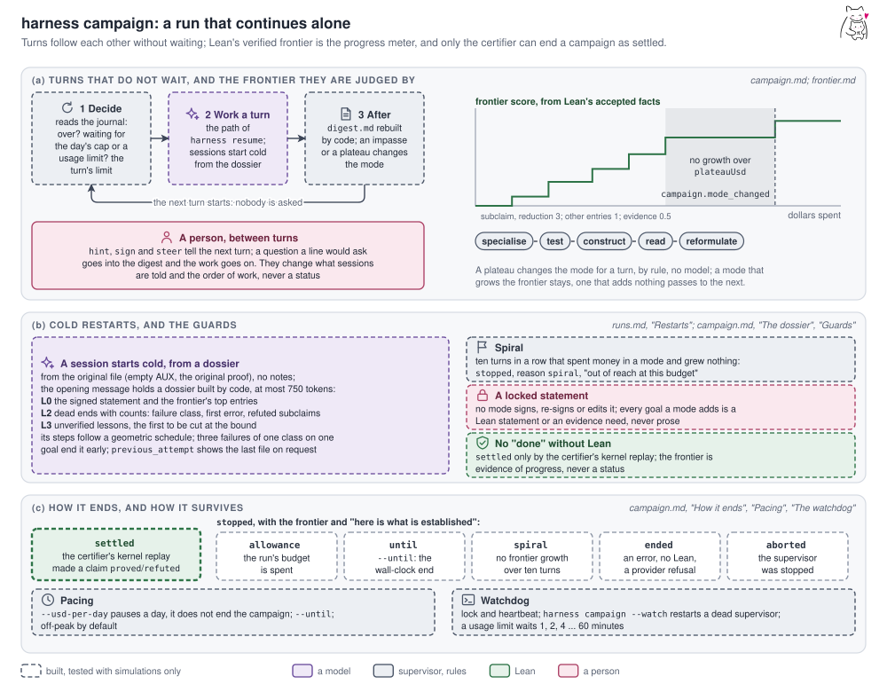

# Campaigns



A campaign is a run that continues alone (plan change LH2, `plans/plan-change-long-horizon.md`): a loop of
consortium turns that do not wait for a person. `harness campaign STATEMENT` takes what `harness solve`
takes (one problem, the signature, the allowance) and runs it for as long as money, time and the claim
allow, instead of for a fixed number of sessions. Nothing about how a claim is settled changes: Lean is the
judge, and only the certifier's kernel replay makes a claim `proved` or `refuted`.

No real campaign has run. Everything here is tested with the faux provider and a simulated Lean, and the
owner has no budget for the $10 real marathon (plan change LH7.2) now.

## The two axes

A campaign is `horizon: "campaign"` and `human: "digest"` ([runs.md](runs.md#the-two-axes)), both recorded in
`run.started`:

- `campaign` has no session cap: a prover's sessions are numbered over the whole campaign (the cold-restart
  schedule caps their length, not their number), and the session prompt omits "of at most N". The
  allowance, the claim settled, the wall-clock end and the spiral guard end it ([How it ends](#how-it-ends)).
- `digest` is a turn that ends by itself (a limit or a breakpoint) and is followed by the next, with nobody
  asked. `campaign` with `consortium` also works and waits for the team as a consortium run does (resume it
  with `harness resume`); `digest` without `campaign` is refused at the start.

`harness campaign` sets `restarts` on (geometric schedule, so every session after a prover's first starts
cold from the frontier, the dead ends and the state card), `frontier.show` on, the off-peak window on (the
existing `offpeak` setting; `--no-off-peak` turns it off) and a turn limit of a tenth of the allowance
(`--turn-usd` changes it). `--usd-per-day`, `--until` and `--spiral-turns` are the `campaign` key of the
configuration ([parameters.md](parameters.md)), recorded with the rest so that a resumed campaign reads them
from its journal.

## The loop

The supervisor (`runCampaign`, `campaign.ts`) holds no state that the journal does not (the lock and the heartbeat are for the watchdog). Its loop:

1. Read the journal and decide whether the campaign is over ([How it ends](#how-it-ends)), whether the day's cap or a usage limit makes it wait ([Pacing](#pacing)), and the limit of the turn.
2. Work a turn, by the same path `harness resume` uses (`resumeBench`); the first turn is `solve`'s run.
3. After the turn, rebuild `campaign/digest.md` from the journal, and, when the turn ended at an impasse,
   journal `campaign.mode_changed`.
4. Go to 1.

The impasse breakpoint of a consortium run ("stop and wait") is, in a campaign, a change of mode: `cold_restart`, and the next turn simply starts
cold. A plateau of the frontier changes the mode too ([Plateau modes](#plateau-modes)). A person's
`hint`, `steer` and `sign` stay available at any time between turns, as in a consortium run; they change what
the sessions are told and the order of the work, never a status.

A question a line or an agent would ask the team does not stop the campaign. The questions that exist today
are the breakpoints of the intake (a statement that is vacuous, a settled literature hit) and two informal
validators that disagree: in a campaign each is written into the digest ("open questions") and the work
goes on without an answer. There is no branch to freeze in a one-problem campaign; when a run has several
problems, the question about one problem still ends the turn for all of them, and the next turn starts, so
nothing waits on the answer. `harness hint` or `harness sign` tells the next turn.

## The digest

`campaign/digest.md` is written by code, whole or not at all, after each turn and when the campaign ends. It
holds: the state; the frontier (its score, its top entries, what is new); what changed in the last turn
(why it ended, what it spent, how many sessions ended how, claim status changes Lean made, new frontier
items, a change of mode); the open questions; and the spend (the run's, against its allowance; the day's,
against the cap). It also counts what CA24's model-free consolidation finds (open state cards, duplicate and
unsupported lessons). No model writes it. It is bounded: each list shows at most eight lines and the page at
most 7000 characters, so it does not grow with the campaign's age.

## The dossier

Each session of a campaign is briefed by a dossier (plan change LH4): a text rebuilt by code from the journal at the session's start, never
rewritten by a model, within `campaign.dossierTokens` tokens (default 750, the state card's bound of 3000 characters). It takes the state card's
place in the opening message. Its tiers:

- **L0**, always shown: the signed statement and the frontier's top entries.
- **L1**, the plan and the top obstacles: skipped. There is no plan without the research agent (Tasks 46 to 48); the tier is empty and the
  code says so in a comment.
- **L2**, the dead-end store: dead ends and failed approaches as items (approach, why it failed, the Lean evidence if any: the first error and
  its goal). They are built from the journal: refuted subclaims and variants and counter-models Lean checked (the frontier's `dead_end`
  entries), failed sessions (their strategy, failure class and first error), and the sessions that ended stuck (the restarts of
  [runs.md](runs.md#restarts)). Each is a delta merged into the store by key, so a dead end that repeats is one item with a count: the key is the
  failure class and the detail, or the refuted statement, both through `normalizeDetail`.
- **L3**, unverified items (lessons, the consolidation page): the ones the randomized inclusion already drew for the session
  ([memory.md](memory.md#randomized-inclusion)), shown last and the first to be left out when the bound is reached; the text says how many notes are not shown.

Each L2 item has an activity, counted from the journal: the sessions it was shown to (started after it existed and before it was retired), those
among them in which the frontier grew (followed) and those in which it did not (ignored), and the sessions that recalled it (whose last failure was
the item, or that called `previous_attempt` right after the session that left it). Items are shown from the most active (twice the followed count
plus the recalled count, then the latest).

When the store holds more than `campaign.deadEnds` items (12), the least active half of the items past that bound is retired after the turn:
`campaign.dossier` records the keys and scores, they stay in the journal and are no longer shown.

With `campaign.reflect` (off by default) one capped model call a turn (site `campaign.reflect`, $0.25 in all for the run, counted from the journal so a resume keeps it, journaled with
the problem it is for) proposes new items as a JSON array. Code reads it under a strict format: an answer that is not a JSON array is dropped
whole, an item without a text `approach` and `why`, or whose text the prose screen refuses, is dropped alone, at most three are kept. What is kept is
journaled as a delta (`campaign.dossier`, `added`) and shown as "proposed by a model, not checked". The model proposes; code merges.

## Plateau modes

When the frontier's score has not grown over a window of spend (`campaign.plateauUsd`, default 10% of the allowance), the supervisor changes mode
after the turn, by rule and with no model role (plan change LH5). A mode lasts a turn; its change is a `campaign.mode_changed` event with the mode,
its reason (the dollars spent without growth, or "the mode added nothing in turn N"), the modes it passed over with why (`skipped`) and `step`, the
modes gone through since the frontier last grew. The order is fixed:

1. **specialise**: line M18's curriculum of variants works for the turn. It applies when M18 is enabled and the statement has something to
   specialise (a binder or a `∀`).
2. **test**: line M11's counter-model search works, and the classical battery runs on each `sorry` a session leaves ([classical.md](classical.md)),
   on the target and the open `aux_` lemmas of the file. It always applies (the battery needs no line).
3. **construct**: line M16's program search works for the turn, with two additions ([induction.md](induction.md#program-search-line-m16)). It applies when
   M16 is enabled and the statement is an existence or a bound (`∃`, an inequality, "bound", "min", "max").
4. **read**: the literature step again, with the terms the frontier added (its subclaim, case, reduction and variant statements) added to the question.
   Only with the person's consent as at the start; the step records its skip as it always does, with the reason `private` under `--private`. It
   applies when the run asked for the literature and the person agreed.
5. **reformulate**: one generalization of the statement as a variant claim (M2's mechanism, `createVariant`): by rule, a numeral of 2 or more in the
   statement is replaced by a new natural-number variable. The claim is a Lean statement in signature form, `open`, with a `proposed` edge; Lean
   checks nothing of it here and nothing gives it a status. It applies when the statement has such a numeral. Today nothing works the variant
   by itself: it is there for a line (M18), a person or a later turn to take up.

A mode that does not apply is skipped, with its reason in the event. A mode that adds to the frontier keeps the run on it; a turn in it that adds
nothing passes to the next mode that applies, and after the fifth the first comes again. Lines M18, M11 and M16 are dormant in a campaign outside
their mode (`ProblemLines` gives their hooks only for the turn of their mode; the run's configuration still lists them, so a resumed run is the same
run). With no plateau window (neither `plateauUsd` nor a run allowance) no mode is ever entered, and then the lines are not gated: they run as without modes. The mode a turn works in is the last `campaign.mode_changed` of the journal. The signed statement is never touched by a mode: every goal a
mode adds is a Lean statement or an evidence need, and only the certifier's kernel replay changes a claim's status.

## Guards

- **No "done" without Lean.** A campaign ends `settled` only through the certifier ([The trust rule](#the-trust-rule)); every other end is `stopped`, with the frontier.
- **The spiral detector.** Spend without frontier growth across two full cycles of the five plateau modes (ten turns in a row that worked in a mode and spent money, none of
  which grew the frontier) ends the campaign `stopped` with the reason `spiral`. Turns, not modes passed over, are counted, so a statement for which few modes apply is
  not stopped early: its modes come round more often within the same ten turns. The older rule (`spiralTurns`, 8) stays for a campaign without modes: it does not count a turn that worked in a mode, which the rule above governs. A mode that grows the frontier starts the count again. The guard reads the journal alone, so a resumed supervisor finds it where it was.
  The second rule of plan change LH6, the same plan revision three times, has nothing to read: there is no plan without the research agent (Tasks 46 to 48). It does not apply.
- **The honest report.** A spiral writes "Out of reach at this budget; here is what is established" in the digest (above the frontier) and in `RESULT.md`
  (under the headline, with the turns and dollars spent), and the frontier follows in both. Nothing in the frontier is a proof of the target.
- **No goal drifts into prose.** Every goal a mode adds is a Lean statement (a variant claim in signature form) or an evidence need (a counter-model search, a battery
  on a `sorry`, a literature query that is data); no mode adds prose as a goal. The signed statement is locked as it is in any run: no mode signs, re-signs or edits it,
  and no mode gives a claim a status (the test `plateau.test.ts` checks both over a campaign that goes through the modes and ends in a spiral).

## Pacing

- **`--usd-per-day X`** (`campaign.usdPerDay`): the day's spend is counted from the journal by UTC day. Each
  turn's spend (`turn.ended.spent.turn`) is put on the day the turn began (`turn.started.at`, by the
  process's wall clock). Before each turn the supervisor gives it a dollar limit of what is left of the day, so a
  turn ends when the day's spend reaches the cap (one response in flight may pass it, by its cost); when nothing is
  left it journals `campaign.waiting` (`daily_cap`) and waits for the next UTC day. The cap pauses the campaign;
  it does not end it.
- **`--until ISO_TIME`** (`campaign.until`): the campaign stops at that instant (`until`). The turns before it get
  a minutes limit that does not pass it, and a wait for the next day that would pass it ends at it.
- **`--off-peak`** (the default; `--no-off-peak` turns it off): the existing `offpeak` setting
  ([human.md](human.md#off-peak)): each turn and each session starts only at the model's off-peak rate, and waits
  for the window otherwise (`turn.deferred`). The host profile needs the model's pricing calendar.
- **`--spiral-turns N`** (`campaign.spiralTurns`, 8): see [How it ends](#how-it-ends).

The supervisor takes the wall clock and the sleep as options, so a test advances a simulated clock; the same
clock goes to the turns' `wallClock`.

## From the local interface

`harness ui` starts a campaign from its start form ("Let it run for days": the allowance, the dollars a day, the end), shows
the digest on the run page, stops it as Ctrl-C does, and continues a stopped one with `campaign --resume`, detached if the person
asks ([ui.md](ui.md#running-commands), UX15). A campaign started from the page lives as long as the page's server; one continued
detached does not. Neither runs the watchdog: `harness campaign --watch RUN_DIR` in a terminal does.

## The watchdog

- **The lock.** `harness campaign` writes `campaign/lock` (its process id and its start). A second supervisor on
  the same run refuses to start while the lock's process is alive, and takes over a lock whose process is gone. The
  lock is released when the supervisor ends.
- **The heartbeat.** `campaign/heartbeat` (the process id, the time, the turns ended) is rewritten each minute and at
  each turn, whichever comes first.
- **Resuming.** A process that dies (a crash, a reboot, a provider's usage limit) is replaced by
  `harness campaign --resume RUN_DIR`, which reads the checkout, the bench and the host from `resume.json` and
  everything else, the pacing included, from the journal. The turn the dead process left open is closed as
  `interrupted` by the next one, as `harness resume` does.
- **The watch.** `harness campaign --watch RUN_DIR` is a small loop that runs `--resume` as a child process and
  restarts it when it dies, or when its heartbeat is older than 15 minutes, after a backoff of 1, 2, 4, ... up to 60
  minutes that starts again whenever a restart ended a turn. It returns when the journal's last word is
  `campaign.stopped`, or when the supervisor was stopped by a person (exit 0 or 130).
- **A usage limit.** A session whose model request ends on a usage limit (a 429, "usage limit", "rate limit",
  "overloaded") ends the turn as `usage_limit` instead of failing, and does not count against the prover. The
  supervisor journals `campaign.waiting` (`usage_limit`) and waits 1, 2, 4, ... up to 60 minutes (one more
  doubling for each such turn in a row) before the next turn. A refusal that a retry cannot cure (a balance, a key)
  is not one: it stops the run as before.

An example, not installed: a systemd user unit (`~/.config/systemd/user/seshat-campaign.service`),

```ini
[Unit]
Description=Seshat campaign

[Service]
WorkingDirectory=%h/seshat
ExecStart=/usr/bin/env pnpm harness campaign --watch %h/seshat/runs/MY_RUN --host local
Restart=on-failure
RestartSec=300

[Install]
WantedBy=default.target
```

started with `systemctl --user enable --now seshat-campaign`, or a cron line that starts the watch at boot and
does nothing when a live supervisor holds the lock:

```cron
@reboot cd $HOME/seshat && pnpm harness campaign --watch runs/MY_RUN --host local >> runs/MY_RUN/campaign/watch.log 2>&1
```

## How it ends

The supervisor reads the end from the journal before each turn.

| Reason | When | Settled or stopped |
|---|---|---|
| `settled` | a claim of the run is `proved` or `refuted` (only the certifier's kernel replay makes it so) and the run has closed | settled |
| `allowance` | the run's budget is spent | stopped |
| `until` | the wall-clock end `--until` has come | stopped |
| `spiral` | `spiralTurns` (8) turns in a row spent money and the frontier's score did not grow, or two full cycles of the plateau modes did ([Guards](#guards)) | stopped |
| `ended` | the run finished some other way (an error, Lean unavailable, a provider refusal) | stopped |
| `aborted` | the supervisor was stopped | stopped |

A stop writes `campaign.stopped` with the frontier and says "out of reach at this budget, here is what is
established" in the digest. Only `settled` is not a stop. A claim that was certified at the end of a turn
while its problem had no outcome yet gets one more turn, which spends nothing and closes the run.

## The trust rule

A campaign ends `settled` only when the certifier's kernel replay settles the target; every other end is
`stopped`, with the frontier. A person's answers change what agents are told and the order of work, never a
status. The frontier is evidence of progress, never a status, and the spiral guard reads it only to stop.

## The simulated marathon

`packages/orchestrator/test/marathon.test.ts` (plan change LH7.1) runs a campaign over 30 simulated days: an injected
clock and sleep, the faux provider, and a simulated Lean that accepts an `aux_` lemma now and then, so the frontier
grows. The watch restarts the supervisor after crashes (the journal cut inside a turn, sometimes with a torn last line,
the projection deleted), reboots (hours of downtime) and usage limits. It checks that no finished session is lost or
doubled and the hash chain verifies, that every turn that began ended and every crash was resumed, that the daily cap held
every day, that the frontier's score never fell, that the first request of a session does not grow with the run's age,
that the digest stays under its bound, and that it all runs in under 30 seconds.

## What has not run

The real marathon of plan change LH7.2 (about $10) has not run: the owner has no budget for it. No real campaign has run: not against a real model, a real Lean or for days. The tests use the faux
provider, a simulated Lean and injected clocks.

The dossier's reflection call, the `read` mode's second literature step and the `reformulate` mode's variant have not run against a real model, a real
literature search or a real Lean; the plateau rule, the guards and the novelty rejection are tested on scripted journals and candidates.
