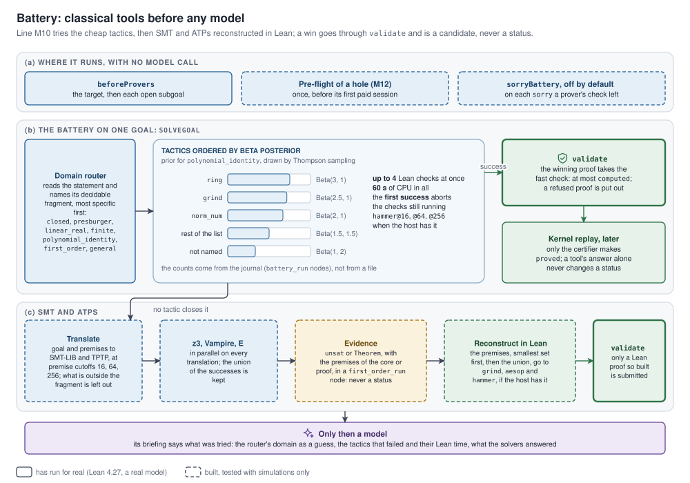

# Line M10: the classical battery, the domain router, ATP and SMT



Plan §7 step 4, "the cheapest gain": before any model works on a goal, classical tools try it. The
package is `@seshat/classical`. This page describes what is built; the end of it says what has not run.

For a goal (the problem's target, or a subgoal that is a claim of the memory), in the order of plan §15:

1. the **domain router** reads the statement and names its decidable fragment;
2. the **Lean battery** runs the tactics the host's Lean has, in the order of their posteriors, a few
   at a time, under a CPU budget, and stops at the first success;
3. a success is **submitted through `validate`**: it makes the claim `computed` at most, and only the
   certifier's kernel replay makes it `proved` ([lines.md](lines.md#validate));
4. ATP and SMT with reconstruction ([below](#atp-and-smt-with-reconstruction)) and only then a model, whose briefing
   says what was tried.

Nothing here raises a status. A tool's answer without a Lean proof is evidence or a `computed` edge,
never a status (Ruling 13).

## The statement reader

`parseStatement` (`parse.ts`) reads a statement in signature form: binders (`(x y : ℕ)`, `{x : ℤ}`,
instance binders `[Mul M]`, type variables `(M : Type*)`, hypotheses `(h : n < m)`) and a conclusion
over arithmetic (`+ - * / % ^`, numerals), relations (`= ≠ < ≤ > ≥ ∣`), connectives (`∧ ∨ ¬ → ↔`),
`∀`/`∃` over named variables, and function application. It is no Lean parser: a cast (`↑`), a big
operator, a bounded quantifier, a lambda or a tuple make it throw `Unreadable` with the reason. The
router then files the goal as `general` and the translators leave it out.

The reader refuses a statement of more than 4000 characters or nested deeper than 150 levels (`Unreadable`, so the router files it under `general` and the translation says it is outside) instead of overflowing the stack.

## The domain router

`routeStatement` computes features (the sorts of the variables, whether the goal is closed, whether
a product or a power is nonlinear, whether a division is by a numeral, uninterpreted functions) and
files the goal under domains, most specific first. The tactics of the domains come in the order
decision procedures first, then the search tactics.

| Domain | The goal | First tactics |
|---|---|---|
| `closed` | no variable, arithmetic and relations | `decide`, `norm_num`, `simp` |
| `presburger` | linear over `ℕ`/`ℤ`, `%` and `∣` by numerals | `omega`, `simp`, `norm_num` |
| `linear_real` | linear over `ℝ`/`ℚ` | `linarith`, `norm_num`, `positivity` |
| `finite` | a variable of `Fin n` (n ≤ 64) or `Bool` | `decide`, `simp`, `omega` |
| `polynomial_identity` | an equation over a commutative ring, nonlinear | `ring`, `grind`, `norm_num` |
| `nonlinear_arith` | an order over a ring, nonlinear | `nlinarith`, `positivity`, `linarith` |
| `bitvector` | reserved for `BitVec` goals | `bv_decide`, `omega` |
| `propositional` | `Prop`/`Bool` variables and connectives | `simp`, `aesop`, `grind` |
| `first_order` | uninterpreted functions, operations on an abstract type | `aesop`, `grind`, `hammer`, `canonical` |
| `general` | anything else, including what the reader cannot read | `simp`, `aesop`, `grind`, `exact?`, `hammer` |

`grind` carries a commutative-ring module that normalizes by a Gröbner basis (the Lean reference,
section on the algebraic solver), so polynomial identities with hypotheses are one of its jobs: the
router lists it right after `ring` for `polynomial_identity`. `polyrith` is a candidate only when the
host's Lean has it: whether it is still in the pinned Mathlib is read from the host, not assumed. On
Lean 4.27.0's Mathlib it parses but answers that it is no longer available, its external service having
shut down; the probe counts a tactic that says so as missing (`isRetiredTactic`).

The router is a guess from syntax. A wrong guess costs one failed try, and the posteriors below
learn it. Its precision (the share of goals whose winning tactic is in the first three of its list)
is what the report will measure once there are runs.

### Exploration moves (plan change CX1)

Beside its domains, `routeStatement` tags the goal with its **moves** (`moves`, from `movesOf`): which of the
twelve exploration moves of `plans/plan-change-cpu-exploration.md` its syntax calls for, the steps where a CPU
tool beats a model (a witness found by search, a counterexample, a certificate). The tags order which tools to
build and try; they prove nothing and change no status. A goal the reader cannot read still gets its moves:
they are read from the text (comments and strings masked, a lexer that never throws, nothing read past 16000
characters), and from the router's features when it could read the goal.

| Move | Tagged when the statement... |
|---|---|
| E1 small cases up to isomorphism | names a class of finite structures (`SimpleGraph`, `Fintype`, `Magma`, `Group`, `Finpartition`, a variable of a `Finset` type) |
| E2 a witness or construction | has an `∃` (not `∃ᶠ`) or a `¬ ∀` in its conclusion, a `.Nonempty`, `IsLeast`/`IsGreatest`, or pins an extremal quantity to a value or a lower bound (`W 3 6 = 32`, `190 ≤ L 9`) |
| E3 a counterexample | has a universal variable (a binder that is not a hypothesis or a type, or a `∀`), and is not an eventual statement (no asymptotic token below); also every polynomial inequality |
| E4 a closed form, recurrence or relation | has a variable of type `ℕ → _` or `ℤ → _`, `StrictMono`/`Monotone`, an equation with `∑`/`∏` and an integer variable, or a function it does not define applied to an integer variable (`a n = 3 ^ n + 6`) |
| E5 an invariant | iterates (`f^[n]`, `.iterate`) |
| E6 a certificate | is a polynomial inequality (readable, nonlinear, an order over number sorts), an integer equation (an equation hypothesis, nonlinear over `ℕ`/`ℤ`), or ends in an impossibility (`≠`, `∉`, a `¬` that is not `¬ ∀`) over arithmetic |
| E8 a split into cases | has a variable of `Fin n`, or a hypothesis or premise bounding a variable by a numeral (`n < 2^50`, `k ≤ 8 →`) |
| E9 an extremal object | names one (`IsLeast`, `sSup`, `⨅`, `max`, `min`, `Largest`, `Longest`, `chromatic`...), bounds a quantity it does not define (`F N 3 ≤ ...`), or pins one at numerals to a numeral |
| E12 growth or asymptotics | has `atTop`, `=O[`, `=o[`, `≪`, `Tendsto`, `limsup`, `∀ᶠ`, `𝓝`, a density |

E7 (a change of representation), E10 (a rewrite path) and E11 (an intermediate lemma) have no syntactic signal and
are never tagged. The moves are journaled in the `battery_run` node with the domains (below), and `harness audit`
counts them over a run's problems ([audit.md](audit.md#exploration-moves)).

**Recall.** `packages/classical/test/fixtures/labelled-moves.json` holds 40 statements labelled by hand (every 15th
problem of `bench/fc-bench-v1-discrete.json` from index 7, and the two Putnam statements the repository holds), with
the labelling rules in its header; `moves.test.ts` asserts that at least 80% of the labelled moves are found (the
plan's acceptance) and prints the measured recall: 62 of 65 (95.4%) when it was written. The labels and the rules
were written by the same hand, so the number is an upper estimate of what a fresh set would give; extra tags are not
counted (23 on the set), since a tag costs one tool try at most.

## The tactics, and what the host has

`TACTICS` (`tactics.ts`): `decide`, `omega`, `norm_num`, `simp`, `ring`, `linarith`, `positivity`,
`nlinarith`, `aesop`, `grind`, `exact?`, and the ones that need something of the host: `bv_decide`,
`polyrith`, `canonical` and LeanHammer's `hammer`. A try is the file `example <statement> := by
<tactic>` after the claim's header, checked by `lean.check` as the battery's actor (`line:M10`), so
each try is a tool run in the journal. A tactic that prints `Try this: ...` (`exact?`, `hammer`,
`polyrith`) is submitted as that suggestion, since a search tactic is not what a proof file should
keep.

The list is read from the host: `probeHost` elaborates `example : 0 = 0 := by <tactic>` for each
optional tactic and reads a parse error ("unknown tactic", "expected ...") as "not there". The line
option `packages` names what the host profile says it has (`hammer,canonical`) and skips the probe for
those. Nothing is assumed: a Lean without LeanHammer never sees `hammer`.

## The battery

`runBattery` runs the tactics in the order of `orderByPosterior`, at most `parallel` Lean checks at a
time (default 4), each with the tactic's own time limit cut to what is left of the CPU budget
(`cpuBudgetSec`, default 60, summed over the parallel tries). The first success aborts the checks in
flight, which are recorded as `aborted` and tell the posteriors nothing; so does a Lean that did not
answer (`error`). A timeout counts as a failure.

**Posteriors.** Each `(domain, tactic)` has a Beta posterior over its rate of success, where the
domain is the router's most specific one. The prior is the router's list for the domain
(Beta(3,1), Beta(2.5,1), Beta(2,1) for its first three tactics, Beta(1.5,1.5) for the rest, Beta(1,2)
for a tactic the domain does not name, flat for `general`): a few pseudo-counts that a handful of
tries outweighs. The counts are rebuilt from the journal when a run starts: `Posteriors.from(memory)`
reads the nodes `battery_run`, and nothing is kept in a file outside the journal. The order is
Thompson sampling (`order: "thompson"`, the default, seeded by the run's seed so that it replays) or
the posterior mean (`"mean"`). This is the hammers' strategy scheduling, learned online by counting,
with no training.

**The hammer at several cutoffs** (plan change PC6 item 2). With `hammer` available, the battery also
tries `hammer@16`, `hammer@64` and `hammer@256`, which is `hammer {aesopPremises := N, autoPremises
:= N}`, in parallel with the rest; the option `hammerCutoffs` sets them. The first success wins, and
each cutoff has its own posterior. The configuration syntax is written from the LeanHammer README and
has not run.

## The certificate stage (plan change CX4)

`certificates.ts`, with the exact arithmetic in `polynomial.ts`. On a goal the router tags E6 ("a
certificate of a bound or an impossibility", CX1), when no tactic closed it, the battery tries four kinds of
certificate that a plain Mathlib checks, with no model call, in this order, before the ATPs:

| Method (try name) | Fragment | What is computed, and where | The Lean text |
|---|---|---|---|
| (a) modular obstruction (`cert.modular`) | an equation over `ℤ` or `ℕ`: a hypothesis, or the conclusion's `≠`, `¬ (a = b)` or `¬ ∃ xs, a = b` | the moduli `m ≤ maxModulus` (default 64, at most 4096 residue tuples) where the equation has no solution, in TypeScript; the two with the fewest tuples | `have h := congrArg (Int.cast : ℤ → ZMod m) h₀`, `push_cast at h`, `revert h`, `generalize (x : ZMod m) = r` per variable, `revert r ...`, `decide` (`exfalso` first when the conclusion is not `False`) |
| (b) local polyrith (`cert.polyrith`) | an equation over `ℤ`, `ℚ`, `ℝ` or `ℂ` and at least one equation hypothesis, at most 6 variables | in the compute tool: sympy's Gröbner basis says whether the conclusion lies in the ideal of the hypotheses, then an ansatz of growing degree (up to 2 above the goal's) solved exactly over `Fraction` gives cofactors | `linear_combination (c₁) * h₁ + (c₂) * h₂`; over `ℤ` only integer cofactors |
| (c) sums of squares (`cert.sos`) | `a ≤ b` (or `≥`) over `ℝ` or `ℚ`, at most 6 variables, Gram bases of at most 36 monomials, at most 150 linear constraints (the exact projection cannot be cut short) | first a plain sum of squares on the Newton polytope's box, then with every hypothesis `g ≥ 0` (`≤`, `<` between polynomials) as a Putinar multiplier; clarabel in the compute tool maximizes `t` with every Gram matrix `⪰ t·I`; here the answer is rounded to rationals (denominators 1 to 10⁸, coarsest first), projected exactly onto the linear constraints, and factored by exact LDLᵀ | `nlinarith [sq_nonneg (l₁), mul_nonneg hpos (sq_nonneg (l₂)), ...]` (each multiplier `have hpos : 0 ≤ g := by linarith`), then the identity `have hsos : 0 ≤ d₁ * (l₁) ^ 2 + ... := add_nonneg ...` closed by `linear_combination hsos` |
| (d) Bernstein subdivision (`cert.bernstein`) | `a ≤ b` or `a < b` over `ℝ` or `ℚ`, every variable of `b - a` between numeral bounds in the hypotheses, at most 64 coefficients a box | in TypeScript: the Bernstein coefficients of `b - a` on the box, the box split at the midpoint of its widest side until each box's coefficients are nonnegative (positive for `<`), at most `maxBoxes` (default 16) boxes; a negative value at a corner stops it | one `rcases le_total x c with h \| h` per split, and on each box `linarith` (a second candidate: `nlinarith`) with the Bernstein products `mul_nonneg (pow_nonneg (sub_nonneg.2 h₀) i) (pow_nonneg (sub_nonneg.2 h₁) j)` as hints |

The goal is read by `readPolyGoal`: variables of one number sort, the hypotheses that are polynomial relations
(the others are left aside), and a conclusion behind `∀` binders and `→` hypotheses, which the candidate
introduces first (`intro`, `rintro`). A goal outside a method's fragment gets a note saying why, and no call.

**Trust.** Every candidate is a Lean text written by the stage from integers, rationals, the goal's own variable
and hypothesis names and fresh names it checks are unused; nothing a tool printed reaches it verbatim. A tool's
answer is data (JSON on its last output line), read strictly: a malformed answer, cofactors that do not combine
to the conclusion, or a Gram matrix whose exact LDLᵀ has a negative pivot gives no candidate. Every identity a
certificate rests on is checked here, exactly, before Lean sees it. The text then passes the screen
(`leanTextProblems`), is checked as `example <statement> := by <certificate>` by `lean.check` (a tool run of
`line:M10`, id `m10:cert.<method>`), and a success goes through `validate` exactly as a tactic's does: the stage
changes no status, and `native_decide` is never written. The SDP value, the residues and the coefficients are
evidence at most, and are not recorded as anything else.

**Budget and journal.** The stage spends the battery's budget: on a goal tagged E6 the tactics run under
`cpuBudgetSec` minus `certificateSec` (default 30, at most half the budget), and the stage spends what is left,
Lean time and compute time together, each Lean check at most 30 s and each compute call at most 30 s. Its
submissions count against `maxSubmissions` with the tactics'. Each Lean check is a try `cert.<method>` in the
same `battery_run` node as the tactics, so it has a Beta posterior per (domain, method) like theirs; the node's
`certificates` field says why each method gave no accepted proof. The briefing names the certificates that
failed.

**The compute tool.** (b) and (c) use the host's compute tool through the registry (`registryCompute`):
`compute.python` (CX3; its pinned packages have sympy and clarabel), else `compute.sage` (which has sympy; (c)
then fails at the import of clarabel and says so). One session per goal (scope
`m10:<problem>:<claim>:certificates`), released when the goal's battery ends; every call is a tool run. Without
either, (b) and (c) are skipped with the note "the host offers no compute tool"; (a) and (d) need none.

**The real pass ($0).** `bench/cx4-certificates.json` holds the inputs of CX4's real pass: 20 olympiad-style
inequalities over `ℝ` (18 expected to have a sum of squares, 4 of them with Putinar multipliers; 4 on a box for
Bernstein, two of which are in both lists) and
20 integer equations (16 for a modular obstruction, one of them over `ℕ`; 4 ideal memberships over `ℤ` for
cofactors), each with the methods expected to close it. On a host with Lean 4.27.0 and Mathlib (and Pyodide for
(b) and (c)):

```sh
pnpm harness certificates bench/cx4-certificates.json --host local --out cx4-pass.json
```

runs every method of the stage on every problem, one method at a time, with no tactics, no model, no claim and no
`validate` (`certificate-pass.ts`): each Lean check is a `lean.check` tool run of `line:M10`, each compute call one
of `compute.python` (else `compute.sage`), in a session per problem. It prints, per problem, whether the router tags
it E6 and the methods whose certificate Lean accepted, then the count per method (accepted, expected, and checks
Lean did not answer); `--out` writes the report as JSON, `--problem ID` (repeatable) picks problems. It changes no
status and writes no journal. One problem, `eq-15` (`¬ ∃ x y : ℤ, x ^ 2 = 8 * y + 2`), is not tagged E6 by the
router, which reads the consequent after the last comma: the pass runs the stage on it anyway, and the battery
would not. It has not run: this machine has no Lean.

**Not verified.** Nothing of the stage has run against a real Lean, Pyodide or Sage: the tests use a simulated
Lean and a fake compute tool (the cofactor search also runs on CPython with sympy stubbed). Unchecked: that
`push_cast` and `generalize` leave the residues as written and that kernel `decide` on `ZMod m` finishes within
30 s for the larger tuples; that `linear_combination` closes `≤` goals on Mathlib for Lean 4.27.0; that `linarith`
expands the Bernstein products (else the `nlinarith` candidate); clarabel's `PSDTriangleConeT` order (upper
triangle by columns, off-diagonal scaled by √2, as the program assumes; a wrong order gives matrices the exact
check refuses, so no false candidate); whether its precision suffices for olympiad inequalities; the programs on
Sage.

## The screen of text that reaches Lean

Statements, headers, tactics, lemma names and premise names that a model wrote or chose are put into Lean
files or Pantograph goals, so they pass a strict screen first (`screen.ts` re-exports `leanTextProblems` of `@seshat/core`, the one copy that every line uses: curriculum
variants, sketch holes, library candidates, `screenLeanText` of `@seshat/induction` and the statements of
`@seshat/models` read text with it): comments
and strings masked, `forbiddenTokensIn` (`#eval`, `macro_rules`, `IO`...), no `#`, and no `--` or `/-`
anywhere in the raw text (a `-- x` would swallow what the harness writes after the text on its line).
`runBattery`, `solveFirstOrder` and `searchGoal` refuse a statement that fails it (`UnsafeText`); the
tactics and lemmas of a search must also be one line; a header (`prove.auto`, `prove.search`, and the
header of a subgoal claim, not the bench's own prefix of the target) is screened without its `import`
lines; a premise name must be a Lean identifier before it is put in `grind [...]`, `aesop (add safe ...)` or
`hammer [...]`. The line logs a goal it skips for this reason; the capabilities fail the call.

`screenTptp` reads quoted atoms before comments, as Vampire does, and refuses `include(` in the code, a `/*` inside a quoted atom,
and an unterminated quote or comment. `describeTried` passes the translator's `Outside` message through `screenProse`, and prints a fixed
sentence when it is refused.

## `solveGoal`

`solveGoal(ctx, {claimId, header, statement})` is the unit the line and the `prove_auto` tool use:
route, battery, then `validate({claimId, proof})` for the winner. A proof `validate` refuses (the
statement it checked is the claim's reference, not the snippet) puts that tactic out and the battery
goes on, up to `maxSubmissions` refusals. Every run, solved or not, is recorded as a node
`battery_run` on the claim:

```
data: { statement, domains, moves?, tries: [{tactic, domain, outcome, timeMs, suggestion?}],
        solved?: {tactic, proof}, submission?: {verdict, status, validationId, reasons}, cpuMs, budgetSec }
```

`moves` (plan change CX1) is the router's moves for the statement, absent in a node written before them.

`outcome` is `success`, `failed`, `timeout`, `error` or `aborted`.

## The non-triviality test

`closesWithCheapTactics(checker, goal, {cpuBudgetSec})` answers "do the battery's cheapest tactics
(`decide`, `omega`, `norm_num`, `simp`, `ring`, `linarith`, `positivity`) close this goal within this
CPU budget?" with a Lean checker alone, no line on, nothing submitted or recorded. Task 9's library
uses it to decide that a lemma is not trivial, and Task 13 will.

## Translation to SMT-LIB and TPTP

`lower(goal, premises)` (`translate.ts`) turns a goal, and lemma statements given as premises, into a
typed problem; `toSmtLib` and `toTptp` write it. The fragment:

- variables of `ℕ` (an integer with a sign assertion `d_n`; a function into `ℕ` has one too, `d_f`), `ℤ` and `ℝ`;
  `ℚ` is outside, because read as the reals it changes the meaning of every quantifier over it. The sort of
  every term is tracked: a subtraction truncates exactly when its operands are of `ℕ`, the scope of a
  quantified `ℕ` ends with the quantifier, and a mix of `ℕ` with `ℤ` (a cast) or a numeral expression next to a
  `ℕ` (`n + (2 - 3)`) is outside. `Prop` variables, abstract types `(M : Type*)` with the operations of their instance binders
  (`[Mul M]` becomes `mul_M`), and function or predicate variables between those sorts;
- `+ - * / % ^ neg`: `^` only by a numeral up to 8, real `/` only by a nonzero numeral, integer `/` and
  `%` only by numerals (Euclidean, as Lean's `Int`), truncated subtraction on `ℕ`, `∣` only by a
  numeral;
- `= ≠ < ≤ > ≥`, `∧ ∨ ¬ → ↔`, `True`, `False`, `∀` and `∃` over typed variables;
- hypotheses as assumptions; each premise `(x : T) (h : P) : Q` as `∀ x, P → Q`.

Anything else (sets, `Finset`, sums, casts, bounded quantifiers, a lemma named inside a term) throws
`Outside` with the reason, and the goal is left to the Lean battery. Each assertion is named
(`h_1`, `p_2`, `d_n`, `goal`), so that an unsat core or a proof says which hypotheses and premises it
used. The SMT-LIB script asserts the hypotheses and premises and the negation of the goal, with
`(get-unsat-core)`; the TPTP problem is TFF with the hypotheses and premises as axioms and the goal as
the conjecture (`$ite` for truncated subtraction, which Vampire reads). A translation is a candidate:
`unsat` or `Theorem` means the goal follows in the encoded theory, which is Lean's only up to the
approximations above.

`smt.z3` and `atp.vampire` ([capabilities.md](capabilities.md#smtz3-and-atpvampire)) run the two
problems. z3 comes from PyPI's `z3-solver`; its tests run when `z3` is on the PATH and say how to
install it otherwise. Vampire and E are untested here (no binary): their shared answer parser is tested on SZS text
written from the TPTP documentation, and the process wrapper on scripts that print it.

## ATP and SMT with reconstruction

`solveFirstOrder` (`firstorder.ts`) is plan §15 step 5. For a goal it:

1. translates it at each premise cutoff (option `cutoffs`, default 16, 64 and 256), the premises being
   the selector's choice mixed with a BM25 stream (`mixSelectors`; Task 11's MePo and SInE plug in as
   a `PremiseSelector`), taken from an index of declarations with their statements (the library's, or
   the `lean.meta` export of Task 21: none by default, and then one call with the hypotheses only).
   A premise outside the fragment is dropped alone. Several short tries beat one long one, and an
   even mix of two selectors gains, which is why the cutoffs run in parallel;
2. runs z3 and the ATPs (Vampire and E, the **portfolio**, below) on every translation, in parallel, and keeps the **union of the successes**:
   each `unsat` or `Theorem` answer becomes an `Evidence` (tool, cutoff, answer, the hypotheses and
   premises of the unsat core or of the proof's `file(...)` annotations) in a node `first_order_run`;
3. hands the premises of each success (smallest first), then of the union, to `grind [p, ...]`,
   `aesop (add safe p) ...` and, if the host has it, `hammer [p, ...]`, as a battery over Lean;
4. submits through `validate` only a Lean proof so built.

The answer of a solver is `computed` evidence at most: it changes no claim's status, no edge is
raised because of it, and a run where Lean accepts no reconstruction ends with the evidence and the
claim as it was. A proof that uses no premise beyond the goal's hypotheses is not reconstructed: the
battery tried `grind` and `aesop` on exactly that. A tool the host does not have is recorded in
`missing` and the other goes on. Nothing in this path has run against a real Lean, Vampire or E;
z3 ran on the translated scripts only.

### The portfolio of Vampire and E

`atp.vampire` and `atp.eprover` ([capabilities.md](capabilities.md#atpeprover)) are two ATPs behind the
same function type, and the stage tries them as a portfolio. Their answers are `Evidence` tagged with
the tool, read by the same SZS reader, and reconstructed by the same premise sets and the same Lean
tactics (`grind`, `aesop`, `hammer`): E adds a second chance, not a second route to a status. Two options
of the line M10 configure it:

- `atpTools` (default `vampire,eprover`): the ATPs to use, in the order given. One the host does not
  offer is skipped, so the default is both when both are installed and the installed one otherwise; a
  list naming only a missing prover runs no ATP (z3 still runs) and the stage notes it in `missing`.
- `atpMode`: `parallel` (default) runs z3 and every ATP at once on each translation and reconstructs
  all the answers together, smallest premise set first, then the union; `order` runs z3 with the first
  ATP, reconstructs, and runs the next ATP only if Lean accepted nothing from the answers so far, so
  the first prover whose output Lean accepts after reconstruction wins and the later ones cost nothing.

The evidence is listed by cutoff and then by the order of the tools (z3, then the ATPs as `atpTools` gives them), never by which prover answered first, so the premise sets reach Lean in the same order on a resume. In both modes a prover that vanishes at run time is recorded in `missing` and the other goes on, and a
set of premises is handed to Lean once. The briefing names the provers that answered ("Vampire and E
proved the goal in the encoded theory..."). The node `first_order_run` records the tools asked (`tools`), and "ATP and SMT found nothing" is said when at least one of them ran.

## The line

Things the line does when it is cut short or when Lean is not as expected: an abort of the problem (a budget, a stop) leaves no `battery_run`, `first_order_run` or `search_run` node for the goal it cut, so a resumed run does the goal again, and an interruption raised by `validate` passes through the hook; the battery records one `success` per run (a later answer that raced the abort is `aborted`) and aborts its other checks if the checker throws; a probe that timed out, or whose import failed, learned nothing, so the tactics are not believed present and the host is asked again at the next goal (an answer is kept for its header). The line does not enumerate the `sorry`s of a sketch itself: a hole is worked when the scheduler (M12) has made it a claim joined by `decomposes_into`, which is how a subgoal reaches the line.

`M10` (`createM10(services)`; `M10` is the one a run gets) has a `beforeProvers` hook and a briefing,
and no state of its own: it reads what it did from the memory (`resume: "stateless"`), so a resumed
run skips every goal that has a `battery_run` or `first_order_run` node and a second run of the hook
makes no Lean call.

`beforeProvers` works the problem's target and then each open subgoal (a claim joined to the target by a
`decomposes_into` edge, at most `maxSubgoals`): the battery (with its certificate stage on a goal tagged E6), then ATP and SMT if the battery failed. A goal
the battery closes ends the line for that goal, and for the target ends the hook. Every Lean try is a
`lean.check` tool run of the actor `line:M10`, so the journal has it. With `search` on and the target still
open, the goal-level search runs last.

Options (`--line-option M10.<name>=<value>`): `parallel` 4, `cpuBudgetSec` 60, `maxSubmissions` 3,
`order` thompson|mean, `hammerCutoffs` "16,64,256", `packages` "" (the optional tactics the profile
promises, not probed), `probe` true, `subgoals` true, `maxSubgoals` 8, `firstOrder` true,
`atpTimeoutSec` 20, `premiseCutoffs` "16,64,256", `reconstructBudgetSec` 60, `search` false,
`searchNodes` 60, `orderer` posterior|decide, and for the certificate stage `certificates` true,
`maxModulus` 64, `maxBoxes` 16, `certificateSec` 30. A bad value stops the hook with the option's name.

The **briefing** (`describeTried`) says, from the nodes, what was tried: the router's domain as a guess,
the tactics that failed and the Lean time they took ("do not repeat them on the goal as stated"), the
tactic that closed the goal and whether `validate` accepted its proof, the certificates that Lean did not
accept, what z3 and Vampire answered and
whether Lean accepted a reconstruction, and the search. A goal M10 did nothing on has no briefing.

The services (`M10Services`) replace the registry's `lean.check`, the solvers, the premise index,
the selector and the certificate stage's compute tool, for tests and for Tasks 9 and 11.

## `prove.search`

The goal-level search (`searchGoal`, capability `prove.search`, plan change PC6) opens the goal with
`lean.goals`, and expands states best first. A node's score is the sum over its path of
`log(1/(rank+1))`, divided by `depth^alpha`; alpha is drawn once per run from {0, 0.5, 1} with the
run's seed and recorded. The budget is in nodes (tactics tried). The candidates at a state are the
model's proposals, which keep their rank, and the battery's tactics for the goal's domain, which come
without a model call and are ordered by an injectable `CandidateOrderer`: the posteriors by default, or
`decide` (plan change J3 item 3, `--line-option M10.orderer=decide`, with the model's own order as the
fallback). A closed search returns the tactics, one per line; the line submits them through `validate`
like any other proof. The search is bounded by nodes (tactics tried), by depth (`maxDepth`, 12), by a time limit for the whole search (`timeoutSec`, 180) and by one for each tactic (20 s; a tactic that takes longer counts as an error); money enters only through the `decide` orderer, which has its own budget. The `prove.search` capability has no journal of its own, so its posterior order is the router's prior. It is off in the line by default, because whether it beats whole-proof sessions
at equal dollars is to be measured, and it has not run against Pantograph.

## The battery on a session's sorry

With `RunConfig.sorryBattery` (`{ maxSorries?, timeoutSec? }`, off by default; Ruling 40, Task 54; `sorry-battery.ts`), after each `lean_check` of an outer prover session whose file has no error and still has `sorry` (a hole session has it too, on the `sorry` of the hole's own proof only: [scheduler.md](scheduler.md#hole-sessions-plan-change-ca10), "What a hole session is given"), the harness, with no model call, finds each `sorry` outside comments in the AUX and PROOF regions (at most `maxSorries`, default 8, in file order) and checks the file with that one `sorry` replaced by `(first | decide | omega | ...)`, M10's tactics in its order, plus the hammer when the line's option `packages` names it, through the same `lean.check` as a tool run of the actor `line:M10`. A replacement that checks with no error and one `sorry` fewer is kept; a second batch of single-tactic files names the tactic that closed it, which then stands in the file in place of the combinator. The kept ones are applied together and checked once; if that file fails they are applied one by one in file order, each kept if the file still checks. They go into the session's working file (`lean_edit` and the next session start from it), and the check's answer ends with "The harness closed K of N `sorry` with the classical battery (no model call): PROOF line 3: omega. The file now reads as below; continue from it." and the new regions, or with "The harness tried the classical battery on N `sorry` and closed none." One node `sorry_battery` per attempt records tried, closed, the tactics, the checks and the time, and the report adds "sorry closed by the harness: K of N" when the setting was on. The files are never submitted through `validate`: a closed `sorry` is a change to the working file and no claim's status changes; only the model's next `lean_check` and the certifier do. The arm `solve-v2-cpu` of `solve-defaults` measures it against `solve-v2`. Run only against a simulated Lean so far.

When the battery closed every `sorry`, the harness also checks the completed file itself, as a submission of the session (through the workbench, as `lean_check` does), so that a session that would end before the model checks again does not lose it: only that check can make it a candidate, and only the certifier's kernel replay makes the claim `proved`. If Lean accepts it, the session ends there.

## Tests, and what has not run

`packages/classical/test`: the reader and the router on a table of goals; the router's moves on planted goals and their recall on the 40 labelled statements (`moves.test.ts`); snippet generation; the
posteriors rebuilt from nodes and their order; the first-success stop, the parallel limit, the CPU
budget and abort; the host probe; the non-triviality test; `solveGoal` against a scripted Lean (a
refused proof, the allowed refusals, a failed run recorded). The scripted Lean (`test/fake-lean.ts`)
answers by tactic name and reads the layout of the file, not Lean's syntax. Also: the translation (checked against z3 when it is installed), the process wrapper and the solver readers on shell-script fake binaries, the first-order stage with cutoffs and reconstruction, the search against a scripted goal machine, the line against a fake problem context (options, probe, subgoals, resume, learning across problems, briefing), and a whole run with the simulated Lean (`orchestrator/test/m10.test.ts`).

The `grind` tactic carries a commutative-ring (Gröbner) module, so the router sends polynomial identities to `ring`, then `grind`; no `polyrith` is assumed, the tactic list is read from the host (plan change PD4 item 1).

Nothing has run against a real Lean: whether each tactic closes what the router sends it, whether
`Try this:` messages come as the code reads them, and the hammer's configuration syntax are open.
