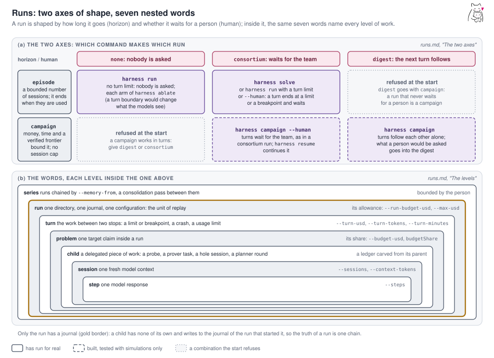

# Runs: one vocabulary

The words below are the ones every flag, key and page uses (plan change LH9). A level contains the ones
below it, and only the run has a journal: the journal is the one source of truth of a run
([journal.md](journal.md)), and a run is the unit of replay.

## The levels

| Level | What it is | Bounded by | Set by |
|---|---|---|---|
| series | runs chained by `--memory-from`, with a consolidation pass between them | the person | `--memory-from`, `harness consolidate` ([memory.md](memory.md)) |
| run | one directory, one journal, one configuration | its allowance | `--run-budget-usd` (`budget.runUsd`), `--max-usd` in `solve` |
| turn | the work between two stops of a run: a consortium limit or breakpoint, a crash, a usage limit | a turn limit | `--turn-usd`, `--turn-tokens`, `--turn-minutes` (`consortium.limit`) ([human.md](human.md)) |
| problem | one target claim inside a run | its share of the allowance | `--budget-usd` (`budget.problemUsd`), `budgetShare` |
| child | a delegated piece of work with its own contract: a probe, a prover task, a hole session, an informal loop, a planner round, a search, a variant | a ledger carved from its parent | the line or the loop that starts it |
| session | one fresh model context | steps, context size | `--sessions` (per prover), `--steps`, `--context-tokens` (`limits`) |
| step | one model response | the session's `steps` | `--steps` (`limits.steps`) |

A step used to be called a turn in `--turns` and `limits.turns`, which collided with the consortium turn.
`--steps` and `limits.steps` are the names now; `--turns` and `limits.turns` stay as aliases (give one, or
the same number: two different values are refused at the start). The journal still records `turns` in
`run.started`, so a journal written before the rename reads and resumes as it always did.

A child is not a run. It has no journal of its own: it writes to the journal of the run that started it,
so that the truth of the run is one chain and replay stays exact.

## The two axes

A run has two orthogonal settings instead of more kinds of run. Both are optional keys of the
configuration, and both are recorded in `run.started` (`horizon`, `human`), shown in the start log
(`shape: horizon episode, human consortium`) and in the header of the report.

- **`horizon`** (`--horizon`): `episode` is a bounded number of sessions; the run ends when they are used.
  `campaign` (money, time and a verified frontier bound it; its sessions are not capped) is what
  `harness campaign` runs ([campaign.md](campaign.md)); every other run is an episode.
- **`human`** (`--human`): `none` means nobody is asked; a measurement uses it, and `harness ablate` always
  does, because a turn boundary changes what the models see. `consortium` means a turn ends at a limit or a
  breakpoint and waits for the team ([human.md](human.md)); a bare `--human` is `--human consortium`.
  `digest` (a turn that ends by itself and is followed by the next, with what a person would be asked
  written into the digest) goes with `campaign` and is refused without it ([campaign.md](campaign.md)).

The value is derived from what the run has, in one function (`runShape` in `run-shape.ts`): `human` is
`consortium` when the run has consortium turns and `none` otherwise, `horizon` is `episode`. Giving a
value that contradicts the run (`--human none` with a turn limit, `--human consortium` with no turn
limit in a configuration that cannot supply one) is refused at the start. So `solve` is `episode` +
`consortium`, `run` without a turn limit is `episode` + `none`, and each arm of `ablate` is `episode` +
`none`. A journal written before the axes has neither field and reads as before.

## Which command for which purpose

| Purpose | Commands | What they have in common |
|---|---|---|
| working a problem | `run`, `solve` (and `resume`) | they certify claims through Lean; the axes above apply |
| measuring | `ablate` | it compares configurations on the same problems and refuses a person (`human` is `none`) |
| maintenance between runs | `consolidate`, `optimize-prompts`, `library build` | they never change a claim's status |

The commands differ because their rules differ; the axes are what changes inside the first purpose.
`harness parameters` and [parameters.md](parameters.md) list every flag and key. `harness frontier` reads a run's verified frontier ([frontier.md](frontier.md)) and writes nothing.

## Restarts

`RunConfig.restarts` (plan change LH3; a settings-file key, off by default, so `solve`'s sets `v1` and `v2` send byte-identical requests) restarts a prover's sessions cold on a schedule, so that a long trajectory does not condition itself on its own failures. It is an option of a run, so an episode can use it as a campaign does ([campaign.md](campaign.md)).

`{ schedule?: "geometric" | "luby", base?: number, stuckChecks?: number }`, with `base` 6 and `stuckChecks` 3 by default.

- **The schedule** gives the step limit of a session by its index for that prover: `geometric` base, 2 x base, 4 x base, ...; `luby` base times Luby's sequence 1, 1, 2, 1, 1, 2, 4, ... Never above the run's `limits.steps`. A session that reaches it ends as before (`stoppedBy: "turns"`, notes asked for) and is journaled as a restart, `attempt.finished.restart: { reason: "schedule" }`.
- **Cold.** A prover's session after its first starts from the original file (an empty AUX and the original proof), with no notes and no last check of the previous session. Its opening message carries what the harness builds from the journal: the signed statement (the file's), the state card as it is today (when `stateCard` is on), the dead ends and the lines' sections, and, with `frontier.show`, the frontier's top entries (the card's, or alone when the card is off). The previous session's file and notes are still what the journal's `carry` holds, for a resumption.
- **Stuck.** A session ends early when `stuckChecks` consecutive `lean_check` or `lean_edit` checks fail with the same class (the one the state card counts) on the same goal (the first error's text, or the first `sorry`'s goal, normalized as the card does); a check that says nothing about the proof (Lean unreachable, a timeout, a refusal) neither counts nor resets. The stop is `stuck`, the model is asked for its notes, and the attempt records `restart: { reason: "stuck", class }`. M6's repeat rule (`line:M6`, cause `repeated_failure`), when that line is on, is the same signal and is recorded the same way.

- **The overlay `previous_attempt`.** A cold session has one more tool, `previous_attempt`, with no arguments. Its answer, on each call, is the previous session's last file (AUX and PROOF) and its notes; the harness never pastes them into the context. Its description says that this is the previous attempt, that it failed, and that it may be wrong. It is offered only with `restarts` on and only after the prover's first session. The answer is a tool answer in the session's transcript, and the attempt records the number of calls (`attempt.finished.previousAttemptCalls`). The session guard of the turns ([m0-loop.md](m0-loop.md#exploring-is-not-checking)) counts it as an exploring tool: after six turns without a check it answers "Submit your file now", as the other tools do. The opening message of a cold session names the tool.

Nothing here changes a claim's status: a restart is a different way to brief a session, and Lean still judges every file. Tested with the faux provider and a simulated Lean (`orchestrator/test/restarts.test.ts`); whether restarts help on a real open problem has not been measured (LH7).

## Children

A child is one delegated piece of work inside a run (plan change LH9). Seven kinds exist today. They were
written one by one, so each carries its own handling of budget, journal records and resume. This is the
inventory, read from the code at the time of Task 56; the common contract that the next sections describe
(`ChildSpec`, `runChild`) is built on it.

| Kind | Started by (caller) | Budget | Actor, site | Writes | Resume | May call |
|---|---|---|---|---|---|---|
| probe | `runProbe` in `probe.ts` (`harness probe`, after a finished run) | no ledger of its own: it runs the probe set twice with `runBench`, each arm a run with its own `--run-budget-usd` | each arm is a whole run: its own journal, `orchestrator` and the usual line actors; the parent journal is never written | `probe.json` and the directories `on/`, `off/`, `verified/` beside the run; no event or node in the parent | the arms are runs and resume as runs; the verified-only memory refuses an existing journal; `set.txt` freezes the set | whatever a run may: lines, models, Lean |
| prover task | `run.ts` (`runProblem`: `createProverTasks`, `startProver`, `prover.ts`) | the problem's ledger (`runLedger.child(capUsd)`), shared by every prover of the problem; a probe slice or an extension is `ledger.child(cap)`; the task row carries `budget {usd, sessions}` | `prover:pN`; site is the session's (`attempt.*`, `attempt.charged`) | `task.created`, `task.status_changed`, `attempt.started/finished/charged`, `model_call.finished`, `validation.finished`, edges and nodes through `validate` | `resume.ts`: the journal's `task.*` and `attempt.*` events; a `running` task goes back to `ready` after `run.resumed`; sessions resume from the attempts | `lean_check`, `lean_edit`, the run's tools (`tools.ts`), `consult`, the model of the run |
| hole session | `runHoleSession` in `hole-session.ts`, from `line-runtime.ts` (`context.holeSession`, line M12) | the problem's ledger directly, no cap of its own; `request.turns` bounds the steps, the budget gate is asked by the line before it asks for a session (site `task`) | the line's actor (`line:M12`), site `scheduler.hole` | `model_call.finished` for each response; the line writes the `m12_*` nodes and the claim's checks through `validate` (`hole_verdict` is a tool, not a status) | by the line's nodes in the memory (`resume: rebuild`): a session cut mid-way is asked again; nothing in the journal says a session ended | `lean_check`, `lean_edit`, `hole_verdict`, and when the run has them the `sorryBattery`, the `lean.search` push and M3's `library_search`; the `hole` role's model |
| informal loop | `runInformalLoop` in `informal.ts`, from `run.ts` (once per problem, before the lines and provers, `informalFirst`) | the problem's ledger through `lineLlm`; the gate is asked before every call (site `task`, estimate `capUsd * INFORMAL_CALL_SHARE`); `rounds` and `passes` bound it | `harness:informal` for the facts lookup, the line id `informal` for the calls; sites `informal.generate`, `informal.verify`, `informal.revise` | an `informal_proof` node (a hint, no status) with its blob; `model_call.finished`; `tool_run` of `lean.search` for the facts | `hasInformalProof`: the node of the claim for this problem means done; a loop cut mid-way has no node and is run again from its start | models (planner and verifier roles), `lean.search` for the facts; no Lean check |
| draft from the informal proof | `draft` in `packages/scheduler/src/line.ts` (line M12, `fromInformal` option, set by `longProof`; with a hole, its local redraft, `redraftDepth`, set by `longProof.depth`, DP7), through `problem.llm` | the problem's ledger through the line's `llm`; the gate is asked as for a planner round, a hole's redraft too | `line:M12`, site `scheduler.planner` | an `m12_sketch` node with `planner: true`, `fromInformal: true`, `lifted: true` (and `redraftOf`, the hole's claim, for a redraft); `model_call.finished`, the Lean checks of `checkSketch` and the battery's `sorry_battery` node | the sketch nodes: a problem that has a record is not drafted again, nor a hole that has a redraft record | the planner's model, `checkSketch`, Lean's `extract_goal` (not run) |
| planner round | `refine` in `packages/scheduler/src/line.ts` (line M12, `refine` option), through `problem.llm` | the problem's ledger through the line's `llm`; the gate is asked as a task of one call (`PLANNER_CALL_SHARE` of a session's cost); `maxRefinements` rounds | `line:M12`, site `scheduler.planner` (the `planner` role may escalate its model) | an `m12_sketch` node with `planner: true` (or `m12_refine_stop` when the model call fails), `model_call.finished`, one `checkSketch` | the sketch nodes: rounds made are counted from them; a round cut while its call was in flight is asked again | the planner's model, `checkSketch` (a Lean check of the file) |
| M16 program search | `work` in `packages/induction/src/m16.ts`, as the `runTask` of a `search` task of line M16, started by `LineRuntime.runTasks` | no ledger of its own: the line stops when `problem.budget.exhausted`; the task is opened through the budget gate (site `task`) | `line:M16`; the model calls of the search are `reuse`d | `search_program`, `search_result` nodes, a `derived_from` edge and a claim for a witness, `validate` for the witness's proof | the task row (`running` goes back to `ready`) and the `search_result` node of the spec's key: a finished spec is returned, an unfinished one is run again at no cost (seeded, answers reused) | the search model, a sandboxed program runner, `sage` through the registry when the spec has a scorer, `validate` |
| M18 variant | `runTask` of a `prove` task in `packages/scheduler/src/curriculum.ts`, started by `LineRuntime.runTasks`; the variants are made by the same line's request | the line's own share of the problem's budget (`share`, default 20%), counted from its own records (`roomFor`), not a carved ledger; the task row carries `budget.sessions`; the gate is asked when the task opens | `line:M18`, sites `curriculum.variants` and the inner sessions' | `m18_generation`, `m18_variant`, `m18_session` nodes, a claim and a `derived_from` edge per variant, `validate` for each proof | the task row and the nodes: a variant already proved or failed is not redone, a session cut mid-way is counted from its recorded cost | the line's model, `validate`; a variant's status never moves the target's |

What differs, and matters for one contract:

- Four kinds are asked of the budget gate before they start (informal loop, planner round, M16 and M18 tasks);
  the hole session is asked by its line, and the prover's session by the wave and session gates; the probe is
  never asked, because it is a set of runs with their own allowance.
- Three ledgers are in play: the problem's own (hole session, informal loop, planner round, prover), a line's
  share counted from its records (M18), and none (probe, M16). Only the prover carves `ledger.child(cap)` today.
- A start and an end are recorded for two kinds only, and both as ledger tasks (`task.created` to
  `task.status_changed`): the prover and the tasks of M16 and M18. The hole session, the informal loop and the
  planner round leave only their results (nodes) and their calls (`model_call.finished`); a resume infers "done"
  from the node.
- Resume is by the task row (prover, M16, M18), by a result node (informal loop, planner round, M16) or by
  running again (hole session, an informal loop that has no node). No kind has a common "finished" key.
- The probe is a set of runs with their own journals, not a child of its parent's journal: a finished run is
  pinned by other runs and is never added to. It cannot be started through a record of the parent run, so
  it stays what it is; it is the one kind that is not a child in the sense of this page, and `ChildSpec`
  names its kind for the campaign's use only.
- M18's variant is not a separate code path: it is a `prove` task that the line proposes and works through
  `runTask`, started where every task is. M16's search is the same. Both already have one start (`runTasks`) and
  one record (the task ledger); what they lack is the common ledger carve and the common resume key.

### One contract: `ChildSpec` and `runChild`

`packages/orchestrator/src/child.ts` gives the kinds above one way to start. A `ChildSpec` says what the
child is: its `kind` (`probe`, `prover`, `hole`, `informal`, `planner`, `program_search`, `variant`), its `goal`
(a claim id, or an evidence need as text), its `parent` (the problem, and the child that started it, if
any), the `ledger` carved for it (a cap in dollars and, where the kind has one, in tokens), the `tools` it may
use (capability ids), the `output` it writes (a node or event kind) and its `resumeKey`.

`runChild(spec, { journal, ledger }, body)` does what is common, once:

1. A child whose `resumeKey` was finished `done` in this run's journal is skipped (`{ skipped: true }`), unless
   the spec says `resume: "run"` (a kind whose result is the caller's input and cannot be rebuilt from the
   journal is recorded, and runs again).
2. The child's ledger is `ledger.child(cap)`: the cap is the least of the spec's and what the parent and its
   ancestors have left, and a token cap ends the child's ledger too (`Ledger.limitTokens`). What the body
   charges to it is charged to the parent as it is spent, so the parent's account is always whole.
3. `child.started` is journaled (kind, goal, problem, caps, tools, output, resume key), the body runs with
   its `childId` and ledger, and `child.finished` is journaled with the status and what the child spent
   ([journal.md](journal.md)). `done` is what a resume skips; `failed` (the body threw: the error goes on) and
   `stopped` (the body's `statusOf` says its output was not written) are run again.
4. The body's typed result is returned. The body is the kind's own code, unchanged inside.

The events are the orchestrator's alone and change no claim. A journal written before them has none: a resume
of it runs a child again, as it always did.

### Which kinds are on it

- **informal loop**: moved. `run.ts` starts it with `runChild` (`kind: "informal"`, resume key
  `informal:PROBLEM:CLAIM`, output `informal_proof`, no cap of its own: the gate and `rounds` bound it). The
  loop and the `informal_proof` node are the body, unchanged; a loop cut by the end of the problem ends
  `stopped` and is run again by a resume, as before. The earlier guard (`hasInformalProof`) stays, for the
  journals written before `child.finished`.
- **hole session**: moved, recorded but not skipped. `line-runtime.ts` starts it with `runChild` (`kind:
  "hole"`, resume key `hole:PROBLEM:KEY` where the key is the line's `<task>:<session>`, `resume: "run"`).
  `runHoleSession` is the body, unchanged, and now charges the child's ledger, which charges the problem's. A
  finished session is not skipped by a resume, because its result (the last submission and Lean's report) is the
  line's input and the journal does not hold it; skipping would change what the line is given. A session cut
  before its end has a `child.started` and no `child.finished`.
- **probe**: left as it is. It has no parent journal to write to: a finished run is pinned by other runs and
  is never added to, and each arm is a run with its own journal and allowance. Its `kind` exists in `ChildSpec`
  for the campaign (Task 59), which can start it from a run that is still open.
- **planner round**, **M16 search**, **M18 variant**: left as they are. Their spend is charged through the
  line's `llm` (`ProblemContext`) to the problem's ledger, which a ledger carved by the orchestrator does not
  see: a child record around them would say `usd: 0`. Putting them on `runChild` needs a hook in
  `ProblemContext` that hands a line the child's ledger, an interface change in `packages/lines` and
  `packages/scheduler` that this task did not make. M16 and M18 already have one start (`LineRuntime.runTasks`)
  and one start-and-end record (the task ledger); the planner round has its sketch nodes.
- **prover task**: left as it is. Its start and end are the task ledger and the attempts' events, whose order
  (`task.status_changed`, `attempt.started`, `attempt.charged`, `attempt.finished`) the resume, the report and
  the turn machinery read; a `child.started` around them would add events inside that order and change what
  every journal-reading test counts. It has the one real carve today (`ledger.child(cap)` for a probe slice or
  an extension) that `runChild` copies.
