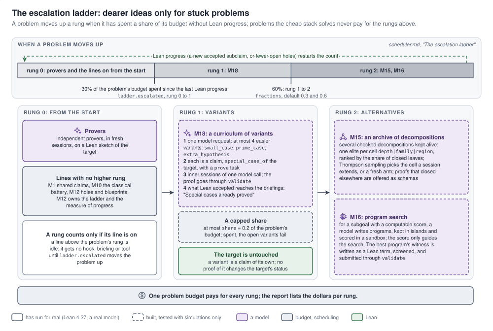
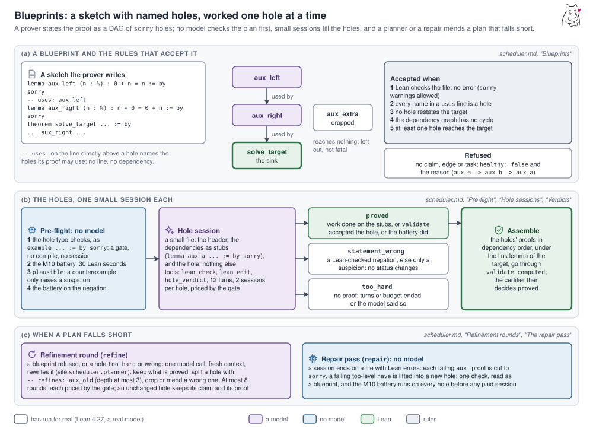
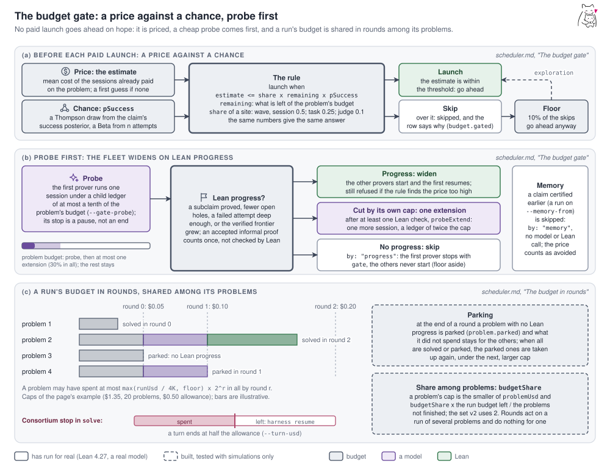

# Scheduler: the saturation kernel, subgoals and the escalation ladder



Line `M12` ([lines.md](lines.md)) is the plan's saturation kernel (§6, Task 10) and the part of the
harness that decides which piece of work comes next. It is `@seshat/scheduler` (`packages/scheduler`),
whose other half is the `TaskLedger` ([ledger.md](ledger.md)). A run enables it with
`harness run --lines M1,M12` (it requires no other line; it uses the graph's propagation and checked edges as a library, so M2 need not be on, and the fleet is optional). Nothing in it
is a model's decision: the rules are numbers and a seeded random source, and a claim changes status
only through `validate` and the certifier ([trust.md](trust.md)).

What it does, in the order it happens in a problem:

1. An outer prover's session ends with a **sketch**: a main proof and some lemmas `aux_<name>`
   whose proof is `sorry`. The line records the sketch (`afterAttempt`).
2. Between sessions the line **registers** the sketch: each named hole becomes a claim, the problem's
   claim gets a `decomposes_into` edge to the holes whose link lemma Lean checks, and each hole
   that is open gets a `prove` task with an inner budget.
3. The line **schedules**: the orchestrator asks it which `ready` task to work on, and it chooses
   with a given-clause loop and weighted proof numbers, and runs it with an inner prover.
4. A hole Lean accepts is a `computed` claim. When every hole of a checked decomposition is accepted,
   the graph's propagation derives the parent, the composed proof goes through `validate`, and the
   problem is settled by the certifier as for any other candidate.
5. The lemmas that were proved reach the outer prover's next briefing, with their names.
6. If the problem spends its budget without Lean progress it moves up the **escalation ladder**.

## The given-clause loop

`GivenClause` (`kernel.ts`) holds two sets, as a saturation prover does: the passive queue (work
waiting) and the active set (work given at least once). `select` moves one item from the first to
the second by an age/weight ratio (default 1 to 4, options `ageRatio`, `weightRatio`): on a cycle of
`age + weight` picks, the first `age` take the oldest item and the others the lightest. Picking only
the lightest starves the heavy ones; the age picks are the fairness guarantee (every item is given
within one cycle of its turn at the head of the age order). Ties go to the seeded random source.
The cycle position is a number the caller keeps, so a process that begins again continues the cycle
(the line counts the tasks it has started).

An item is a task on a claim. Its **weight** is `price / (1 + lemmaValue)`:

- the **price** (`pricing.ts`) is what the task is expected to cost in dollars: the mean cost of an
  inner session, times the sessions it is expected to need, which is one over the success rate
  drawn from the Beta posterior `Beta(1 + s, 1 + f)` of the problem's inner sessions (Thompson
  sampling, so a rate nobody has seen is tried), at most the task's `sessions` budget. A problem
  with no inner session yet uses a prior of $0.05 a session;
- the **lemma value** is Task 5's label of the claim in the assumption-based truth maintenance
  (`lemmaValue` of `@seshat/graph`): the more of the graph's open claims depend on it, the more it
  is worth, and the lighter its task.

All draws come from `seeded(hash32(seed:m12:problem:picks))`: the run's seed (`ProblemContext.seed`),
or the line's option `seed`. The same seed gives the same order of tasks; a resumed process draws
the same values because the pick count is read from the ledger.

## Weighted proof numbers

`ProofNumbers` (`proofnumbers.ts`) are Allis's proof numbers on the AND/OR graph of claims, weighted
by price instead of counting leaves. A claim can be reached by its own proof (a leaf) or by any of
its decompositions (OR); a decomposition needs all its parts (AND). `pn` is the least total price of
leaves that settles a claim, `dpn` the least that shows every known way to it fails. For options
`o1..ok`, `pn = min pn(o)` and `dpn = sum dpn(o)`; for a decomposition `pn = sum pn(part)` and
`dpn = min dpn(part)`. A settled claim has `pn = 0`; a refuted or dead one has `pn = Infinity`. A
claim shared by several parents counts in each parent's sum (an overestimate that is accepted) and a
cycle is cut where it closes. The scheduler asks `mostProving` for the leaf under the problem's claim that advances it most for its
price: at each claim it follows the cheapest option, and in a decomposition the unsettled part with
the least disproof number (the one that fails soonest). The task on that leaf is given **weight 0**,
so it wins every weight pick outright; the age picks still reach the other tasks, so none starves.
(The code does not compute how much `pn` falls if each task succeeds; `mostProving` stands for it.)
A node whose subtree cut a cycle is not memoized, so `of(x)` does not depend on the order of the queries.

## Simplify early, generate late

Each scheduling step follows the saturation provers' rule: it **simplifies before it generates**. It first
registers the sketches the sessions ended with, closes the new holes that a known fact covers (forward
subsumption), sweeps the open holes against the facts proved since (backward subsumption) and
propagates what that derives. Only then does it make tasks for the holes still open and choose among
them. A claim a known fact closes costs no inner session.

## Named holes become claims

`readSketch` (`holes.ts`) reads a submission. A **named hole** is a `lemma` or `theorem` named
`aux_...` whose whole proof is `sorry`. A sketch is split when it has at least one hole, its main
proof has no `sorry` of its own (an anonymous hole belongs to no subgoal), no hole's statement and
no other aux command names a hole (a lemma resting on a hole cannot be lifted out), and every hole
is in signature form. Otherwise the sketch's record says why it is not split and nothing is made.

A split sketch gives:

- one claim per hole (`ensureClaim`, so a hole equal to a claim the memory has is that claim,
  with its status), made by `line:M12`;
- a `decomposes_into` edge from the problem's claim to the holes. Its **link lemma** is
  `(T1) -> ... -> (Tn) -> (F)`, and Lean proves it from the sketch's own main proof
  (`intro h_aux_1 ...; refine fun <binders> => ?_; have aux_x := h_aux_1; <main proof>`). The edge
  is `lean_checked` only if that check passes (`checkEdge`), and only a `lean_checked` edge
  propagates. If the check fails the edge stays a candidate and the holes are still worked, but
  the parent is not derived from them.

## Blueprints (plan change CA9)



Task 37. The option `blueprints` (off by default; `--line-option M12.blueprints=true`) reads a sketch as a **blueprint**: a sketch whose holes may
depend on each other. Without it nothing in this section applies, a `-- uses:` line is a comment, and M12 reads a sketch as described above.

A hole declares what it may use with a comment line **directly above it** (no blank line between them):

```lean
lemma aux_left (n : ℕ) : 0 + n = n := by
  sorry

-- uses: aux_left
lemma aux_right (n : ℕ) : n + 0 = 0 + n := by
  sorry
```

No `uses` line means no dependency. The **target is the sink**: it uses the holes its main proof names. A blueprint is accepted when

1. Lean checks the file with no error (`sorry` warnings allowed), as for any sketch (the record's `healthy`);
2. every name in a `uses` line is a hole of the same blueprint;
3. no hole restates the target (the statement id of the hole is the target's: the refusal's class is `restates_target`, `SketchRecord.failureClass`);
4. the dependency graph has no cycle;
5. at least one hole reaches the target: a hole reaches it when the main proof names it, or a hole that reaches it uses it, directly or through other holes. A hole that does not reach it is **dropped** (below); when none does, the blueprint is refused (`aux_a does not reach the target: no main proof and no hole uses it`).

A hole's **statement** still may not name a hole, as before (a statement that depends on an unproved lemma's name cannot be lifted out of the file), and
no other aux command may rest on a hole. What the option changes is that the holes may use each other in their proofs, as declared. A blueprint that fails a rule is
refused as a sketch that cannot be split is: the `m12_sketch` node holds `healthy: false` and the reason in `problem` (`the dependency graph has a cycle:
aux_a -> aux_b -> aux_a`), and no claim, edge or task is made. A blueprint's record also holds `blueprint: true` and `uses`, the declared names of each hole.

**What the prover is told (plan change PA16).** In the third real run all five blueprints were refused and nothing ever told the prover the format (`-- uses:` was in no prompt), nor why a sketch was refused. With `blueprints` on, and only then (the prover's system prompt and `v1`'s check answers are what they were):

- **The briefing** of the outer prover gets a section "How to write a blueprint" (`BLUEPRINT_FORMAT` in `holes.ts`, from M12's `briefingSections` hook): holes are `aux_` lemmas proved by `sorry`; `-- uses: aux_a, aux_b` on the line directly above a hole whose proof will use others; a complete main proof naming the holes (a main proof that is `sorry` is not a blueprint); every hole used by the main proof or, through `uses`, by one that is; no `import` or `open` in AUX; `∑ i ∈ s, f i`.
- **The check answer.** After each check of a file with holes, M12's `afterCheck` hook adds a notice to the answer (the `notice` the hook already had, no new hook): `Read as a blueprint: aux_a, aux_b will be worked as separate sessions.`, or `Not a blueprint yet: <the problem>.` and the fix (a hole nothing reaches: add `-- uses: X` above the hole whose proof will use X; a main proof with a `sorry`: write the main proof from the holes; a cycle: remove one `uses` line of it; a file with Lean errors, one refused before Lean, or one edited outside its regions: fix that first; no named hole: the format again). The notice is made by `blueprintNotice` from the same `readSketch` call, with M12's options, that `afterAttempt` makes the record from, so the answer and the record cannot disagree. A file without holes, and a run without M12 or without `blueprints`, get the answer byte for byte as before.
- **A hole nothing reaches is dropped, not fatal.** When at least one hole reaches the target, the others are left out of the reading: no claim, no `decomposes_into` edge, no task, no session. The record keeps their names in `dropped`, and the check answer says `aux_x is used by nothing and is left out; add \`-- uses: aux_x\` above the hole that needs it to keep it`. The dropped lemma's `sorry` does not make the blueprint unhealthy: `healthy` is what Lean checked (no error, no edit outside the regions), and the dropped lemma is a lemma of the file that nothing uses. The link lemma does not need the lemma: `linkProof` introduces only the kept holes as hypotheses and its aux is the sketch's other commands, which cannot name a hole (checked for every hole, the dropped ones included), and the main proof does not name a dropped hole, nor does a kept hole's `uses` (it would reach the target). So the dropped lemma is in no file Lean checks after the sketch: not in a link lemma, not in a hole's small file, not in the assembly.
- **`import` in AUX.** The screen refuses an `import` in a region (`aux: 'import' is not allowed`, and `aux: only theorem, lemma, def and abbrev are allowed here, found 'import'`, before Lean runs; it was the reason of the 2025 B5 file, whose AUX began with `import Mathlib` and `open Finset BigOperators`). With `blueprints`, the aux lines `import M ...` whose modules the file's header already imports are dropped before the screen (M12's `rewriteCheck` hook, the orchestrator's one new line hook: the checked and recorded file is the one without them) and the answer says so in one line. An import the header does not have, and `open` (the screen refuses a bare `open`; `open X in` before a lemma passes), stay refused, and the notice says the file was refused before Lean ran.
- **The record** also holds the check's flags, `editsOutsideRegions` and `leanHoles`, so that an audit reads them from the journal.

**The link lemma and the dependency edges.** The target keeps its edge and its link lemma as before: `decomposes_into` from the problem's claim to all the holes, whose
link lemma `(T1) -> ... -> (Tn) -> (F)` Lean proves from the sketch's main proof. A hole that declares dependencies gets a `decomposes_into` edge of its own, from its claim
to the claims of the holes it uses, and its link lemma takes the dependencies as hypotheses: `(D1) -> ... -> (Dk) -> (H)`, proved by the hole's own proof with the dependencies
introduced as `h_aux_j` under their names (the same `intro ...; refine fun <binders> => ?_; have aux_a := h_aux_1; <proof>` as the target's). That lemma is checked when the
hole's work is done ([Hole sessions](#hole-sessions-plan-change-ca10)). The rule is the one of every edge: **only a `lean_checked` edge propagates**. So a hole is derived
from its dependencies only once its link lemma passed Lean and every dependency is `computed` (or better): the graph composes the hole's proof from the link lemma and the
dependencies' own proofs, in dependency order, and the composed proof goes through `validate` like any derivation (`realize`). A dependency that is refuted or
never accepted derives nothing, and the hole is not validated.

**Trust is unchanged.** Nothing here sets a status. The problem is settled only when the assembled file, the holes replaced by their accepted proofs in dependency order,
goes through `validate` (the composition of the target's link lemma and the holes' proofs) and the certifier.

## Hole sessions (plan change CA10)

With `blueprints` on, a hole's inner work is a real session with tools instead of one model call. It runs through the orchestrator's service
`ProblemContext.holeSession` (`hole-session.ts`: `runSession` on the hole's own workbench; the scheduler package does not import the orchestrator). The session
has `lean_check`, `lean_edit` and `hole_verdict`, a prompt that is its only context, and a **small file**: the claim's header, the hole's declared dependencies as
**stubs** (`lemma aux_a <statement> := by sorry`, in the aux region), and the hole. Nothing else is in the file or the prompt: no outer notes, no other holes, no sketch.
The prompt shows the header whole when it has at most `HOLE_HEADER_CHARS` (2500) characters; a longer one is cut after its first lines (the imports and opens come first) with a line saying that the rest is cut (`cutHeader`). It also repeats the failure reasons of the hole's earlier sessions, at most `HOLE_HISTORY_CHARS` (900) characters in all, the newest kept (`boundHistory`).
**The blueprint's context (task 51).** The AUX commands of a blueprint that are not holes (definitions, abbreviations, lemmas with complete proofs: `SketchReading.others`) are its **context**. A hole whose statement, or the statement of a hole it uses (all the way down), names a context command gets the context it needs: its claim's **header is the problem's header plus those commands**, so its statement id (M1), its small file, its pre-flight and its link lemma are all read with them, and its prompt shows them whole after the header (`contextFor` and `headerWithContext` in `holes.ts`). What is needed is **computed, not "all of them"**: the commands that declare a name the texts mention, and, in turn, those that the chosen ones mention, in file order, with the commands that declare no name (`open Nat`, `variable`, `set_option`) that come with them; a hole that names no context command has the problem's header and nothing more, so a blueprint without context commands is what it was. Before this, a hole's claim carried only the problem's header, and a hole such as `(aux_L m).factorization p = ...` over a `def aux_L` of the AUX did not type-check (the 2003 B3 replay: four paid sessions on a file that did not compile). Tested with the simulated Lean (`hole-context.test.ts`).
**What a hole session is given when the run has it (plan change DP4).** A hole session is an ordinary session on a small file, so `hole-session.ts` passes `runSession` what `prover.ts` passes an outer session. (1) The classical battery (`RunConfig.sorryBattery`, `sessionSorryBattery` in `sorry-battery.ts`, shared with the prover): after a check with no error and a `sorry` left, on the `sorry` of the hole's own proof only (the given lemmas' stubs keep theirs); its checks and its `sorry_battery` node carry no attempt id, like the session's other checks. (2) The push of verified `lean.search` hits (`RunConfig.leanSearch`) in the check answers. (3) M3's "Library" section and `library_search` tool, searched by the hole's name and statement (`ProblemLines.openHole`, which reads the hole as the session's target for M3 only): the section is drawn like a prover's (unverified advice, `session.draw`, the run's seeded source, one stream for each hole and session number); the draw is not journaled, since a hole session is no attempt. (4) `holePrompt` shows, after the lemma to prove, the **informal step** the blueprint says the lemma formalizes: the comment directly above the lemma in the blueprint's aux region (a `-- step k:` line, or any note the sketch's author left there; the `-- uses:` and `-- refines:` directives are not part of it; a blank line between the note and the lemma makes it a note on something else), at most 600 characters, quoted as data and said to be unchecked ("it may be wrong or incomplete; use it as a hint, and Lean decides"). Nothing is shown when no step is known. Without the options (no `sorryBattery`, no `leanSearch`, no M3, no note above the hole) a hole session's requests are what they were. Tested with the simulated Lean: `hole-session.test.ts` (the step, the library) and `lean-search.test.ts` (the battery and the hits in a hole session's check answer). Not run against a real model.

Its length is the option `holeTurns` (12 by default); a hole's task has `holeSessions` sessions (2 by default, since a session is a whole tool loop). Its responses are
`model_call.finished` events of `line:M12` at the site `scheduler.hole`, charged to the problem's ledger, so the report counts them.

**When the work is done (CA10).** `readWork` (`hole-work.ts`) is the line's rule on the last check: Lean reports no error, nothing changed outside the regions, a stub that is in the
file is exactly the dependency's statement with the proof `sorry`, and the rest of the file (helper lemmas, the hole's proof) has no `sorry` or `admit`, and no helper lemma names a dependency (the link lemma takes the dependencies as hypotheses, so such a helper could not be lifted: a dependency is used inside the hole's own proof, and the prompt and the check's answer say so); so every `sorry` Lean reports lies
in a dependency stub. It also reads Lean's own report: `report.sorries` must all fall in a dependency stub (located by their line in the checked file), and `report.axioms` may hold only the validator's standard axioms and `sorryAx` (which the stubs bring in). A check that satisfies it ends the session (`afterCheck`). Work done is **recorded, not a status**: the `m12_session` node holds `workDone`, the proof and its helper
lemmas as a blob (`work`) and their sha256 (`workHash`). A hole without dependencies has no stub: its check is the workbench's, and a proof Lean accepts makes the claim `computed` as before.

**When the claim becomes `computed`.** Only when its proof, with its dependencies' accepted proofs in place of the stubs, passes `validate`. The line checks the link lemma `(dependencies) -> (hole)` with the
hole's proof ([Blueprints](#blueprints-plan-change-ca9)); the graph then derives the hole by `realize` from the link lemma and the dependencies' proofs, and the composed proof goes through `validate`. So a hole whose dependencies
are not accepted yet **waits** (its task ends with the reason "the work is done on stubs..." (`HOLE_WAITING_REASON` of `@seshat/core`): the task API has no non-failure ending that fits, so the task is `failed`, and the account ("waiting" among the other tasks) and the breakpoints (an impasse counts it as blocked) read it as waiting, not failed; `ensureTasks` makes no new task for it). The briefing tells the next session of such a hole whose dependency has a Lean-checked negation that the dependency is false, and of one whose composed proof `validate` refused (a `derivation` node with verdict `invalid`) that it was refused, with the reasons; only the others "wait for the lemmas they use" and is validated, in dependency order, at the step after its dependency is accepted
(every step propagates). A hole whose dependency is refuted, or never accepted, is not validated.

**Waves, bounds and the gate.** All open holes whose pre-flight passed are eligible at once (their dependencies are stubs, so they do not wait for each other); the task order is the given-clause loop's, and `maxInnerTasks`,
`rounds` and `stepTasks` bound the work as before. A hole's task is proposed with the budget `{sessions: holeSessions, turns: holeTurns}`; the budget gate prices it as a task (`taskUsd(sessions, turns)`: sessions times the cost of a session, scaled by `turns / 12`,
12 being the length the mean or the first guess of $0.05 stands for) and may skip it, as it does any task ("the budget gate skipped it"). `TaskBudget.turns` is an optional field ([journal.md](journal.md)).

**Resuming.** Everything is read from the memory's nodes and the ledger. A session cut after its record was written resumes exactly (the verdict node is made again from the record: `repairVerdicts`); **a session cut while it was running is lost and is asked again and paid again** (the model's
responses of the cut session were charged and are not replayed). Resumption is tested with cuts at every record of a blueprint run except inside a session.

## Pre-flight (plan change CA11)

Before a hole's first paid session, once (an `m12_preflight` evidence node, so a resumed run does not repeat it), at no model cost, through the service `ProblemContext.holePreflight` (`hole-preflight.ts`):

1. the hole is **type-checked** under its header (the problem's and the blueprint's context it needs, above), as `example <statement> := by sorry`; this is a **gate** (task 51): a hole whose file does not type-check gets **no session**. The `m12_preflight` node says so (`compileError`, Lean's first error, and a note), the task ends ("its statement does not compile: ..."), no further task is made for the hole, and the blueprint's next planner round (case b: `holesFailed` counts it as failed) sees it as a hole with the error "its statement does not compile: <error>" in its line. If Lean does not answer (a timeout, a server error) the check is no gate and the pre-flight goes on;
2. the **battery** of line M10 (its core tactics, 30 Lean seconds, `validate` for a win) on the hole: a hole it proves is `computed` with no session, verdict `proved`. M10 itself runs only at `beforeProvers`, on the holes that exist then; the pre-flight is how a hole registered later is tried. A battery proof of a hole
   needs no dependency as hypothesis: the hole's statement stands alone (a statement may not name a hole), so its proof is a proof of the claim itself, which is stronger than a proof from the dependencies;
3. `plausible` through Task 36's `plausibleTest` (recorded as a `hygiene` node of the claim). A counterexample is a `suspect_false` node (source `plausible`) and stops nothing;
4. a short attempt of the battery on the hole's **negation** (no model call). A proof of the negation goes through `validate` with the negation flag; if it passes, the verdict is `statement_wrong` with a Lean-checked negation and the hole gets no session.

M11's small models are **not** asked: the line cannot reach M11's check through a service without a new dependency, and this is a marked extension point (`holePreflight` is where it would go). Not run against a real Lean: the
tactics' behaviour on real holes.

## Verdicts (plan change CA11)

Each hole session ends with one verdict, a memory node of kind `hole_verdict` (`HOLE_VERDICT_KIND` of `@seshat/core`, re-exported by `loop-telemetry.ts`) with `data.verdict`, `claimId`, `sessionId` (`<task>:<n>`, or `<task>:preflight`), `taskId`, `problemId`:

- `proved`: the work is done (above) on a hole with dependencies, or `validate` accepted the proof of a hole with none, or the battery proved the hole. A hole with no dependency whose file is done but which `validate` refused (a forbidden tactic, an axiom) is `too_hard`, with the validator's reasons in the session record;
- `statement_wrong`: the prover says so through `hole_verdict`. If it gives a Lean proof of the negation (`negation_proof`), the line sends it through `validate` with the negation flag; only when it passes is the node marked `negationValidated` and the claim's negation `computed` (a valid negation validation; the certifier alone makes it `refuted`);
  the hole then gets no more sessions. If it gives only an argument, a tool's counterexample, or a proof Lean refuses, the verdict is still recorded, with a **`suspect_false` evidence node** on the claim (`checked: false`), and **no status changes**;
- `too_hard`: the session ended (turns, budget, or the model stopping) with no proof, or the model said so. Its node and its session record carry `reason` (`HOLE_TOO_HARD_REASONS` of `@seshat/core`, plan change LP5): `turns` (the session reached its `holeTurns`, or its context limit), `budget` (the money ran out) or `model_said` (the model said `too_hard`, or ended the session itself with no proof); the report's Loop section counts the `too_hard` verdicts by reason, and `harness audit` writes `too_hard (turns)` in its verdict counts. A node written before the field has no reason. A session that ends without saying anything is `too_hard`. A `proved` that the model says without a last check that shows it is `too_hard`. A session that ends in an error (an exception, or the model or Lean could not be reached) is no verdict: its record has `stop: "error"` and no `hole_verdict` node is written; the session counts against the hole's limit.

The session record's `ok` means that `validate` accepted the proof in that session; a hole's work done on stubs is its own field, `workDone` (the price book counts either as a success).

A suspicion never stops work on the parent by itself and never propagates: the claim stays `open`, no edge changes, and the next outer session's briefing lists it under "Suspected false, UNVERIFIED". A hole with a Lean-checked negation is listed as a fact. Task 33's telemetry
(`loopTelemetry`) counts the `hole_verdict` nodes and reports the share whose verdict is `statement_wrong` **with a Lean-checked negation** (`negationValidated`) as "turned out false"; the verdicts that only a prover or a tool says are false are shown apart ("suspected false, unverified") and are not counted as false.

## Refinement rounds (plan change CA12, PA11)

Task 38. In the third real run M12 stated blueprints and never revised one: a refused blueprint, or one whose hole nothing proved, was the end of it. With `blueprints` **and** `refine` on (both off by default; `--line-option M12.refine=true`), M12 runs a **refinement round** for a problem: one model call that rewrites the blueprint from what happened to it. Without `refine`, nothing here applies and every record, prompt and task is what it was.

**When a round runs.** In M12's `schedule` step (between the outer sessions, and when the problem's provers are over), for a problem that is not solved, when

- **a.** the problem has no healthy blueprint, and at least one blueprint record that Lean checked (its last check exists: the record has `editsOutsideRegions`), or a planner's answer that was no blueprint. The round revises the last such record;
- **b.** the current healthy blueprint (the latest `m12_sketch` that is a registered, healthy blueprint) has every hole accepted or with a `hole_verdict` and no task that can still run, and at least one hole is not proved: its claim is refuted, or its last verdict is not `proved`. A hole worked out on its stubs that waits for the lemmas it uses is not a failure: it ends when they do.

A blueprint record is revised once (a record that a planner record names in `refinedFrom` is not revised again), and a round whose blueprint is not healthy leaves the problem in case a: the next round, in the same step, revises it, up to the cap. A problem has at most `maxRefinements` rounds (default 8), counted from the `m12_sketch` records with `planner: true` that are not the draft from the informal proof ([Long proofs](#long-proofs-the-have-sketch-and-its-lifter-plan-changes-lp2-dp1-to-dp3)).

**The call.** One model call in a **fresh context** (no conversation history), through the same one-call path as the other M12 calls (`problem.llm.completeJson`), at the site **`scheduler.planner`**: a `model_call.finished` of `line:M12`, charged to the problem's ledger. Its prompt is `plannerPrompt` in `refine.ts`, a constant with a version (`PLANNER_VERSION`, in its first line), and holds only: With `RunConfig.roles.planner` the call goes to the planner's own model, at its settings, and is charged at its price ([models-setup.md](models-setup.md#roles-a-model-and-settings-for-each-place-a-model-is-called-ca15-ca23)); without it, to the run's.

- the target theorem's statement;
- the current blueprint, AUX and PROOF as submitted;
- one line per hole: its name, the first characters of its statement id, its status (`computed`, `open`), the verdict of its last session, its depth, and the first line of the last error or argument of its sessions (`name [id]: open, verdict too_hard, depth 0, last: ...`);
- for case a, the reading's problem (why the blueprint is refused) and Lean's first errors, at most 5 of 300 characters each (the record keeps them as `errors`);
- when the person gave one (`harness solve --sketch`), their sketch, quoted and said to be unchecked ([human.md](human.md#a-persons-sketch-ca14));
- the blueprint format (`BLUEPRINT_FORMAT`, the text the outer prover is told), and the round's instructions: keep what is proved, split a hole that is too hard into smaller holes, repair or drop a hole that is wrong, rewire `-- uses:`, and say which hole a new one replaces.

It answers with JSON `{aux, proof}`, the two regions. An answer that is not JSON of that shape (after `completeJson`'s one retry) is a round that counts: its record is not healthy and its `problem` says so.

**`-- refines:` and depth.** A new hole that replaces an old one says so with `-- refines: aux_old` on the line above it, next to its `-- uses:` line if it has one (`NamedHole.refines`; several names are allowed). A hole's **depth** is 0 in a first blueprint; with `-- refines:` it is the depth of the deepest hole it refines plus one; without, it keeps the depth its statement had in the blueprint being revised (a hole kept as it is stays where it was). The reader, given the depths of the revised blueprint (`ReadOptions.depths`), refuses a blueprint with a hole deeper than 3: `aux_x refines too deep (depth 4, at most 3)`, with the same effects as any refusal (a record that is not healthy, and case a for the next round). The prompt says the depth of each hole. The record has `depth`, an optional array parallel to `names`, with `refine` on.

**What happens to the answer.** It is read by `readSketch` with the options of a blueprint (so `restates_target`, the dropping of unreachable holes (PA16) and the depth rule apply; an `import` the header has is dropped first), **checked by Lean** on the problem's own file through `ProblemContext.checkSketch` (the check a prover's `lean_check` makes, with no attempt: [lines.md](lines.md)), and recorded as an `m12_sketch` with `planner: true`, `refinedFrom` (the node id of the record it revises) and `round` (1, 2, ...). If healthy, it is registered like any blueprint, in the same step: its holes become claims by their statement ids (M1's `ensureClaim`), so **a hole whose statement did not change is the same claim** and keeps its status and its proof, whatever name the planner gives it, and a statement already `computed` or `proved` in memory (another blueprint of the problem, or, under the same Lean environment, a `proved` claim a `--memory-from` run carries) is that claim too and gets **no session**. (Records carry across `--memory-from` as well, with the problem's id: a blueprint an earlier run recorded is this problem's too, and counts for the rounds. The cross-run reuse has not been run in a test, only the reuse inside a run.) The new holes go through the pre-flight and the hole sessions as any hole. Nothing here sets a status: a hole becomes `computed` only through `validate`.

**The gate.** Each round is put to the budget gate as a task of one call (`problem.budget.ask`, site `task`): its estimate is a twelfth of what an inner session has cost on the problem (the gate's price of a task of one session bounded to one response; `PLANNER_CALL_SHARE`), the rule is the one of [the budget gate](#the-budget-gate), and the gate journals its answer (`budget.gated`). A round the gate skips is not made and is not counted; the gate is asked once for each blueprint it revises (a resumed process asks again). Without a gate the round is made.

**A planner that fails.** A round whose model call fails (the provider's error after the retries) is no round: it does not count, no record is written, but **refinement stops for that problem for the rest of the run**, and the memory holds why in a node `m12_refine_stop` (`problemId`, `round`, `reason`; the log says so too).

**Resuming.** M12 is `resume: "rebuild"`: the rounds made are counted from the `m12_sketch` records with `planner: true`, a record the planner wrote is registered like any other whose registration a cut left undone, and a round whose record exists is not made again. A round cut while its call was in flight is **lost and asked again**, as a hole session is (the call that was paid for before the cut is returned at no charge, `LlmRequest.reuse`; one that was cut before its `model_call.finished` is asked again).

**The planner's escalation (CA15).** With `RunConfig.roles.planner` and `roles.escalation` (`{ model, maxShare? }`, default share 0.25; `--role escalation=PROVIDER/ID`, `--role-setting escalation.maxShare=X`), a problem whose refinement rounds make no Lean progress asks a stronger model. Each planner call is the start of a round, and what happened since the call before is that round's result, measured as the ladder and the budget in rounds measure Lean progress (`progressOf`: a new proved subclaim, or fewer open holes in the best healthy blueprint). After two rounds in a row without it, the planner's next calls go to the escalation model, charged at its price, as long as what the escalated calls have cost this problem is below `maxShare` of the problem's allowance (the check is made before a call, so the last one may pass it); past it they go back to the planner's own model. A round with progress resets the count, and a model call that asks again within a round (a retry of a bad JSON answer) is not a new round. The call's site stays `scheduler.planner`; the `model_call.finished` carries `escalation: { from, rounds }` (the planner's own model, and the rounds without progress that led here) and the model it went to. The count is kept by the process, so a resumed run counts again from its first call; the share is read from the journal. A run without `roles.escalation` never escalates. Not run against a real model (`roles.test.ts`: two rounds without progress switch the model, the share switches it back, progress resets the count, and the same on a scripted problem).

**Not built, and not run.** Sub-blueprints for a single hole (a planner call whose target is a hole): a split happens inside the global blueprint. The `consult` tool (NL3) is the next part of the plan. Nothing has run against a real Lean or model: the planner's prompt, whether a model writes a `-- refines:` split that Lean accepts, and the price of a round (a twelfth of a session is a guess) are untested; the arm `solve-v2-blueprints-refine` of the experiment `solve-defaults` ([ablate.md](ablate.md)) measures it against `solve-v2-blueprints`. `refine.test.ts` runs it with the simulated Lean and the faux model: a refused blueprint revised into a healthy one (case a), a hole that ended too hard split with `-- refines:` while the hole that did not change keeps its claim and gets no session (case b), a statement already computed reused under another name, depth 4 refused, `maxRefinements`, the gate skipping a round, a planner that fails, an answer that is no blueprint, and a resumption cut after a round's record and one cut while the call was in flight.

## The repair pass (CA13)

Task 38. With `blueprints` **and** `repair` (both off by default; `--line-option M12.repair=true`; on in the arm `solve-v2-blueprints-refine`), an outer prover session that ends on a file whose last check has **Lean errors** (not a refusal before Lean, not a timeout or an unreachable Lean) gets a repair, with **no model call** (APOLLO's sorrifier and auto-solver):

1. `cutFailures` (`repair.ts`) cuts each failing block to `sorry`, placing the cuts by the check report's positions in the AUX and PROOF regions of the checked file (the regions `locate` in `feedback.ts` reads);
2. the cut file is checked once through `ProblemContext.checkSketch`, the check a planner's blueprint gets;
3. read like any blueprint (`readSketch` with M12's options), it is recorded as an `m12_sketch` with `repairOf` (the attempt it repairs), healthy or not, and registered between sessions like any other: its holes get the pre-flight of [CA11](#pre-flight-plan-change-ca11), whose battery (M10) runs on every hole before any paid session. That is the point. A cut file that `readSketch` refuses (no hole, a hole that names a hole) is a line in the log and no record, and no Lean call.

At most one repair per attempt and `maxRepairs` (default 2) per problem, counted from the records with `repairOf`. A repair record is never the base of a refinement round (case a revises the prover's or the planner's records only). Nothing here sets a status: a hole becomes `computed` only through `validate`, by the battery or a session.

**The shapes handled.** The cut is all or nothing: one error that cannot be cut gives no repair.

- An **`aux_` lemma or theorem** whose proof holds an error: its whole proof becomes `:= by sorry`, its statement unchanged (a term proof too). It is a hole afterwards.
- A **top-level `have name : T := ...` of the main proof**, with a block (`:= by ...`) or a term, over one or several lines, whose block holds an error: it is **lifted** into a new hole `aux_name` with the theorem's binders and `T` (`lemma aux_name <binders> : T := by sorry`, added at the end of AUX), and the `have` becomes `have name : T := aux_name <explicit binders>`. Only when `T` mentions nothing the main proof bound before the `have` (any word of `T` that is not a binder of the theorem and that occurs earlier in the proof, `intro k` then `have h : k = k`, refuses the repair: it is conservative, a global name used earlier refuses it too). A `have` is top-level when it stands at the main proof's own indentation.

**Not handled: no repair.** An error in a statement (of a lemma or of a `have`); in the fixed part of the file; in a declaration of AUX that is not an `aux_` lemma or theorem; in the main proof outside a top-level `have` (the final `exact`, a `have` inside `induction`, `cases` or a bullet); a `have` with no name or no type (`have : T`, `have h := t`, `have h (x : A) : T`).

**Not run.** Whether Lean's positions for a real error fall where `cutFailures` expects (an "unsolved goals" error at the `by`, an error in a term at the term) is untested: only the simulated Lean has run (`repair.test.ts`: two failing AUX lemmas become a blueprint of two holes and the battery proves one, a failing `have` with only the theorem's binders becomes a hole, an error in a statement gives no repair, `maxRepairs`, without `repair` nothing changes, and `cutFailures` on its shapes and refusals).

## Long proofs: the `have` sketch and its lifter (plan changes LP2, DP1 to DP3)

A long proof is a chain of short ones. The part that exists today is the **lifter**, `liftHaves` in `lift.ts` (plan change DP1): given a proof whose steps are `have h_k : T_k := by sorry`, it makes each step a hole, with Lean doing the extraction, the way DeepSeek-Prover-V2 cuts a proof into subgoals (each `sorry` a standalone lemma whose hypotheses are the local context, earlier steps included). No dependency is declared, so there is no `-- uses:` line, and no text is read for a context.

1. **The battery.** With the report of the file Lean checked, the classical battery of line M10 (`closeSorries`, given to the lifter as a function) tries each `sorry` and closes in place the steps a tactic closes. Without the battery or the report this step is skipped.
2. **The extraction.** One Lean check of the proof with every remaining `have h : T := by sorry` as `by extract_goal; sorry`. Mathlib's `extract_goal` prints, at each, the theorem it extracted: the binders of the target, the earlier steps, whatever the step is under (an `intro`'d variable, a `cases` branch) as hypotheses. The printed statements are read in file order, each renamed `lemma aux_<step> ... := by sorry` (a name already used gets a suffix) and added to the AUX region with the step's `-- step k: <the informal step>` comment on the line directly above it (a hole session quotes that comment as the step the hole formalizes).
3. **The rewrite.** Each step becomes `have h : T := by apply aux_h <;> assumption`, and the file is checked. If it has an error, and every lemma's explicit binders have names, the steps become `have h : T := aux_h <explicit binders>` and it is checked again; the file with fewer errors is the result.

The result is an ordinary sketch in signature form that `readSketch` reads as a blueprint with no dependencies, registered with its link lemma checked by Lean like any other. A statement Lean printed that does not compile is an error in the returned file's report, so the file is not healthy and goes to refinement (case a) with the error. A probe Lean refuses, one that prints a different number of statements than there are steps, or a printed text that is no statement gives `{ reason }` and no lift. Nothing here sets a status: `extract_goal` only writes a statement, and a hole is `open` until `validate` accepts its proof.

**The draft from the informal proof (LP2).** With `RunConfig.longProof` (needs `triage`; `draft`, default true), line M12 with `blueprints`, and an informal proof the verifier accepted (`informalFirst`), M12's option `fromInformal` (set by `longProof`; a value the person gave for it stays) makes the **first blueprint** before the first outer session:

1. one planner call in a fresh context (site `scheduler.planner`, the planner's role, asked of the budget gate like a refinement round) answers one PROOF region: the target's proof as `have h_k : T_k := by sorry` steps, each preceded by `-- step k: <the informal step>`, ending in a complete closing tactic (`draftPrompt`, `DRAFT_VERSION`, in `refine.ts`; the informal proof is shown quoted and said to be unchecked, Ruling 13). The answer is JSON `{proof}`;
2. the sketch is checked **once** through `ProblemContext.checkSketch`; a draft with a Lean error stops there and is recorded as it was written, not healthy;
3. otherwise `liftHaves` runs with the battery (`ProblemContext.closeSorries`, which the orchestrator gives M12 when the run has `sorryBattery` or `longProof`) and the lifted sketch is checked;
4. it is read as a blueprint (`readSketch` with M12's options) and journaled as an `m12_sketch` with `planner: true`, `fromInformal: true` and `lifted: true`. It is **not a refinement round**: it has no `round`, and the rounds counted against `maxRefinements` leave it out (`isRefinement`). If healthy it is registered between sessions like any blueprint, its link lemma checked by Lean; if not (a Lean error, a refused lift, an extracted statement that does not compile, a hole that restates the target), it is the last blueprint Lean checked and the first refinement round revises it (case a), told Lean's errors.

**Several drafts (DP3).** `longProof.drafts` (M12's option `drafts`, default 1; the arm planned for the long-proof experiment, LP6, sets 3) asks for that many planner calls, each asked of the budget gate as a refinement round is, and its prompt says which draft it is (`draft k of N, written independently of the others`: two calls with one prompt are one call, `LlmRequest.reuse`). Each draft goes through steps 2 to 4 above, which cost no model call, and the one **left with the fewest holes after the lift** is the draft; a healthy draft is preferred to one that is not, ties go to the fewer steps (`haveSteps` of the written proof), then to the earlier draft. The others are recorded as Lean said (`healthy` is what the check found) with `discarded: true`, written first so that the kept draft is the last `m12_sketch`, and **never registered**: no claim, edge, task or session, and nothing that reads the sketches sees them: M12's own reader leaves out a record with `discarded` (so the refinement rounds never revise it), and the briefing, the ladder's measure and the diversity archive read registered records only. The audit's last sketch is the kept draft, which is written last; the planner calls of the others are counted as planner calls. A gate that skips a call, a call that fails and a problem that ends stop at the drafts made, which are ranked; an answer that is no proof is a draft that does not count. `drafts: 1` is the draft above.

It is made once: a problem that has a sketch record is left alone, so a resumed run reads the record (a planner call cut before its record is returned at no charge). A gate that skips the call, a call that fails and an answer that is no proof make no record, and the prover writes the first blueprint as it always did. A hole stays `open` until Lean proves it.

**Not run.** Whether `extract_goal` exists under that name in the pinned Mathlib, whether its output re-elaborates on real goals (instances, coercions, `⋯`, inaccessible names), and whether `apply aux_h <;> assumption` closes the rewritten step have not been run against a real Lean. The simulated Lean (`extractGoalMessages` in `packages/core/test/fake-lean.ts`) prints the statement the tactic would for the shapes the tests use: the theorem's binders, earlier steps, `intro`'d names and case binders, all of type `ℕ`. `lift.test.ts` runs it.

## Options of M12

| Option | Default | Meaning |
|---|---|---|
| `subgoals` | true | named holes as claims and tasks |
| `innerSessions` | 8 | one-call sessions of a hole's task (without blueprints) |
| `maxInnerTasks`, `rounds`, `stepTasks` | 8, 2, 2 | the bounds above |
| `ageRatio`, `weightRatio` | 1, 4 | the given-clause ratio |
| `subsumption`, `subsumeFacts` | true, 40 | closing claims by known facts |
| `ladder`, `fractions` | true, [0.3, 0.6] | the escalation ladder |
| `blueprints` | false | blueprints, hole sessions, pre-flight, verdicts (CA9 to CA11) |
| `holeTurns` | 12 | model responses in a hole session (blueprints only) |
| `holeSessions` | 2 | sessions of a hole's task (blueprints only) |
| `holeContinuation` | false | a hole whose last session was cut by its turns gets one session more than `holeSessions`, under the same caps, before a refinement round splits it (blueprints only; the orchestrator turns it on under `RunConfig.longProof`) |
| `refine` | false | refinement rounds: a planner call rewrites a blueprint Lean refused, or whose holes had their sessions with one not proved (blueprints only; CA12, PA11) |
| `maxRefinements` | 8 | the most refinement rounds for a problem (refine only) |
| `repair` | false | the repair pass: a session that ends on Lean errors has its failing blocks cut to `sorry`, checked once, and recorded as a blueprint (blueprints only; CA13) |
| `maxRepairs` | 2 | the most repairs for a problem (repair only) |
| `drafts` | 1 | the drafts asked for, of which the one with the fewest holes after the lift is registered (`fromInformal` only; DP3; `longProof.drafts` sets it) |
| `fromInformal` | false | the first blueprint is a `have` sketch drafted from the accepted informal proof and lifted by Lean (blueprints only; LP2, DP1; `longProof` sets it) |
| `seed` | null | the scheduler's draws |

What M12 records: `m12_sketch` (a sketch; `editsOutsideRegions` and `leanHoles`, the check's flags; with blueprints also `blueprint`, `uses`, `failureClass`, `dropped`; with `refine` also `depth`, `errors`, and for a planner's blueprint `planner`, `refinedFrom`, `round`; for a repair `repairOf`; for the draft from the informal proof `planner`, `fromInformal` and `lifted`; for a draft that was not kept `discarded`), `m12_session` (a session; with blueprints also `stop`, `turns`, `verdict`, `workDone`, `work`, `workHash`, `negationValidated`, `argument`),
`m12_subsumption`, `m12_preflight`, `m12_refine_stop` (a planner call that failed), `hole_verdict`, `suspect_false`. All are facts, none a status, none learned.

## Inner provers and tasks (PC4 item 1)

Each unproved hole gets a `prove` task, proposed by `line:M12` through the task API: acceptance
"the hole's claim is at least `computed`", budget `{sessions: innerSessions}` (default 8), and
`parentTaskId` set to the previous task on the same hole when it is a retry. The options
`maxInnerTasks` (default 8: tasks for the holes of one sketch, that is per outer session, as PC4 item 1 asks; a later sketch's holes get their own), `rounds` (a hole's tasks in all, default 2) and
`stepTasks` (tasks worked between two outer sessions, default 2) bound the work. Tasks are
`ready` when proposed; the orchestrator moves them `running` when the line starts one and `done` or
`failed` when it ends, with the reason the line gives.

The **inner prover** is the line's own: each session is one model call (site `scheduler.inner`, so
the report counts its spend) that returns a proof of the hole, which goes through `validate` like any
prover's. Its prompt has the target, the hole, the header and the reasons of the last three failures. The hole's claim changes status only if Lean accepts the proof. Each session
is recorded as an `m12_session` node (ok, cost, reasons), from which the posterior is computed.

Where an outer prover is told, the briefing (`briefing` hook) has a section "Lemmas of your sketch":
the proved holes with their names and proofs, and the ones not proved (`Not proved: aux_right`). That
is how a proved lemma reaches the outer prover's next session, so that it can use it by name.

## Subsumption

A claim can be closed by a more general one that is already known. `forwardSubsume` takes a new
claim and asks `lean.meta` ([lean-meta.md](lean-meta.md)) for the known facts it is an instance of;
`backwardSubsume` takes a new fact and finds the open claims it covers. Both compare only claims under
the same header, at most `subsumeFacts` (default 40) at a time. A candidate pair is never trusted:

- `lean.meta` only proposes. The special case gets an `instance_of` edge to the general fact, and the
  edge is checked by Lean: its link lemma is the general statement applied to the case, closed by one
  of a short list of tactics (`INSTANCE_CLOSERS`: `exact h`, `apply h`, `simpa using h`, `aesop`...).
- The case closes through propagation only if that edge becomes `lean_checked`. A pair `lean.meta`
  proposes and Lean refuses is recorded as unchecked and changes nothing.
- A link lemma is not a fact (`isLinkLemma`): it is not compared with other claims.
- If `lean.meta` is down, the line counts the failures and stops asking after two.

Each pair tried is an `m12_subsumption` node (instance, general, edge, checked).

## The escalation ladder (PE4 of the memory-evolution plan change)

The ladder is a rule of the run, kept in the orchestrator and the journal; the scheduler supplies
the measure of progress. Rung 0 is the provers and the lines that work from the start. A line says
it belongs to a higher rung with `Line.rung` (1, 2, ...). A rung counts **only if its line is on**. Rung numbers are compressed: the rungs of a run are the sorted distinct `Line.rung` values of the enabled lines, as indexes 1, 2, ... (a line alone on `rung: 3` is rung 1), and `from` and `to` of `ladder.escalated` are these indexes, not `Line.rung`. A line on a rung above the problem's is idle: the
orchestrator gives it no `beforeProvers`, briefing, session or tool until the problem reaches the
rung, when it starts the line with `beforeProvers` (or `resumeProblem`). A cut between the event and the line's start leaves the line active and not started, so a resumed run calls the `beforeProvers` of every active rung line again, even though the provers had begun: it must be safe to call twice (a line that keeps state records it once).

A problem moves up when the dollars spent **since its last Lean progress** reach a fraction of the
problem's budget: the option `fractions` (default `[0.3, 0.6]`, one for each move).
**Lean progress** is a new subclaim of the problem's claim that Lean accepted (`computed` or
`proved`), or fewer open holes in the best healthy sketch (the one with the fewest). The orchestrator
reads it with `progressOf` after each session, writes a `ladder_progress` node when it changes (the
mark of the spend at that moment), and when the spend since the mark reaches the fraction, appends
`ladder.escalated` (problem, from, to, lines, threshold, spend since progress, budget, reason). The
journal checks the event: the spend since the last progress must reach the threshold, and the rung
moves up. The marks are nodes, so a resumed run reads them back and decides the same.
The option `ladder: false` turns the rule off: every enabled line then starts at once, as without M12.

The report ([m0-loop.md](m0-loop.md)) adds a table **Problem / Solving rung / Dollars per rung**:
for each problem, the rung at which it was solved (only for a certified `proved` or `refuted`; none otherwise, a candidate included) and what each rung cost,
read from the journal alone. A session's cost is counted at the rung in force when it ended, and a
one-shot call at the rung of its own event; the dollars per rung add up to the problem's cost.

Line `M18` ([curriculum.md](curriculum.md)) is the line of rung 1 and `M15` ([archive.md](archive.md)) a line of rung 2; `M16` (rung 2 in the plan, [induction.md](induction.md#program-search-line-m16)) is built (its `Line.rung` is set in the package). The ladder is tested
with a stand-in line of rung 1, with M18 and with M15. Dollars that a rung's line spends count in the problem's spend since its last Lean
progress, so M18's variants hasten the move to the next rung; a proved variant is not Lean progress (it is no subclaim of the target).

## The budget gate



Task 29 (PB1 to PB5 of `plans/plan-change-proportional-budgets.md`, Ruling 31). Before this, a problem spent its whole budget whatever its chance of success was: every prover started at once and every session ran until the budget stopped it. The gate puts a price against a chance before each paid launch. It is **off by default** (`harness run --gate`, `RunConfig.gate`); without it nothing here applies and the run is as it was. The rule and the probe live in `@seshat/scheduler` (`gate.ts`), the orchestrator applies them (`budget-gate.ts`), and the answer is journaled as `budget.gated` ([journal.md](journal.md)).

**A probe the repeat rule stopped.** A probe whose one session was ended by M6's repeat rule ([guards.md](guards.md#the-repeat-rule); the session result carries `lineCause: "repeated_failure"`) runs one more session, the one that is told to change approach, under the same probe ledger, so the probe's cap in dollars is unchanged; only then does the gate judge it. At most one such session per probe: a second stop by the repeat rule, or a stop by any other cause, leaves the probe as it was.

**A probe its cap cut.** The pilots of the set `v2` showed probes cut by their cap (a tenth of the allowance) after 12 to 26 Lean checks, while the model was still working; the gate then read "no Lean progress" and ended the problem with 90% of its allowance unspent. A session the cap cut says nothing about the problem: it is no failure. With the gate setting `probeExtend` (a boolean, default false: `harness run --gate` and the set `v1` are as they were; the set `v2` turns it on), a probe whose session was ended by the probe's own cap (the attempt ended for want of budget, and what the task spent reached the cap; not because the model stopped, the turns ran out, a guard or the repeat rule ended it, or an error), that made at least one Lean check, and that the gate would otherwise skip for want of progress, runs **one extension** before the gate judges: one more session of the first prover, taken up from where it stopped, under a new probe ledger of twice the probe's cap, so a probe spends at most three times its cap in all (30% of the allowance at the default). At most one extension per problem. It is journaled as a second `probe` row of the wave (`budget.gated`, `by: "probe"`) whose reason says so ("the probe was cut by its cap after N Lean checks: one extension of $X"); no new field, and a resumed run reads that row, so it never grants the extension twice. The report counts it apart from the probes. A second cut ends at the gate as before. The repeat rule's extra session above is independent and unchanged.

**Why a probe overshoots its cap (task 51; the replay saw up to 48%).** A response is charged after it arrives, and the session looks at its ledger only when a turn ends (`finishTurn`: `ledger.exhausted`, which is `usd >= limit`). The call that crosses the cap is therefore paid in full, and the calls of a late turn are the dearest of the session, since the context has grown: a probe of $0.05 whose last call costs $0.024 ends at $0.074. The overshoot is bounded by one call (the retry path already refuses a resend that would pass the cap, `wouldExhaust`). Stopping before a call whose last price would pass the cap is possible but was left out: the probe's extension reads "what the task spent reached the cap" to know a session was cut by its cap, and a session stopped just under it would no longer be read as cut, so the extension would not run. Changing both together is a decision for a later task; the overshoot is documented, and it is the price of a probe that is cut while it is still working.

**The rule (PB1).** A launch has an estimate (dollars, from the mean cost of the sessions already paid on the problem, or a first guess when there are none) and the claim's chance of success, a Thompson draw from its success posterior ([fleet.md](fleet.md#posteriors)). The launch goes ahead when

```
estimate <= share(site) x remaining x pSuccess
```

where `remaining` is what is left of the problem's budget and `share` is the part of it one launch of that site may cost: `wave` and `session` 0.5, `task` 0.25, `judge` 0.1 (`--gate-share SITE=X`). The rule is a function of its numbers, so the same numbers give the same answer. The draws (the Thompson draw, the flat prior's, the floor's) are seeded by the run's seed and a key of the **request**: the problem, the site, and the prover and session, or the task, or the round of the wave. They do not depend on the row the answer lands on, so provers that ask at the same moment, in whatever order, draw what they would have drawn alone, and a resumed run asks the same question and gets the same answer. The posterior a draw is made from does depend on which attempts have finished; it is recorded in the row's reason. `budget.gated` carries the numbers (the estimate, what is left, the budget, the share, the chance, the threshold, the rung) and the reason in words, with the posterior ("Beta(a, b) from n attempts"); the journal recomputes the threshold and refuses an answer that does not follow from it.

**The floor (PB2).** A fixed fraction of the launches the rule would skip go ahead anyway (`--gate-floor`, default 0.1; a draw under the fraction). Without it a posterior that is wrong would never be corrected, since a skipped launch produces no evidence. A launch the floor let through says so (`by: "floor"`, `exploration: true`) and the report counts them and their estimated price. The row carries the draw and the fraction (`floorDraw`, `floorFraction`), and the journal refuses a floor row whose draw is not under its fraction, or whose estimate is not over the threshold (the floor lets through only what the rule skipped; a widening for want of Lean progress has no threshold to check). A floor of 0 turns it off.

**Where `decide` is asked (PB3).** The rule has no numbers at a cold start (no attempt counted on the claim) and is near its threshold at a tie (the estimate within the margin, `--gate-margin`, default 0.1, of it). Only there is the question put to `decide` at `budget.wave` (a wave of provers, or a session of one) or `budget.line` (a line's task, or a judge call), as a choice between `launch` and `skip` ([decide.md](decide.md)). The state of the question holds counts and dollars and no mathematics. A decision that is off, fails, or is not made leaves the rule's own answer, which at a cold start is the rule on the flat prior's draw. The answer is booked in the journal with `by: "decide"` and its decision id, and the journal checks that the decision is in it, is about this problem, was asked at `budget.wave` (a wave or a session) or `budget.line` (a task or a judge call), and answered what the row does. The model calls cost money, are booked to the pseudo-line `gate`, and the report adds them up.

**Probe first (PB4).** A problem does not start with its whole fleet. The first prover runs one session under a child ledger of at most a tenth of the problem's budget (`--gate-probe`, default 0.1); its stop is `probe`, a pause, not an end. The gate then answers once for the wave: it **widens** (the other provers start and the first one resumes) when the probe made Lean progress (the measure of the ladder above: a subclaim proved, or fewer open holes, or an attempt that failed deep enough to count as progress), or when the floor lets it through, and otherwise **skips** (`by: "progress"`: the first prover ends with the stop `gate` and the other provers never start). A widening after progress is still under the rule: it can be refused for its price. Sessions after the first `minSessions` (default 2, `--gate-min-sessions`) of a prover that goes on are gated at the site `session`: one low draw cannot end a widened prover after its first session, and the tasks of a line and its judge calls at `task` and `judge`: a task the gate skips is cancelled with the reason "the budget gate skipped it".

**The probe reads the frontier (LH3).** With `RunConfig.frontier.show`, a probe that grew the verified frontier ([frontier.md](frontier.md)) with a new subclaim, case, reduction or accepted `aux_` lemma, outside a blueprint too, made Lean progress, and the row's reason says "the frontier grew: KIND: STATEMENT"; `evidence`, dead-end and `best` entries do not count, and the growth is measured from the moment the probe began. Without the setting the measure is what it was (`orchestrator/test/budget-gate.test.ts`).

**An informal proof counts once as progress (task 51; PA5's second half).** When the problem has an accepted `informal_proof` node (the informal loop's result, [informal.md](informal.md)) and the probe made no Lean progress, the widening reads the proof as progress, **once**: the formula decides as it does after Lean progress, and the row's reason says "an informal proof was accepted (not checked by Lean)". A second probe, a later turn or a later judgement does not count it again: the gate reads its own earlier rows for that sentence. Without an accepted proof nothing changes. The replay (Task 50) had four problems stopped after the probe, each with an accepted informal proof journaled before the probe ended.

**A formal-cost triage (plan change PA14).** With `RunConfig.triage` (off by default), after the informal loop and before the first outer session, a pure function (`triageProblem`, `triage.ts`; no model call, no Lean) classes the problem from what the journal holds: the accepted informal proof (characters, numbered steps, and the names `lean.search` found for its facts, as a share of the facts), the `plausible` result, the first-cases table when one was computed, the statement's length and the allowance. The class and its reasons are a `formal_triage` node of the claim. The thresholds are named constants (`MAX_PROOF_CHARS` 6000, `MAX_STEPS` 12, `SHORT_PROOF_CHARS` 4000, `MIN_FACT_SHARE` 0.5, `LONG_STATEMENT_CHARS` 1500, `SMALL_BUDGET_USD` 1, `SHORT_PROBES` 3; the `long` class is described below): no accepted proof, a proof over the limits or more than half its facts unfound is `skip` when the allowance is small and `short` otherwise; a proof of at most 4000 characters with every fact found, a short statement and no sign that it is false is `invest`; the rest is `short`. The gate reads the node, only where the probe made no Lean progress, since a probe's Lean progress is stronger evidence than a prior: `skip` ends the problem at its probe (no informal credit, no floor); `short` widens as the rule says but the provers' work after the probe is held under a ledger so that the problem spends at most `SHORT_PROBES` (3) probe caps in all; `invest` changes nothing. Without the gate the node is only journaled. `harness audit` shows the triage in each dossier, computed from the journal alone when the run made none ([audit.md](audit.md)). The arm `solve-v2-informal-triage` ([ablate.md](ablate.md)) measures it. Nothing has run on a real model: the thresholds are guesses to be tuned on the replay of the 1967 A5 and 2025 B5 journals.

**A long proof (plan change LP4).** With `RunConfig.longProof` (`{ triageUsd?, dryChecks? }`, off by default; it needs `triage`), the triage has a fourth class, `long`: an accepted informal proof over the short limits (more than `MAX_PROOF_CHARS` characters or `MAX_STEPS` numbered steps), with at least half its facts found by `lean.search` and nothing else against it, on an allowance of at least `triageUsd` (a `RunConfig` default, `DEFAULT_LONG_TRIAGE_USD`, $1, since no host setting carries it yet), is `long` where it would have been `skip` or `short`; below `triageUsd`, or without the option, the class is what it was. The gate then follows the frontier for such a problem, in the two places it already looks at progress. At the probe, the frontier's growth (a proved subclaim or `aux_` lemma, a case, a reduction: `evidence` and dead ends do not count, whatever `frontier.weights` says, unless it sets them) counts as Lean progress even without `frontier.show`, beside the ladder's measure, which already counts a healthy blueprint and its closed holes. After the widening, a session of a `long` problem is not weighed by the formula (which, with a low success chance, would stop a problem that is closing its holes): it is launched while the frontier has grown within the last `dryChecks` finished sessions, and the gate stops the problem when `dryChecks` (default 3) finished sessions in a row closed nothing, by `progress` with `progress: false` and the count in the reason, like any other stop. A session counts as closing something when `frontierGrowth` (LH3) has a point between the end of the session before it and its own end; the count is read from the journal, so a resumed run gives the same answer. The allowance still bounds the problem. Not run on a real model: `dryChecks` and `triageUsd` are guesses, and a hole that takes more than three sessions to close is stopped.

**A hole cut by its turns (plan change LP5).** Under `RunConfig.longProof` the orchestrator sets the M12 option `holeContinuation`: when the last session of a hole ended `too_hard` with the reason `turns`, the task runs one more session than `holeSessions` (the same `holeTurns`, the same gate and ledger rules; one continuation, not one for each cut), and only then does the hole count as failed for a refinement round. A hole the model called `too_hard`, or that the budget cut, gets no continuation. Without `longProof` nothing changes. Simulated in `refine.test.ts`; the depth of `-- refines:` stays at 3 (it waits for LP6).

**A problem the gate stopped.** Without a team the stop ends the problem: it is `unsolved`, its first prover has the stop `gate`, the others are cancelled, and a resume of an interrupted run keeps it stopped. In a run with turns (`--human` or a turn limit, [human.md](human.md)) the stop does not end the problem: the turn ends at an impasse (`breakpoint.kind` `impasse`, the problem named), the probe's prover stays paused and the others ready, and the problem waits for the team. The next turn, after a hint, a steer or a new budget, asks the gate again, with the draws of a new round (the floor has another chance), and the probe is not run again. A stop is final only within the turn, the ladder rung and the budget it was given at (`turn` is a field of `budget.gated`); if nobody changes anything the gate may stop the problem again, and the team may drop it (`harness steer --drop`).

**The price of a task.** A line's task is priced at its sessions times what a session costs (`taskUsd`): the chance of success is in the rule's threshold and is not counted in the price too. A line that gives its own `pSuccess` to `budget.ask` must give a number from 0 to 1; anything else is refused before it is journaled.

**A claim certified earlier (PB5).** With the gate on, a problem whose chain already holds the claim proved or refuted (a run on `--memory-from`, under the same Lean environment, where the memory carries the status over) is not launched again: the problem ends `skipped`, the journal holds a `budget.gated` row `by: "memory"` and no model or Lean call is made. The estimate of that row is the price of one session, and the report counts it as avoided spend. Without the gate the loop launches the problem again, as it always did. The soft failure memory ([fleet.md](fleet.md#soft-failure-memory)) has no state in which a claim is exhausted for good: what it records of past failures lowers the chance, and the gate prices that.

**In the report and the table.** The report adds a paragraph and a table of the gate by site (launched, skipped, let through by the floor, decided by `decide`, avoided dollars) read from the journal alone, with no model call (PB8). The avoided dollars are **an estimate** at the moment of the skip, not money that was spent or measured, and they are marked as such wherever they appear. What the gate is worth is measured by `harness ablate --experiment gate` ([ablate.md](ablate.md#experiments)): four arms, no gate, the rule, the rule with `decide` asked of the model, the rule with `decide` asked of Jev, on the same problems and budget, compared by cost to first success.

**Resuming.** The settings are written into `run.started` and a resumed run reads them back; the answers already journaled are not asked again.

**Not run.** The gate is tested with a simulated Lean and the faux provider: the rule and its arithmetic, determinism, the floor's rate over many draws, the probe cap, widening and skipping, `--memory-from`, the report, resume. Whether it pays on real problems, whether its defaults (shares, floor, probe fraction, margin, `minSessions`) are right, and whether Jev answers its two sites better than the model, have not run.

## The budget in rounds

Task 35 (plan change CA8). In the first real runs the first problem took 92% of a run's budget. With `RunConfig.budgetRounds` and a run budget `runUsd` for K problems, the problems are worked round-robin, a slice at a time. It is **off in `harness run`** (and with one problem, or without `runUsd`, it changes nothing) and **on in `harness solve`'s defaults set `v2`**. The rotation is `rounds.ts` of the orchestrator; it only decides which problem gets the next slice and how large it is, and nothing inside a slice differs from a problem worked alone (the gate, the probe, the ladder and the lines act as before).

- **The cap.** In round r (from 0) a problem may have spent at most `max(runUsd / (4K), floor) x 2^r` **in all** (`roundCap`). The `floor` (plan change PA5) is what the probe may spend, the gate's `probeFraction` (a tenth) of the problem allowance `problemUsd`, and is used only when the budget gate is on (a run with no gate has no probe, and the cap is `runUsd / (4K) x 2^r` as it was): in the third real run round 0 gave a problem $0.0169 (run budget $1.35 for 20 problems) while one probe cost $0.03 to $0.07, so 19 problems were parked with nothing learned. The floor never exceeds the allowance (the slice never does either), and under `budgetShare` the problem's ledger still bounds the slice. With `$1.35`, 20 problems and an allowance of `$0.50`, round 0's cap is `$0.05`, then `$0.10`, `$0.20`. Later rounds keep doubling from that round 0. Its slice is that cap less what it has already spent, and never more than the problem allowance `problemUsd`, which still binds. The slice is a child ledger of the problem's: when it is spent the provers pause with the stop `slice` (their tasks stay running, nothing ends), as the probe's provers do, and the problem asks the rotation for its next slice. The provers then go on from where the journal says they stopped (the file, the last check, the notes), a session the cap cut being counted as a session used, as in a resumed run.
- **A probe a slice paused.** Before PA5 round 0's cap (`runUsd / (4K)`) could be below the budget gate's probe cap (a tenth of the problem allowance); with the floor it no longer is at round 0, but a later slice (the cap less what the problem has spent) or a resumed run can still be, and then the slice, not the probe's own ledger, runs out during the probe's session. The probe is not started again: at the problem's next slice its prover goes on from where the journal says it stopped (no new `tasks.start`), still as a probe, for one more session under a probe ledger of what is left of the probe's cap (the cap less what the problem has spent on it). When that cap is spent, or the session ends, the gate judges as it does for any probe; if nothing is left of the cap, it judges at once. Its answer is journaled once.
- **Parking.** At the end of a round, every problem whose slice ended and that is not solved is measured. It has **Lean progress** when the ladder's measure improved since the round began (a subclaim proved, or fewer open holes, `progressOf`), or, as the budget gate's probe reads it, a check typed every step and left only goals (depth `PROGRESS_DEPTH`) where none had. A session that the slice cut is no failure: its `failureClass` stays absent, and the class of its last check is kept apart in `lastCheckClass` of `attempt.finished` (only when the option is on), which only this measure reads, so that its progress is seen. A problem without progress is **parked**: `problem.parked` is journaled, and what it did not spend stays in the run's budget for the others.
- **Taking up again.** The next round is made of the problems that went on. When every problem is solved or parked and budget remains, the parked problems are taken up again, in a round of their own with the next, larger cap (`budget.round` with `resumed`). A solved problem, or one that ended for any reason, leaves the rotation.
- **Order.** Slices are given in the order of the round (the run's problem list), at most `concurrency` at a time; the same journal and outcomes give the same rotation.
- **The warning.** A run with the option warns once, in its log, when `problemUsd` is above `runUsd / K`: one problem can then take more than its fair share, up to the round's cap. It warns once too, when the run budget cannot give every problem the floor (`K x floor > runUsd`): the problems are then served in the run's order, a slice each, until the budget is spent, and the last ones may never begin.
- **Journal and resume.** Every round is a `budget.round` event (its number, cap, problems, and the marks the round's end is compared with) and every parking a `problem.parked` event ([journal.md](journal.md)). A resumed run reads them (`recordedRounds`): it takes up the last round where it stands, a slice being over when the problem spent the cap, and ends the round, parks and begins the next as the run that was not cut would have; a problem that had a candidate when the process ended needs no slice, only its end. `packages/orchestrator/test/rounds.test.ts` cuts a run at every round, parking and problem end and holds that the rounds, their caps and the parked problems are the ones of the run that was not cut.
- **In the report.** A paragraph gives the rounds, the last cap and each parking.

**Not run.** Tested with the simulated Lean and the faux model: the arithmetic (with the probe's floor), the measure, three problems whose first would have taken the whole budget (without the option it does; with it all three are solved), one problem, the warning, and resumption. Whether the quarter of the budget of round 0 and the doubling are right on real problems, and how often a session cut by a small slice loses work that a longer one would have kept, have not run.

A problem's share (`RunConfig.budgetShare`, plan change PA4). In the third real run one problem spent a third of the run budget and the last one ran out. With `budgetShare` set and a run budget, a problem's ledger is capped when it is opened (or resumed) at `min(problemUsd, budgetShare x what remains of the run budget / the problems not yet finished, this one included)`; with `budgetRounds` the slices are cut from that ledger, so the bound holds for the problem's total over its rounds, and the one place the rule lives is `problemCap` in `run.ts`. A resumed problem counts its own earlier spend as left, and the journal gives both the run's spend and the finished problems, so a resumed run computes the same bound. `problem.registered` records the cap used (`allowanceUsd`, only under the setting). Absent, the setting changes nothing; the set `v2` turns it on with `budgetShare: 2` and `v1` does not.

## Owners chosen by the fleet (Ruling 29)

`TaskApi.assign(taskId, owner, reason)` ([lines.md](lines.md#tasks)) gives a task of the problem that
has not started to a new owner. The orchestrator refuses an owner that is not an actor name
(`prover:p1`, `line:M12`), a task that has started or ended, and a task of another problem; the call
returns `{assigned: false, reason}` and writes nothing. When the fleet is enabled together with M12 it
implements the hook `assignOwners(problem, tasks)`: for each unowned `ready` task it chooses a
prover by least load, then by Thompson sampling on the provers' posteriors (`chooseOwner` in
`@seshat/fleet`), seeded by `seed:owner:problem:place`. The choice is accounting: the inner prover is
the line's, so the owner records who the work is attributed to, and the ledger can say that.

## Resuming

M12 declares `resume: "rebuild"` ([lines.md](lines.md#resuming-a-run-with-lines)). Everything it keeps is
in the memory's nodes (`m12_sketch`, `m12_session`, `m12_subsumption`) and the ledger's tasks, and
`resumeProblem` makes the process state again from them: the graph state, the pending registrations,
the tasks that a cut left undone. Model calls are replayable: `LlmRequest.reuse` asks the call
for the response a journaled call with the same request hash already holds, which is returned at no
charge, so an inner session that was paid for before the cut is not paid for again. A sketch node
is written when the session ends and registered in a second step (`registered: true`), so a cut
between the two loses nothing: the registration is idempotent (claims are `ensureClaim`ed, the edge is
looked up before it is made).

`packages/orchestrator/test/resume-m12.test.ts` also cuts a run across the ladder's move at every event with a stateful rung-1 line (it fails if the line is not started again) and runs M12 in turns of 1, 1500 and 3000 tokens (a sample), and `resume-adopted.test.ts` pins the recovery of a line's other claims when the problem's candidate was adopted. It cuts a whole M12 run (a sketch with two holes, both
proved, the parent settled) after **every event of its journal except the last** (every cut but the last: 69 cuts at the time of writing) and resumes
each: the run ends, the journal is sound, and for every cut at which no session was in flight the
problem has the outcome, the attempts, the cost and the claims, edges, tasks and statuses of the run
that was not cut. A cut inside the outer session loses the session's sketch, so it only has to end
soundly. This is one scenario with one outer prover, not a matrix of runs.

## Tests, and what has not run

`packages/scheduler/test` covers the pieces: the kernel (the ratio, fairness, ties by seed), proof
numbers (AND, OR, shared claims, cycles), the hole reader, the pricing, the ladder's measure,
and subsumption with a simulated `lean.meta`. `packages/orchestrator/test/m12.test.ts` runs the line
in whole runs: two holes proved and the parent settled through propagation, the briefing's feed
within the inner budget, `maxInnerTasks`, a sketch that cannot be split, the ladder (a rung-1 stand-in
starts when the problem moves up, no move on progress, the ladder off) and the report's rung table.
`packages/fleet/test/owners.test.ts` covers the owner choice.

Everything runs with a simulated Lean, a faux model and a faux `lean.meta`. **Not run** against a
real Lean or model: the link lemma's proof (`intro h_aux_k ...; refine fun ...`), the tactics that
close an `instance_of` link lemma, the `lean.meta` instances call, the inner prover's prompt, and the
price model (the prior of $0.05 a session and the 0.3 and 0.6 fractions are untuned). The lines of
rung 2 do not exist yet.

**Blueprints, not run.** `hole-session.test.ts` and `blueprint.test.ts` run a blueprint of three holes (one depending on another: worked on stubs, waiting, validated after its dependency, the assembled proof through `validate` and the certifier), a cycle, an unreachable hole, an unknown name, a hole restating the target, the three verdicts, a wrong hole whose negation the simulated Lean accepts (and one with only an argument),
the gate's price and refusal, the session's file, and a resumption cut at every record of the wave, all with the simulated Lean and the faux model. **Not run** against a real Lean or model: the hole session's prompt and tools with a real model, the link lemma of a hole with dependencies, the battery and `plausible` on real holes, the price scale by turns.

**Long proofs, not run.** `packages/scheduler/test/lift.test.ts` runs the lifter on its shapes with a stand-in check (a 4-step draft whose battery closes one step, a step in a `cases` branch and one under an `intro`, a taken name, the explicit-argument fallback, a probe Lean refuses), and `packages/orchestrator/test/long-proof.test.ts` runs the draft in whole runs with the real battery on the simulated Lean (`lift-helpers.ts`): a healthy blueprint of three holes registered before the first outer session, the lifted shapes, an extraction that does not compile and a draft Lean refuses going to the first refinement round, and three drafts ranked (the fewest holes, then the fewest steps), a healthy draft kept over a refused one, a gate or a failed call stopping at the drafts made, and a run without `longProof` unchanged. **Not run** against a real Lean or model: `extract_goal` on real goals, the planner's draft prompt, and the battery's time on a draft.
