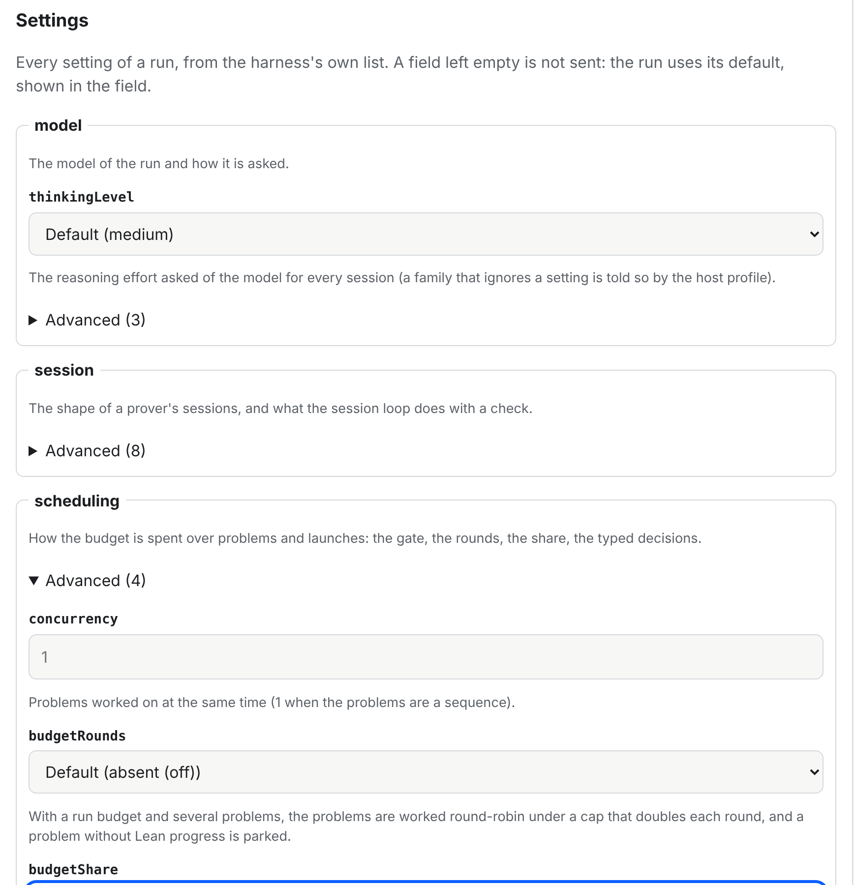

# The local interface

`harness ui` is a small web page on your own machine for the person who would rather click than type.
It lets you state a problem, watch what it costs, stop it, read the result and answer the team. It is
`packages/ui` (`@seshat/ui`). Everything it does is something a command already does: it reads the
journal, and it starts `harness solve|run|resume|hint|steer|sign` as subprocesses. **It contains no
research logic and it cannot change a claim's status**: only a Lean check does, as everywhere else
([trust.md](trust.md)).

This page is built stage by stage, as the interface is.

## The journal reader

`readRun(dir)` (`packages/ui/src/reader.ts`) returns the projection of a run directory as JSON, from its
`journal.jsonl` and its blobs alone, with no model call and no write. Every number and status in it is
what `buildResult`, `buildAccount` and the projection already say ([quickstart.md](quickstart.md#resultmd),
[human.md](human.md)); the reader only gathers them.

| Field | Holds |
|---|---|
| `state`, `stop`, `journal` | how the run ended (finished, paused for the team, or cut), why, and the journal's length, last hash and whether its hash chain verifies |
| `status` | the plain-language status of each problem: `proved` or `refuted` only when a valid kernel replay of that claim is in the journal, `candidate` for a proof that passed the fast check only, `leads` when programs found evidence, and so on. Evidence is never worded as proof |
| `claims`, `edges` | the research graph: each claim with the status the journal holds, its parent and whether it is a problem's claim; each edge with its kind and its status (`lean_checked`, `human_signed`, `proposed`) |
| `frontier` | the verified frontier of each problem that has entries, when the run's configuration shows it (`RunConfig.frontier`, [frontier.md](frontier.md)); empty otherwise; evidence entries are marked and apart |
| `leads`, `evidence` | counter-examples and indicative evidence, listed apart; none of it changes a claim's status |
| `turns` | each turn of a consortium run: its limit, why it ended, what it spent, and its account (what the team is asked, what the team has answered) |
| `spend` | dollars and tokens, the budget, what is left, spend per site and per rung of the ladder |
| `proof` | the certified Lean files, then the candidates and the partial sketches, apart |
| `resume`, `resumeInfo` | the command that continues the run, and the checkout, bench and host it began with (`resume.json`) |
| `resultMd` | the text of `RESULT.md` as the journal gives it now |

`listRuns(runsDir)` lists the directories that hold a journal. `runDirectory(runsDir, id)` maps a run id
to its directory and refuses anything that is not one plain name inside the runs directory (`..`, a
slash, a leading dot or underscore). `JournalTail` follows a journal as it grows, reading only the
bytes after the last whole line; what it announces (sequence number, type, actor, time) never carries
an event's data.

## The server

`startServer` (`packages/ui/src/server.ts`) serves the page and the API with [hono](https://hono.dev), bound to
`127.0.0.1` and to nothing else; the address is a constant, not an option. With `--port 0` (the default) the
system picks a free port. It prints one address with the token in its fragment (`http://127.0.0.1:PORT/#token=...`). A
fragment is never sent to a server, written in a referrer or kept in the history: the page reads it, keeps it in the tab's
`sessionStorage`, replaces the address with `#/` and sends it as `Authorization: Bearer` on every request. There is no cookie,
so two instances on two ports (or a restart on the same port) cannot read or overwrite each other's session. Opening the page hands the
address to `xdg-open`, `open` or `start`, so the token is visible to `ps` for that moment, to the same user only. The command opens it
by default when its standard output is a terminal on a machine with a display (macOS, Windows, or `DISPLAY` or `WAYLAND_DISPLAY` set:
`opensByDefault` in `packages/ui/src/command.ts`); `--open` forces it, `--no-open` keeps the page closed and only prints the address. A test or
a script, whose output is not a terminal, never opens a browser.

### Security

All of it is in `packages/ui/src/security.ts` and runs before any route, so a request that fails a check never reaches code
that reads a run or starts a process. The tests are `packages/ui/test/server-security.test.ts`.

| Threat | What stops it |
|---|---|
| Another machine on the network | the socket is bound to loopback |
| A web page of another site that has the address | the token: no `/api` request and no write is answered without `Authorization: Bearer`; a cross-origin page cannot send that header without a preflight this server never grants, and an `Origin` header that is not this server's is refused. The static files hold no secret and no run data, so they are served to a request that passes the Host and Origin checks |
| DNS rebinding (an attacker's name that resolves to 127.0.0.1) | the `Host` header must be `127.0.0.1:PORT` or `localhost:PORT` |
| A cross-site form or fetch that changes something | a request that is not a read must carry this server's `Origin` (or `Sec-Fetch-Site: same-origin`), the header `X-Seshat-Request: 1` and a JSON content type, which a cross-origin page cannot send without a preflight this server never grants |
| Script in text that came from a model, a program or a person | every journal text is put on the page as text (the front end never sets HTML), and a content security policy, `default-src 'none'; script-src 'self'; style-src 'self'; connect-src 'self'; frame-ancestors 'none'`, forbids inline script, inline style, any other origin and framing |
| A path that leaves the front end's files or the runs directory | static paths are resolved and checked against the build directory; a run id must be one plain name inside the runs directory |
| A token guessed by timing | the comparison is constant time |

Every answer, a failure included, carries the policy, `nosniff`, `no-referrer` and `no-store`. The server logs only what
it says about itself; it never logs a request body, and a line that came from an error has every stored key replaced.

### Running commands

`POST /api/jobs` takes `{kind, ...fields}` for `solve`, `run`, `resume`, `hint`, `steer` or `sign`.
`packages/ui/src/commands.ts` checks each field against a fixed list (length, pattern, range) and builds the
arguments of the command in the `--flag=value` form, as an argument list: no shell reads it, and no value can be taken
for a flag. The text of a hint comes after `--`. Every field is checked first; only then is a statement written to a file
under `runs/_inputs` with mode 0600 (and removed again if the command cannot start), and the command is given that file, so a
statement that looks like a path or a flag is read as the text it is. A refused request writes nothing. Statement files of
commands that started stay under `runs/_inputs`, with the run's other files. A `run` needs `runBudgetUsd`: the interface does
not start a run that would spend by the harness's default.

`packages/ui/src/jobs.ts` is the process manager. It starts `node packages/orchestrator/src/cli.ts ...` with the
process's environment plus the stored keys it needs (below), keeps the last 2000 lines each command prints (every stored key
replaced by `[key hidden]`: as it is, JSON-escaped, URL-encoded and in base64, including a key split across two reads or by
the cut of a very long line), and offers:

- `GET /api/jobs/ID` and `GET /api/jobs/ID/events` (server-sent events: every new line, then the end);
- `POST /api/jobs/ID/stop`, which does what Ctrl-C does: an interrupt first, so that the problems in progress end as
  `aborted` and `RESULT.md` is written; a terminate after ten seconds and a kill after twenty if the command has not
  stopped. Each command leads its own process group and the signals go to the group, so the programs it started stop with it;
- `POST /api/jobs/ID/answer` with `{"yes": true}` or `false`, the answer to a signature.

One command works on a run at a time. At most four run at once. When the server stops it stops every command it
started the same way and waits for them. A job ends when its process does: a program the command left behind with the pipes
open is killed, and does not keep the job or the server from ending. The last 50 finished jobs are kept. A `resume` or `run` the person starts **detached** (`"detached": true`) is
the exception: it outlives the server, writes to a log file under `runs/_inputs` and is not followed afterwards (a command
that needs this page, such as a `solve` that asks for a signature, cannot be detached). A server that is killed outright
leaves its commands running, as any parent does. The log of a detached command holds raw output while it runs, since nothing
reads it in between; when the command ends the server rewrites it (mode 0600) with every stored key replaced.

**The signature.** `harness solve` asks "Does this say what you mean?" on a terminal. Driven by a program it takes
`--ask-stdin`. The manager gives each `solve` job a random nonce in `SESHAT_ASK_NONCE` (no other kind of command gets one, and
the command removes it from its environment at once). The command prints one line, `SESHAT_SIGNATURE NONCE JSON` (the person's
words, the Lean statement, its `statementId`, the test lemmas), and reads one line on its standard input: `yes STATEMENT_ID`
to sign, anything else for no. The manager believes a signature line only with this job's nonce, only from a `solve`, and only
the first one; any other line, whatever it looks like, is shown as the text it is, with the nonce hidden. So a model's output,
a prover's output or a file a command prints cannot open the card or make the person sign a statement they were not shown: the
answer names the statement id of the card. The manager shows the line as a job in the state `awaiting_signature` and writes the
answer. The `statement.signed` event is written by the command, as
always, before any spend.

## What the server reads and writes

| Route | Reads | Writes |
|---|---|---|
| `GET /api/runs`, `/api/runs/ID`, `/api/runs/ID/result`, `/api/runs/ID/events` | the journal and blobs of a run, through the reader | nothing |
| `GET /api/doctor` | the machine, as `harness doctor --no-write` does | nothing (the isolation profile is written by the command only) |
| `GET /api/parameters` | the catalogue of settings (`parameters.ts` of the orchestrator): the entries a person sees; with `?command=solve` (and `&defaults=v1` or `v2`, default `v2`) each entry also carries `solveDefault` and `solveSet`, the value `solve` really applies | `command`, `defaults` |
| `GET /api/providers`, `/api/providers/ID/models` | the library's providers | nothing |
| `PUT` and `DELETE /api/providers/ID/key` | | the key file |
| `POST /api/jobs` and the routes of a job | | a statement file and, when settings were chosen, a settings file under `runs/_inputs`; whatever the command it starts writes, as that command |

## Provider settings

No provider is named in this package. `GET /api/providers` lists what the pi-ai library holds at run time
(`packages/ui/src/providers.ts`): its id, name, how many chat models it lists, and whether credentials are found.
`GET /api/providers/ID/models` lists the models of one, with the library's price per million input and output tokens, in the
`PROVIDER/ID` form that `--model` takes.

**Which variable carries a key.** The library reports every environment variable it looks at while it checks a provider's
credentials. The interface asks it, and takes the first name ending in `API_KEY` (then `TOKEN`) with which the library
says the provider is configured; a provider with none (ambient credentials, a login flow) has nothing to save, and the
screen says so. Nothing is mapped by hand, so a provider the library adds works the day it is added.

**Where a key lives.** `PUT /api/providers/ID/key` writes it to `keys.json` in `$XDG_CONFIG_HOME/seshat` (or
`~/.config/seshat`; `SESHAT_KEYS_FILE` moves it). The directory has mode 0700 and the file 0600, written whole through a rename.
A path inside the repository is refused (by real path: a link into the repository does not get round it), so a key cannot be committed. The interface creates the key directory with mode 0700 and changes the mode of that one directory only; a parent the person made keeps its mode. The file is read only if it is a plain file of the
current user that no one else can read; otherwise the settings screen says to `chmod 600` it, and no command is started
with keys the interface cannot trust. A stored key counts as credentials for the doctor and for the model list, and a
stored key wins over the same variable in the server's own environment. That environment is the one the server starts its
commands from (`startServer`'s `env`, the process's by default), so the doctor and the model list count the credentials a
command would get, and a test that gives the server an environment of its own sees none of the machine's.

**How a command receives it.** The process manager adds a stored key to the environment of the subprocess, under the variable
the library reads: the command finds its credentials as it does when you export them yourself. A command gets only the key of
the provider of the model it was asked to use (`--model PROVIDER/ID`; a `resume` uses the model its run records). When no model is
named, it gets every stored key, since the harness then picks the cheapest model of any provider; `hint`, `sign` and `steer` call
no model and get none. A variable of the server's own environment is not touched. A key the person saved for one provider therefore
does not reach a command that never uses it, whatever a program that command runs may print.

**What never happens to it.** The browser can save and delete a key and is never sent one back: the answers say
`stored: true` and nothing more. It is not logged (the server logs no request body, and an error line has every stored key
replaced), not journaled (the interface writes no journal; a command's events never carry the environment) and not echoed: a
line a command prints that holds a stored key is shown as `[key hidden]`. The tests save a key and then look for it in every
answer, every log line and every file under the runs directory (`packages/ui/test/keys.test.ts`).

## The screens

The front end is Preact and Cytoscape (MIT, pinned in `packages/ui/package.json`), built by Vite to the static files in
`packages/ui/static`, which are committed and served by the server: no CDN, no font, no request to another origin. After
changing anything under `packages/ui/web`, run `pnpm --filter @seshat/ui build:web`; a test compares a digest of the sources with the one the build
wrote, so a stale build fails `pnpm check`. The digest covers the sources, the pinned versions and the lockfile entries (with their integrity hashes) of Vite, Preact, Cytoscape and what they pull in, and every built file under `static/`, so an edited bundle fails too; a second test builds again into a temporary directory and compares byte for byte, and a third scans the bundle: no `XMLHttpRequest`, `WebSocket`, `EventSource` or `sendBeacon`, no URL but the XML namespaces, and the front end calls `/api` paths only. The sources are type-checked by `packages/ui/web/tsconfig.json`, also by a test.

The header carries Seshat's logo (`packages/ui/web/src/logo.tsx`, the paths of `assets/logo/seshat.svg`, its lines in the
text colour so that it follows the theme), and the tab's icon is its 64-pixel render, inline in `index.html` as a `data:` URL.

| Screen | What it does |
|---|---|
| **Problems** (start) | the statement in words or in Lean, the spend ceiling, the model (the cheapest priced one, or a provider and a model from the library's list), the runs on this machine: each by its words (the person's, else the signed statement, else the first problem's statement), where its first problem stands, what it spent, its state and model (`summary` of `GET /api/runs`, `summarize` in `reader.ts`, for the 30 newest runs, read again only when a journal changes) |
| **Signature** | for a statement in words: your words beside the Lean statement a model made of them, what the first cases said, a warning when cheap automation proves it, and two buttons. For a statement in words the card says the formalization was a model call already charged to the allowance; it reads a malformed shape defensively, and a screen that cannot be drawn shows one plain line |
| **Run** | a header with the phase (preparing the statement, waiting for your signature, researching, paused, stopped, finished: `phaseOf` in `run.tsx`, from the job and the journal), the model, the host and how long the run has worked; the plain-language status of each problem; the spend gauge, by site and rung, with a stop button; the result (each certified Lean file with a copy button, `RESULT.md`); candidates and partial sketches apart under a warning; turns and the questions put to the team; continue, hint, steer and sign an edge; the read-only research graph; "Established so far" when the run shows its frontier; leads, evidence and failures |
| **Checklist** | `harness doctor` as a list: what is ready, what is missing, what to do. It writes nothing |
| **Providers** | the library's providers, whether each has credentials, a place to save or remove a key |

**Words, not ids.** A claim is shown by the first words of its statement everywhere a person reads or picks one: the status lines, the
proofs, the candidates and sketches, the hint, steer and signature choices, the leads and evidence, what failed, and the boxes of the graph.
The id stays beside it, small, for a command or a search in the journal. The command's raw output is folded under "What the command says"
(with its line count); the stop buttons say that the run can be continued, as `harness resume` and "Continue the run" do.

**Evidence is never shown as proof.** A problem is worded as proved or refuted only when a valid kernel replay of its claim is in the
journal; a proof that passed the fast check is "a candidate, not certified"; counter-examples and a tool's findings are "leads" and
"evidence", in their own section, each marked. The words come from the reader (`plainStatus`), and the tests check them.

**Escaping.** Every text that came from the journal, a model, a program or a person is put on the page as a text node: the front end
never sets HTML (a test searches its sources for `innerHTML` and the like, and a browser test loads a statement that is an `` and a
`<script>` and checks that nothing ran and no element appeared). The graph draws labels on a canvas.

**Continue with more budget.** The allowance fixed at the start is the run's whole budget and the existing commands cannot raise it;
"continue" resumes the run with a limit for the next turn (`--turn-usd`), within what is left. The screen says so.

**Phone width and colour schemes.** The layout is one column below 720px, buttons are at least 44px high, and the page follows the system's
light or dark scheme. The browser test takes screenshots of every screen at phone and desktop width in both schemes, and fails when the page scrolls sideways.

## Settings

The start form has a "Settings" panel that covers every parameter of a run and keeps covering them as settings are added, because nothing in it is written by hand. `GET /api/parameters` (`packages/ui/src/parameters.ts`) gives the catalogue of [parameters.md](parameters.md) (`packages/orchestrator/src/parameters.ts`): the entries a person sees (`ui` is not `hidden`, `status` is not `internal`: the keys a settings file accepts), each with its group, the way it is entered (`kind`: a switch, a number, a list, a choice, text or JSON), type, default, summary and status. The page draws one section per group; the `basic` entries are shown and the `advanced` ones sit behind an "Advanced" disclosure; a `beta` or `experimental` status is a badge; each field's default is its placeholder and its summary is its help text. A key added to `RunConfig` and to the catalogue (`tsc` fails without the entry) appears in the menu with no interface code. A `solve` leaves out the settings its own fields and flags take (`budget`, `model`, and the other keys of `SOLVE_OWN_FLAGS`). The panel of a `solve` asks `GET /api/parameters?command=solve`: each entry whose value `solve` runs with differs from `harness run`'s default (`budgetRounds`, `editTool`, `firstCases`, `budgetShare`, `lines`, ... under `v2`) shows that value as its placeholder, with a mark ("on in v2", or "v2 default" for a value that is not a switch). The values are derived from `setConfig` and `studentLines` (`solveDefaultsOf` in `student.ts`), the code `solve` itself calls, so they cannot drift from it; the "solve v2" column of [parameters.md](parameters.md) is generated from the same function.

A field left empty is not sent. On start, the request carries `settings`, the filled-in values; `plan` (`commands.ts`) checks them with `parseSettings`, the reader that `harness run|solve --settings FILE` uses ([quickstart.md](quickstart.md#a-settings-file)), and a refusal (an unknown key, a wrong type, a value `checkConfig` rejects) is shown in the form and starts nothing and writes nothing. Otherwise the values are written to `runs/_inputs/RUN_ID.settings.json` (mode 0600, beside the statement, removed again if the command cannot start) and the command gets `--settings=FILE`; the values are never on the command line. No setting chosen: no file and no flag. The tests are `packages/ui/test/settings.test.ts` (the API, the start request, the refusals) and the settings test of `browser.test.ts` (the panel in Chromium, skipped without Playwright).

## Tests

`packages/ui/test`: the reader against a recorded journal (`reader.test.ts`); the guards (`server-security.test.ts`); the routes, the event
streams and the doctor (`server-routes.test.ts`); commands, hostile statements, stop, detach and shutdown against a fake subprocess
(`jobs.test.ts`); the key file's mode and non-disclosure (`keys.test.ts`); a run started, signed and stopped through the API with pi-ai's faux
provider and a simulated Lean (`faux-run.test.ts`); `harness ui` as a child process and `solve --ask-stdin` (`cli.test.ts`); the front end's
build, sources and types (`web.test.ts`); and one smoke test in headless Chromium through Playwright, which is skipped where Playwright is not
installed (`browser.test.ts`; `SESHAT_UI_SHOTS=DIR` keeps its screenshots); the settings API and start request (`settings.test.ts`).

## What has not been run

No person has used it in a real browser session, and nothing has run through it against a real model, Lean, Kimina or certifier: the
tests use a fake subprocess, the faux provider and a simulated Lean. The provider list and the key variables come from the library's own tables
and have been checked only against what it reports here. Windows and macOS are untried (`--open` uses `open`, `start` or `xdg-open`).
